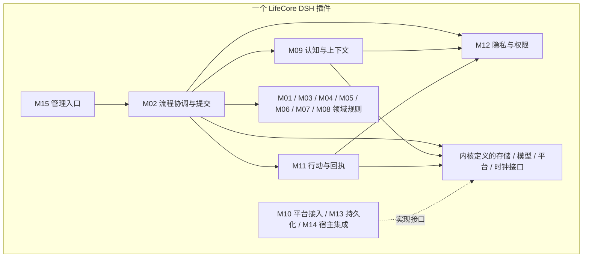

# LifeCore 分层、模块职责与调用契约

日期：2026-10-29

状态：总体方向已确认；本轮分层与调用细化待维护者确认。仅设计文档，无产品代码或依赖安装。

共同基线：[架构 V1](v1.md) · [出生流程](modules/M01-birth-flow.md) · [SnowLuma 参考](references/snowluma.md)

## 1 目标、范围与已选方案

维护者已选择：一个 DSH 插件，生命内核与外部接入分离。用户安装一个插件，内部模块可以分别开发、验证和替换；不需要另行部署生命服务器。DSH 停止时插件停止，持久化身份和经历保留。

本轮明确各模块的归属、数据责任、主要输入输出和调用边界，为后续详细设计提供共同契约。沿用 M01–M15 编号；它们是逻辑职责，不是 15 个进程、服务或模型代理。一个逻辑模块可以包含多个类或文件。

### 方案与取舍

| 方案 | 收益与代价 | 结论 |
| --- | --- | --- |
| 业务模块直接依赖 DSH、平台和数据库具体接口 | 初期接线较少，后续升级及独立测试牵涉更多模块 | 未选择 |
| 一个插件，领域规则与外部接入通过接口分离 | 增加少量接口和装配工作，使模型、平台、存储的替换范围明确 | 维护者已选择的方向 |
| 独立生命服务与 DSH 客户端 | 可独立部署，但增加服务、鉴权和运维负担 | 既有范围已排除 |

不在本轮冻结人格数值、记忆排序公式、提示词全文、数据库表结构、UI 控件、框架和依赖版本。DSH 具体宿主接口及 SnowLuma 兼容性须另行核验，不能由本设计推定可用。

失败判据：外部适配器独自改人格；模型输出直接写库；换会话或模型重新出生；试聊自动混入正式经历；隐私过滤发生在检索或模型出站之后；同一动作因恢复重复发送。

## 2 四层与贯穿的权限模块

| 归属 | 模块 | 职责 |
| --- | --- | --- |
| 交互入口层 | M15 管理与可观测性 | 提交管理请求、展示受权限限制的状态与诊断 |
| 应用协调层 | M02 生命协调器、M09 认知与上下文、M11 行动与回执 | 串联流程、组织模型回合、管理外部动作和统一提交 |
| 生命领域层 | M01 身份、M03 事件、M04 记忆、M05 情绪、M06 关系、M07 人格、M08 自主活动与承诺 | 定义生命数据的含义和变化规则，输出候选变化 |
| 接入与基础设施层 | M10 平台适配器、M13 存储与恢复、M14 DSH 集成 | 实现平台、存储、宿主和模型能力的具体连接 |
| 贯穿各流程的规则模块 | M12 隐私与权限 | 统一定义准入、读取、模型出站、动作执行及管理操作的规则 |

M12 属于内核规则边界，不依赖具体 UI、平台 SDK 或数据库。它提供权限决定，调用方负责在对应边界执行；不是只在输入时检查一次的独立服务。

“生命内核”广义上包括应用协调、领域规则和权限规则；其中领域层不直接调用模型、网络、宿主或数据库驱动。模型请求由 M09 经模型接口发起；状态由 M02 组织，经存储接口提交。

本图表示内部依赖，不画全部消息流。运行时外部消息会反向进入内核的入站接口，但不要求内核导入外部模块的实现。插件启动时由 M14 的装配入口创建 M13/M10 及内核对象，连接接口；这部分只装配与释放资源，不承载生命规则。

## 3 十五个模块的具体边界

“拥有”指负责定义和校验数据含义，不表示该模块自行写数据库。生命状态、事件和动作记录的持久变更均由 M02 组织；M13 负责实际存储。

| 模块 | 拥有的规则或数据 | 输入与产出 | 调用边界 |
| --- | --- | --- | --- |
| M01 身份与出生 | 唯一身份、出生档案、出生草案及版本、原始设定来源 | 用户确认材料 → 可提交的出生/修订结果 | 由 M02 调用；需要模型整理时由 M02 委托 M09；不把当前成长人格写回出生档案 |
| M02 生命协调器 | 用例流程、运行状态、提交顺序、版本与幂等控制 | 入站事件、管理命令、模型提案、动作回执 → 已提交结果或明确拒绝 | 调用领域模块、M12、M09/M11 和存储接口；是统一提交入口，但不包含每个模块的算法 |
| M03 事件与经历 | 事件分类、来源、去重语义、因果关联和纠错规则 | 经接入核验的事件材料 → 标准事件及去重决定 | 由 M02 调用；平台字段解析在 M10，持久去重约束在 M13；不做回复或人格演化 |
| M04 记忆 | 记忆条目、来源链、冲突/纠错、压缩与检索规则 | 已提交事件和已验证解释 → 记忆变化；允许范围内的候选 → 检索结果 | M02 组织更新；M09 通过只读记忆查询接口获取结果；不保有另一份承诺执行状态 |
| M05 情绪与心境 | 短期情绪、心境、衰减及原因 | 状态快照、已验证评价、显式时间 → 情绪变化 | 由 M02 调用；不改人格、关系或工具权限 |
| M06 关系 | 人物及跨平台身份关联、熟悉/信任/亲近/边界、关系证据 | 已核实身份、经历、评价、管理确认 → 关系与身份关联变化 | 由 M02 调用；不能凭昵称或模型猜测绑定账号，也不能因亲密放宽权限 |
| M07 人格演化 | 当前人格、证据聚合、惯性、变化预算及修订历史 | 去重证据与旧人格 → 接受/拒绝的演化结果 | 由 M02 调用；出生时接收 M01 初始人格建立当前状态，之后保留自身版本；不回写出生原稿 |
| M08 自主活动与承诺 | 目标、兴趣驱动、计划、承诺状态及下一次检查条件 | 经历、当前状态、显式时间、动作结果 → 计划变化及行动候选 | 由 M02 调用；不直接开计时器、调模型或发消息；执行结果来自 M11 回执 |
| M09 认知与上下文 | 回合上下文、提示词组合、模型输出解析、评价/回复提案 | 可信场景、状态快照、受限记忆、当前输入 → 结构化候选结果 | M02 发起；通过模型接口调用 M14 实现，通过受限查询接口调用 M04 规则；不提交状态或直接执行动作 |
| M10 平台适配器 | QQ/B站协议转换、连接状态、账号来源核验、平台能力 | 外部消息 → 入站材料；已获执行许可的动作 → 原始回执 | 入站交 M02；出站仅接受 M11 执行请求；不直接调 M05/M07，不持有生命状态写入接口 |
| M11 行动与回执 | 动作生命周期、授权绑定、发送期限、结果核对和重试分类 | 已提交的动作候选 → 状态转换请求、平台调用及结果 | 通过 M02 持久化动作状态，调用 M12 和平台接口（M10 实现）；不持有数据库写入入口 |
| M12 隐私与权限 | 策略、共享授权、访问范围、出站限制、管理权限与额度规则 | 可信主体、场景、来源、策略及用量 → 允许范围或拒绝原因 | 由应用流程及受限查询调用；政策修改走 M02 管理命令；额度预留/消耗由 M02 经 M13 原子保存 |
| M13 存储与恢复 | 数据库、事务、版本约束、索引、迁移、备份、删除与恢复的存储实现 | 受限查询/提交/恢复请求 → 持久化结果与一致性快照 | 实现内核定义的存储接口；不决定人格、记忆或权限语义，不自动重发动作 |
| M14 DSH 集成 | 插件装配、宿主生命周期、模型调用适配、会话映射、工具注册、时钟唤醒 | DSH 能力与通知 ↔ 内核的宿主无关接口 | 启停调用 M02 生命周期；模型调用服务 M09；采集事件交 M02；不让宿主会话成为生命身份 |
| M15 管理与可观测性 | 管理 Web UI、查看原因、操作反馈及脱敏诊断展示 | 已认证用户请求 → 管理命令；受限查询结果 → 页面 | 所有读写走应用层管理/查询接口；不直连数据库、平台 SDK 或模型接口；浏览器不接收平台凭据明文 |

## 4 调用与写入规则

### 4.1 统一命令入口，允许独立只读查询

M02 对外提供入站、管理、回合结果、行动结果和生命周期入口。M15、M10、M14 只能提交自己被授予的请求类型；管理身份与社交场景身份分开核验。禁止把聊天内容直接当成管理命令。

M02 是逻辑模块，可以拆为出生流程、互动流程、提交服务、查询服务和恢复流程。统一的是校验与提交权，不是要求所有逻辑塞进一个函数。

M15 和 M09 使用应用层的受限只读查询接口。查询服务组织 M12 权限筛选、M13 候选读取和 M04 领域排序，不调用 M02 的变更队列，不重新触发回合。M09 获得的接口已经绑定可信场景，不能自己传入更高的权限。

权限限制必须在 M13 候选查询时生效，再交 M04 排序，不能先取出全部私人记录再过滤。同样检查摘要、索引、附件和派生来源；模型出站前 M09 再向 M12 核验当前政策与上下文。

### 4.2 计算不等于提交

领域模块以明确输入和状态快照计算变化，不直接修改其他模块的状态。跨领域协作由 M02 传递带版本的结果，例如先形成事件评价，再分别交 M05/M06/M08，M07 按独立证据和自身预算决定是否成长。

不规定所有领域模块必须在每条消息上运行。是否需要更新及更新次序由对应流程明确；长期成长和压缩可作为后续内部任务处理，但任务仍通过 M02 提交，且记录触发来源与处理版本。

M02 校验版本、权限、幂等与变化集合后，通过 M13 原子提交相关状态、证据引用、处理标记及待执行动作。已有事件可先独立持久化，后续模型失败不会删除已入账事实。

单写入指提交有序，不表示等待模型和平台网络时占着队列或数据库事务。模型结果回来后重新校验其依赖版本；过期结果不能直接覆盖新状态。采用重算、丢弃或限定合并的具体规则留给 M02 详细设计，不允许默默提交过期结果。

### 4.3 外部动作走一条受控出口

M09/M08 产生的是候选动作；M02 验证并保存，M11 才能调度。M11 发送前经 M12 重查政策和范围，要求 M02 持久化执行许可、额度预留和 sending 状态后，再调用 M10。许可绑定具体动作、目标、内容版本、期限与恢复代次。

M10 返回成功、失败或无法确定的回执，由 M11 提交给 M02；M02 通过 M03 形成结果事件，更新动作状态和必要的领域状态。回调是新的排队请求，不在原提交事务中递归进入 M02。断线、取消或超时不证明平台未执行，不盲目重发。

所有对外社交发送，包括模型工具触发的发送，都必须经过这条出口。M14 注册的工具返回行动提案或受控查询结果，不直接暴露平台 SDK、通用 shell、数据库和管理操作。DSH 的文本输出也不能由另一个自动转发器再发一遍。

### 4.4 依赖只指向接口和规则

内核定义自己需要的模型、平台动作、存储、时钟/标识能力接口；M10/M13/M14 实现并在启动时注入。接口中的数据是 LifeCore 自己的格式，不泄漏 OneBot、DSH 或 SQLite 的具体对象。

领域层模块之间共享稳定的值和标识，不互相调用对方的写操作；应用层负责组合。M13 的数据库和索引读写、M10 的连接缓存、M14 的宿主会话缓存属于技术实现，不能成为第二份生命状态权威。

## 5 三条关键流程

### 5.1 出生与试聊

1. M15 将预设或自然语言草案交给 M02；M01 管理原文、来源和版本。模型整理由 M09 经 M14 执行，返回可编辑的建议。
2. M02 为试聊建立独立工作区及状态快照，调用同一套 M09 和必要领域规则，但使用试聊存储范围，不产生正式生命状态。计入真实模型用量，不能把试聊当作免费调用。
3. 试聊的记忆素材和关系候选分别交 M04/M06 形成待确认材料；旧关系保留，调整建议不覆盖。试聊不得持有真实平台发送能力；浏览器展示回复。
4. 用户确认最终版本和导入选择后，M02 调用 M01、M04、M06、M07 校验出生材料。M13 在一个提交中保存身份、出生档案、当前初始人格、选中记忆和另行确认的关系。
5. 导入关系先关联已确认的管理用户身份；跨 QQ/B站账号的绑定仍需 M06 核验，不从昵称或试聊内容猜测。试聊来源记忆不作为出生后事件重新入账或增加成长证据。
6. 保存失败不显示出生成功；重复确认恢复同一结果。出生成功不自动授权 QQ 对外发送；平台启用走独立管理请求。

试聊工作区由 M02 管理，内容分别遵循 M01/M04/M06 规则并由 M13 隔离存储；M15 只是操作入口。工作区标识与 life_id 分开，两个预设不会生成两个正式生命。具体保留期限和清理 UI 留待后续讨论。

### 5.2 一次 QQ 私聊

1. SnowLuma 的 OneBot 事件进入 M10，完成协议解析和来源/账号核对后交 M02。
2. M02 调用 M12 建立可信场景，调用 M06 解析已验证的人物关联，调用 M03 标准化与去重，再经 M13 持久入账。不认识的人先保持独立身份，不能猜测合并。
3. M02 取得一致状态快照，交 M09；M09 使用受限查询接口取得 M04 规则组织的记忆，通过 M12 出站检查后，经 M14 请求 DSH 模型。
4. M09 返回评价、回复和动作候选。M02 校验来源、版本与权限，按流程调用 M04/M05/M06/M07/M08 需要参与的规则，经 M13 提交本次变化与待执行动作。
5. M11 经最新权限检查与持久执行许可，调用 M10 执行。实际结果经 M11 → M02 → M03 回流，更新动作与承诺状态。

DSH 模型返回和宿主事件采集可能观察到同一回合；M14 必须附带调用关联标识，M03/M02 持久去重，不能重复算作两份经历。文本回复和平台发送回执分开记录。

### 5.3 启动、暂停与恢复

1. DSH 激活插件，M14 装配各模块；M13 获得数据目录锁、核验持久化版本，M02 决定进入未出生、草案、运行、暂停或恢复状态。
2. 现有数据读取失败进入恢复/诊断，不触发重新出生。管理界面可显示错误；需要的宿主能力缺失时不回退到权限更大的会话。
3. 正常重启读取已提交状态与任务。M08 给出计划规则，应用层调度器依据持久任务安排唤醒；M14 只提供宿主时钟与取消资源。到时向 M02 投递唤醒请求，不由定时器直接改状态或发送。
4. 普通重启中的 sending 按结果未知核对。恢复旧备份还需先应用删除清单、生成新恢复代次并冻结全部旧待发动作；M13 负责存储操作，M02 统筹恢复模式，M11 按规则处理动作。
5. 用户暂停由 M15 → M02 发起；宿主停用由 M14 → M02 发起。M02 停止新活动和执行许可，取消可取消的回合，保存检查点；已越过外部发送边界的动作继续核对，不承诺撤回已发网络请求。
6. M14 释放订阅和定时资源，M10 关闭连接，M13 完成关闭并释放锁后才允许新实例取得运行权。关机期间不编造生活或集中补发过时社交动作。

## 6 下一轮接口详细设计的共同数据

下列是语义契约，不是已冻结的字段名或函数签名。

| 交换内容 | 产生方 → 使用方 | 必须携带或保持的信息 |
| --- | --- | --- |
| 入站材料 | M10/M14 → M02/M03 | 来源身份、平台账号、场景、源事件标识、发生/接收时间、载荷及来源限制 |
| 管理请求 | M15 → M02 | 已认证主体、操作类型、目标草案或生命、确认版本、幂等标识 |
| 状态与上下文快照 | 查询服务 → M09/领域规则 | 生命或试聊工作区、状态版本、可信场景、允许的材料及来源、显式时间 |
| 模型提案 | M09 → M02 | 回合关联、依赖版本、证据引用、解释/状态候选/行动候选；不得自选身份或权限 |
| 变化集合 | 领域规则 → M02/M13 | 目标状态、前置版本、变化与原因、规则版本、相关事件及处理标记 |
| 动作与执行许可 | M02/M11 → M10 | 动作标识、固定目标及内容版本、有效期、权限与额度校验结果、恢复代次 |
| 行动回执 | M10 → M11/M02/M03 | 动作关联、平台回执标识、成功/失败/未知、收到时间与必要证据 |
| 只读视图 | 查询服务 → M15 | 当前授权可见字段、一致版本、运行诊断；不得附带凭据或越权来源 |

同一内容的领域归属、读写权限和存储实现分别说明，避免把“数据落在 M13”误解为所有数据语义都由 M13 决定。

## 7 架构验收与后续自由度

后续应能用模拟模型、模拟平台和测试存储完成：出生与重复确认、试聊隔离、受限记忆检索、重复事件、过期提案、发送前后崩溃、取消/暂停、普通重启与旧备份恢复。应能在不启动真实 QQ 的条件下验证内核规则。

依赖检查应确认领域模块未导入 DSH/OneBot/数据库驱动，M15/M10 未持有生命状态写入接口，M09 未持有平台发送能力。模拟验证不替代固定 DSH/SnowLuma 版本的真实集成测试。

当前需要维护者确认的是本轮分层、模块职责和调用边界。确认后先做接口与数据契约详细设计，再形成实施计划；用户尚未要求编码，不能直接启动实现。框架、目录细分、内部类名、队列库与检索算法可在不改变上述边界的前提下后续决定。
