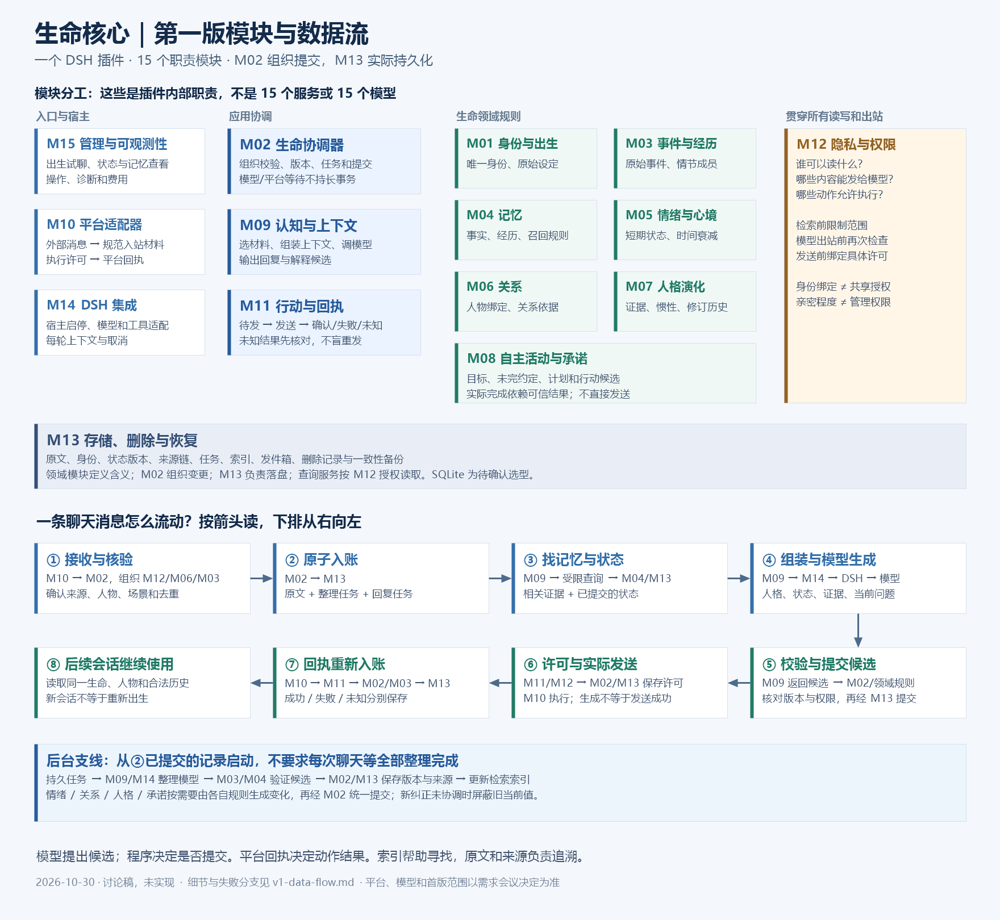

# 生命核心第一版架构与数据流

日期：2026-10-30 · 状态：供范围和开发方案讨论，尚未实现

关联：[第一版需求单](../requirements/v1-requirements.md) · [架构基线](v1.md) · [分层与调用契约](layers-and-calls.md) · [记忆专项](modules/M04-M09-memory-system.md)。

这些图从三个角度解释同一个系统：模块放在哪里，一轮消息怎么流动，以及后台如何让经历成为长期状态。M01–M15 是一个插件里的职责，不是 15 个服务，也不是每条消息都要运行 15 次模型。

## 1 先看总览

图片用于快速读懂分工；下面的 Mermaid 图保留可编辑的准确流程和异常分支。它们是架构图，不是产品界面或正在运行的状态。

### 图例

- 实线箭头：本图关注的数据传递/处理次序，不代表任意代码导入或直接数据库权限。
- 虚线箭头：校验、状态输入或管理约束。
- 数据库形状：M13 持久化；写入箭头只从 M02 的提交路径进入。
- “查询服务”“后台任务”是应用层内部职责，不是新增 M16，也不需要独立服务器。
- 图中的模型服务可以是已配置的远端或本地模型；具体部署待决定。DSH 是运行宿主，LifeCore 是插件，大肥鱼的回复由模型结合人格、状态与记忆生成。

## 2 完整部署与模块图

~~~mermaid
flowchart TB
  Owner["维护者 / 聊天对象"]
  Platforms["外部 QQ 网关 / 可选群聊与B站工具"]
  LLM["已获准的模型服务：回复 / 整理 / 向量 / 重排"]
  subgraph DSH["DSH 宿主"]
    Host["宿主 Agent / Session / Tools / 模型路由"]
    subgraph Plugin["LifeCore 单插件"]
      M15["M15 管理与可观测性"]
      M14["M14 DSH 适配与生命周期"]
      M10["M10 平台适配器"]
      M12["M12 隐私与权限"]
      subgraph App["应用协调"]
        M02["M02 用例协调与统一提交"]
        M09["M09 认知与上下文"]
        M11["M11 行动与回执"]
        Query["受限查询服务 / 持久任务调度"]
      end
      subgraph Domain["生命领域：定义状态与变化规则"]
        M01["M01 身份与出生"]
        M03["M03 事件与经历"]
        M04["M04 记忆"]
        M05["M05 情绪与心境"]
        M06["M06 关系与人物绑定"]
        M07["M07 人格演化"]
        M08["M08 自主活动与承诺"]
      end
      M13[("M13 存储 / 索引 / 任务 / 删除 / 备份")]
    end
  end
  Owner --> Platforms
  Owner --> M15
  Platforms --> M10
  M10 --> M02
  M15 --> M02
  M14 --> M02
  M02 --> Domain
  Domain --> M02
  M02 --> M13
  M13 --> Query
  Query --> M04
  M04 --> Query
  Query --> M09
  Query --> M15
  M02 --> M09
  M09 --> M14
  M14 <--> Host
  Host <--> LLM
  M14 --> M09
  M09 --> M02
  M02 --> M11
  M11 --> M10
  M10 --> Platforms
  M10 --> M11
  M11 --> M02
  M12 -.授权.-> Query
  M12 -.提交校验.-> M02
  M12 -.模型出站.-> M09
  M12 -.发送许可.-> M11
  M12 -.管理鉴权.-> M15
~~~

M02 可以调用某个领域模块计算变化，获得候选后再提交。M13 负责数据库操作；它不会自己决定“更信任谁”。M04 定义记忆筛选和变更规则；它不会自己调模型或直接写库。

M15 的管理写入通过 M02，读取通过受限查询。M14 负责装配和宿主适配；它不会成为第二个生命协调器。M10 只规范消息和执行许可，不独立调用模型抢答。

对应需求：V1-G-02、V1-G-04、V1-M02-05、V1-M10-03、V1-M12-02、V1-M14-04。

## 3 一条聊天消息的同步主线

~~~mermaid
flowchart TD
  A["1 对方发来文字"] --> B["2 M10 解析平台来源、账号、消息ID"]
  B --> C["3 M02 组织校验：M12范围 / M06人物 / M03事件与去重"]
  C --> Dup{"已接收的相同源事件？"}
  Dup -->|是| Existing["返回既有结果；原有持久任务继续恢复"]
  Dup -->|否| Tx["4 M02 → M13 原子入账：原文、游标、整理任务、turn/reply job、未协调水位"]
  Tx -->|失败| Err["不确认已接收；保留可重放缺口与诊断"]
  Tx -->|成功| Dispatch["5 应用调度领取持久 reply job"]
  Dispatch --> Snapshot["6 读取可信身份和已提交状态快照"]
  Snapshot --> Q["7 M09 调受限查询：M12过滤 → M13取候选 → M04筛选"]
  Q --> Gate{"要使用的当前事实尚未协调？"}
  Gate -->|是| Fix["优先协调；失败则不把旧值当当前事实"]
  Fix --> Pack
  Gate -->|否| Pack["8 M09 组装 ContextPacket 并检查预算/出站许可"]
  Pack --> Host["9 M14 为本轮装配 DSH 作用域"]
  Host --> Model["10 DSH 调模型：人格 + 当前输入 + 受限状态与证据"]
  Model --> Draft["11 M09 解析回复、评价和行动候选"]
  Draft --> Check["12 M02 检查取消、来源版本与策略；领域规则验证候选"]
  Check --> Save["13 M02 → M13 提交适用状态变化和待发动作"]
  Save --> PermitCheck["14a M11 / M12 复核执行许可"]
  PermitCheck --> PermitCommit["14b M02 → M13 持久保存具体许可、额度和 sending"]
  PermitCommit --> Send["14c M11 持有效许可请求 M10 执行"]
  Send --> Receipt["15 平台回执 → M11 → M02/M03"]
  Receipt --> End["16 M02 → M13 保存成功/失败/未知结果；按需更新承诺"]
~~~

**几点容易混淆的地方：**

1. 第 4 步完成才表示原始消息在本地保存成功；第 10 步模型是否成功不会改变这一事实。
2. 第 6 步使用已提交状态。当前消息本身也在包里，模型可以理解当前情境，但不能把尚未提交的情绪/关系/人格提案描述成已经保存的状态。
3. 第 11 步的模型文字是草稿；第 16 步确认后，才能作为“已向对方说过”的记录。
4. 回执入账不会再触发一条普通聊天回复。事件带类型和触发规则，避免“自己回复自己”的循环。
5. 每次只运行需要参与的领域规则。人格成长不需要每条消息都改变，也不一定阻塞本轮回复。

对应需求：V1-M02-01/02、V1-M03-03、V1-M04-04、V1-M09-01/05、V1-M11-01/03。

## 4 检索和上下文内部发生了什么

~~~mermaid
flowchart LR
  Input["当前问题 + 少量近期话语"] --> Intent["M09 识别主体、时间、指代和问题类别"]
  Scope["M12 可信读取范围"] -.-> Allowed["查询服务建立授权候选范围"]
  Intent --> Allowed
  Allowed --> Exact["M13 主体/属性/时间精确查询"]
  Allowed --> Lexical["M13 中文全文索引"]
  Allowed --> Vector["M13 语义向量索引"]
  Allowed --> Episodes["M13 情节/时间导航"]
  Exact --> Candidates["候选ID + 分数 + 覆盖情况"]
  Lexical --> Candidates
  Vector --> Candidates
  Episodes --> Candidates
  Candidates --> Recheck["查询服务复核原始版本、删除与许可"]
  Recheck --> Rank["M04 融合/去重/相关性规则；必要模型重排经 M09/M14"]
  Rank --> Evidence["M13 受限读取原文与相邻话语"]
  Evidence --> Assemble["M09 证据 + 连续性 + 工作头 + 当前输入"]
  States["M01/M05/M06/M07/M08 已提交状态"] -.-> Assemble
  Assemble --> Packet["ContextPacket：来源、版本、预算、缺口"]
  Packet --> DSH["M14 → DSH → 大肥鱼回复模型"]
~~~

向量索引是查找入口，查到的 ID 必须回到权威数据复核；“相似度高”不等于“事实可信”或“当前相关”。没有相关材料时可以只用连续性、近期对话和当前输入，不强塞回忆。

模型若需要追加读取，经 M14 注册的只读工具返回应用查询服务；执行同样的权限/来源检查，并把结果计入新一轮预算与依赖清单。它不能通过工具改 scope_id 扩大权限。

### 上下文装配表

| 包里的材料 | 从哪里来 | 它能证明什么 |
| --- | --- | --- |
| 人格与身份 | M01 原始设定、M07 当前人格 | 当前应采用的确认版本 |
| 对方与关系 | M06 账号映射、受限关系摘要 | 这是谁、哪些关系依据当前可用 |
| 情绪/心境 | M05 当前版本 | 当前行为调节状态；不是客观世界事实 |
| 未完事项 | M08 承诺/目标 | 任务状态，不能用摘要替代 |
| 工作头/近期对话 | M03/M04/M13 | 当前分支谈到哪里，实际说过什么 |
| 相关事实/经历 | M04 规则组织、M13 读取 | 有来源的当前/过去信息，保留冲突和限制 |
| 关键原文 | M03 事件正文与版本 | 某人何时说过什么；不保证其陈述客观真实 |
| 当前问题与缺口 | 本轮事件、查询状态 | 这一轮要回答什么，哪些信息未知/未覆盖 |

对应需求：V1-M04-01/03/04、V1-M09-01/02/04、V1-M12-02/04。

## 5 后台记忆整理和状态变化

### 5.1 原始经历如何成为可回忆的材料

~~~mermaid
flowchart TD
  Events[("M13 已提交原文与持久整理任务")] --> Worker["应用调度领取任务和来源版本"]
  Worker --> Privacy["M12 检查这次整理和模型出站范围"]
  Privacy --> Prepare["M09 准备指定来源区间及必要旧候选"]
  Prepare --> LLM["M14 → DSH → 整理模型"]
  LLM --> Proposal["事实/摘要/情节关联/重要性候选 + 具体来源"]
  Proposal --> Rules["M03 校验事件关联；M04 校验记忆语义与来源"]
  Rules --> Commit["M02 复核源版本/删除/权限，提交或拒绝"]
  Commit --> Store[("M13 事实版本、来源关系、摘要、coverage、索引任务")]
  Store --> Index["索引 worker 从已提交版本生成关键词/向量投影"]
  Index --> IndexCommit["M02 授权的索引提交任务 → M13 更新覆盖/缺口"]
  Commit -->|输入已改变| Retry["丢弃过时输出，必要时重新排队"]
  LLM -->|失败| Failed["任务保留待重试/可见失败，原文不丢"]
~~~

后台模型和回复模型可以采用相同模型配置，但任务目的、输入范围和可用工具不同。后台整理没有真实平台发送工具。

索引 worker 只更新可重建投影，不成为事实权威。后台抽取失败，原文仍可查询；而“当前事实”须遵守未协调水位屏障，不能因后台落后继续误用旧值。

### 5.2 经历如何影响情绪、关系、人格和承诺

~~~mermaid
flowchart TD
  Event["M03 已入账事件 / M11 实际结果"] --> Eval["M09 评价候选：意义、对象、来源；必要时经 M14 调模型"]
  Eval --> Verify["M02 验证来源/重复/当前版本"]
  Verify --> Emotion["M05 即时情绪与心境规则"]
  Verify --> Relation["M06 针对具体对象的关系规则"]
  Verify --> Growth["M07 独立证据、惯性和变化预算"]
  Verify --> Agenda["M08 承诺、目标和活动规则"]
  Emotion --> Changes["带依据和前置版本的变化候选"]
  Relation --> Changes
  Growth --> Changes
  Agenda --> Changes
  Changes --> Tx["M02 统一校验与提交"]
  Tx --> DB[("M13 状态版本与原因记录")]
  DB --> Next["下一次授权快照 → M09 上下文"]
  Agenda --> Intent["仅为行动候选"]
  Intent --> Outbound["M02 → M13 持久化候选；再按图3的许可提交与发送路径执行"]
~~~

例如一次误解可以立即影响情绪，也可能影响与某人的信任；是否影响长期人格由 M07 的独立证据和预算决定。不会沿着箭头自动将“难过”传播成“永久变得不信任所有人”。

对应需求：V1-M04-05、V1-M05-02/04、V1-M06-03、V1-M07-02/03/04、V1-M08-02。

## 6 出生、试聊与正式生活

~~~mermaid
flowchart TD
  User["维护者选择预设或输入设定"] --> UI["M15 草案与试聊并排"]
  UI --> Draft["M02 → M01 草案版本、原文与建议来源"]
  Draft --> Trial["M02 建立隔离试聊工作区"]
  Trial --> Chat["M09/M14 试聊；无真实平台发送能力"]
  Chat --> TrialCommit["M02 校验并提交试聊记录/候选；保持试聊范围"]
  TrialCommit --> TrialStore[("M13 试聊范围：原话、候选记忆/关系")]
  TrialStore --> Select["M15 展示：选中记忆；关系默认不导入"]
  Select --> Review["用户复核人格、记忆及单独启用的关系"]
  Review --> Validate["M02 调 M01/M04/M06/M07/M12 验证确认版本"]
  Validate --> Birth["M02 → M13 一次出生事务"]
  Birth -->|成功| Formal["唯一 life_id + 出生档案 + 当前初始状态"]
  Birth -->|失败| NoBirth["保持未成功；重复请求核对原结果"]
  Formal --> Enable["平台启用与对外发送许可另行设置"]
~~~

初始导入保留“出生时确认、来自试聊”的来源类别；不伪装为出生后的真实生活。出生成功也不自动获得向 QQ 发消息的授权。

对应需求：V1-M01-01–05、V1-M15-01、V1-G-05。

## 7 暂停、删除和恢复的数据流

### 7.1 普通重启与旧备份恢复不同

~~~mermaid
flowchart TD
  Start["DSH 启动 → M14 装配"] --> Lock["M13 取得数据目录锁、核验版本与完整性"]
  Lock --> Mode{"恢复来源"}
  Mode -->|普通重启| Reconcile["M02 重放已持久删除意图，恢复现有生命和任务"]
  Mode -->|旧备份| Restore["M13 核对快照与最新独立删除账本"]
  Restore --> Proof{"删除水位与谱系可证明完整？"}
  Proof -->|否| Isolate["保持隔离；仅开放受限恢复诊断"]
  Proof -->|是| Apply["M02/M13 先应用删除，生成新恢复代次"]
  Apply --> Freeze["冻结旧待发动作与旧许可"]
  Freeze --> Reconcile
  Reconcile --> Unknown["M11 核对 sending/unknown，不盲重发"]
  Unknown --> Ready["M02 按原运行/暂停设置开放处理"]
  Ready --> Wake["持久 pending 任务按规则恢复；不编造离线经历"]
~~~

### 7.2 删除为什么不只是删一行

~~~mermaid
flowchart TD
  Request["M15 已认证的删除请求"] --> Policy["M12 确定目标范围与权限"]
  Policy --> Block["M02 暂停受影响范围的新读取/出站"]
  Block --> Ledger[("M13 独立删除账本先持久化 DeleteIntent")]
  Ledger --> Tombstone["M02 主库事务：删除标记、新策略代次、清理任务"]
  Tombstone --> Cascade["失效：原文、事实、摘要、关系/成长依据、索引、缓存、packet、待发草稿"]
  Cascade --> Host["M14 取消旧生成并处理受影响宿主历史"]
  Cascade --> Rebuild["各领域规则用剩余合法来源复核/重建"]
  Rebuild --> Commit["M02 → M13 保存新的有效状态"]
  Commit --> Report["M15 显示停止使用、清理进度及备份/外部副本边界"]
  Host --> Report
~~~

主库事务前后崩溃，启动都先对账和重放独立删除意图。已发到外部平台/模型服务的副本不能仅凭本机删除撤回；报告必须区分这一限制。

对应需求：V1-M02-04、V1-M11-05、V1-M12-05、V1-M13-03/04、V1-M14-05。

## 8 数据在哪里，谁有权决定

| 数据 | 语义负责方 | 实际持久化 | 读取者与限制 |
| --- | --- | --- | --- |
| 出生原稿/唯一身份 | M01 | M02 → M13 | 授权管理和认知；不会被成长覆盖 |
| 原始事件/情节成员 | M03 | M02 → M13 | 记忆、状态规则和查询；带来源权限 |
| 事实/经历表达/摘要 | M04 | M02 → M13 | M09/M15 经受限查询，旧版本和争议显式 |
| 情绪/心境 | M05 | M02 → M13 | 当前场景可用的状态/理由 |
| 人物映射/关系 | M06 | M02 → M13 | 身份与关系用途不同，不自动赋权 |
| 当前人格/修订历史 | M07 | M02 → M13 | 当前人格与私密变化理由分别披露 |
| 承诺/目标/计划 | M08 | M02 → M13 | M09/M04 引用，只有本模块裁定业务状态 |
| ContextPacket/选择清单 | M09 | M02 → M13 审计记录 | 不构成第二套不受删除管控的聊天库 |
| 动作/发送状态 | M11 | M02 → M13 | M08 用实际结果更新目标 |
| 策略/共享/删除范围 | M12 | M02 → M13 | 所有边界按版本执行 |
| 全文/向量索引 | M13 实现、M04 定义检索规则 | 经授权索引任务写入 M13 | 可重建，查询后复核权威来源 |
| 连接/会话缓存 | M10/M14 | 技术缓存或宿主日志 | 非生命事实权威；失效/保留须受管理 |

“存进了 M13”不代表所有模块都能任意读取。M13 是存储设施；读取范围由 M12 决定，规则归对应模块，提交由 M02 组织。

## 9 用一段具体对话走完整条线

以下为虚构测试，不是往正式生命写入真实记忆。

**第一次：**“叫我小林吧。上次那个方案维护起来太复杂，我们决定先做本地版本。”

1. M10 给出可信账号、对话和源消息 ID；M06 映射到人物 P1，M12 限定私聊范围。
2. M03 把“用户陈述”和时间、来源分清；M02 经 M13 保存原话及两类待办。
3. M09 准备当前回复所需材料，经 M14 调 DSH；回复只是候选，发送回执确认后记录实际交流。
4. 后台整理提出“称呼小林”和“某方案被放弃，理由是维护复杂”的候选，带各自原文片段。M03/M04 校验后 M02 提交。若“上次那个方案”无法消解，保留未知，不编一个方案名称。
5. M05/M06 等按需要评价这次交流。不是每次聊天都应触发人格修改。

**重启后新会话：**“我们为什么先做本地版本？”

6. M01/M06 恢复同一生命与 P1，M09 读当前分支导航。
7. 查询服务在 P1 当前私聊合法范围内查中文词项、语义和相关情节；M04 排除其他“本地”话题。
8. 读取原文，组装“维护复杂”这一依据和必要背景；不把所有身份和人生经历全文注入。
9. 模型得到足够证据回复原因。M15 可从该回复定位所选来源。

**随后：**“我们后来已经换成服务器方案了。”

10. 原话入账立即推进未协调水位。当前方案相关旧事实暂停作为已确认现状使用；协调后新增当前状态，过去选择本地的记录仍可用于历史问题。

如果后台模型失败，原话仍在；如果语义检索失败，报告降级；如果找不到“那个方案”的可靠指代，就保留不确定。每一类问题都有对应节点，不靠一句“她忘了”掩盖具体原因。

## 10 讨论时如何使用这些图

先看总览确认模块责任，再沿图 3 指定一个回合，逐个问清输入、输出、来源和失败状态。讨论记忆检索看图 4，讨论情绪/关系/成长看图 5，出生看图 6，暂停删除恢复看图 7。

每次变更同步更新[需求编号](../requirements/v1-requirements.md)、数据交接表和受影响图。图中所有“待决定”的平台、模型、预算和状态参数以需求单 D01–D15 的会议决议为准；图的存在不代表这些决定已经批准或功能已经实现。
