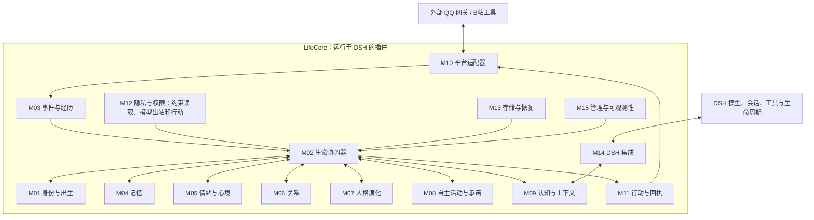

# LifeCore 架构 V1

日期：2026-10-29

状态：第一版架构基线、M01 出生产品流程及单插件内核/接入分离方向已确认；分层与调用细化待确认，其他详细设计继续讨论；无可运行插件。

背景：[项目总体设计](../project-design.md) · 后续：[模块讨论指南](discussions.md)

## 1 愿景与范围

**我要给她完整的一生。**

LifeCore（生命核心）以开源分享和长期探索为目的，首个正式生命是“大肥鱼”。她具有持续身份，经历能够成为记忆，关系能够延续，人格可以因长期经历缓慢变化，并保留历史惯性。“生命”和“情绪”是本项目的创作愿景与行为模型，不预设主观意识。

交付物是直接安装到 DeepSeek Harness（DSH）的插件系统。生命核心运行在插件内部，持久化数据独立于插件代码保存。DSH、QQ 网关、B站外部工具及模型服务由使用者自行配置，不随本项目分发；不要求额外部署独立 LifeCore 生命服务器。可按接入需要提供插件管理的连接辅助脚本。

一个部署只有一个正式生命；QQ 私聊、QQ群和B站是她的不同活动场景。DSH 关闭时插件停止活动；重启恢复历史与状态，不编造离线期间的生活。

### 1.1 本轮确定的原则

- 持久的 `life_id` 与聊天会话、平台账号、模型版本分离。
- 共享身份和受控成长状态，各场景分别管理上下文与权限。
- 观察、他人陈述、模型解释、行动意图和实际结果分别记录。
- 情绪、心境、关系和长期人格分别建模；重复事件与自生成反思不累加独立成长证据。
- 模型提出解释与候选行动，程序校验并提交状态变化。
- 隐私限制覆盖原文、摘要、索引、模型上下文及行动输出。
- 外部发送必须记录结果，未知结果不能当成成功或盲目重发。
- 重启、模型替换、升级和备份恢复不自动重新出生。
- 出生支持自然语言草案、来源标注、两个可试用的人格预设及隔离试聊；记忆按选择确认导入，关系默认不导入并单独复核。具体规则见 [M01 出生流程](modules/M01-birth-flow.md)。
- 正式出生后的记忆优先支持共同经历和重要事情；她自主判断并自动重点保留，不逐条询问，用户可以查看、纠正和删除。此选择不改变试聊材料须选择确认导入的规则，也不自动扩大保留期限、场景权限或对外发送权限。
- 主动联想由用户通过独立开关选择是否开启。开启时在当前话题相关的情况下自然提起共同经历，不必等待显式回忆请求；避免刻意翻旧事和反复提及同一件事。此偏好适用于正在进行的对话，不新增离线主动发送授权；关闭行为及默认值见 M09 设计提案。
- 一个 DSH 插件内采用模块化分层，生命内核与外部接入通过接口分离；内核不直接绑定 DSH、QQ 协议、数据库驱动或 Web UI。运行形态已确认，十五模块的分层与调用细化见[待确认草案](layers-and-calls.md)。

### 1.2 待后续讨论的工程提案

TypeScript/JavaScript、SQLite、本机单写入队列、全文检索优先、插件内持久化任务调度，是当前推荐方向。具体库、宿主支持版本、接口签名、表结构、阈值、作息与预算默认值尚未冻结。

第一版不包含多个正式角色切换、分布式多活、自动安装插件、自主改代码、桌宠、语音、直播或扩展市场。正式出生设定、账号、模型配置、许可证和数据保留默认值仍待维护者确定。

## 2 架构选择与参考项目

| 方式 | 取舍 | 当前结论 |
| --- | --- | --- |
| 直接以 SurfCore 为主工程或做它的内部扩展 | 能快速获得功能，但继承其角色、存储和调度约束 | 借鉴实现，不作为必需运行时 |
| 独立生命服务加 DSH 客户端 | 宿主解耦更强，增加服务部署和鉴权负担 | 不符合当前插件交付范围 |
| DSH 插件内的生命核心与平台适配器 | 复用宿主能力，自己维护生命数据与成长规则 | 采用 |

以下为 2026-10-28 源码阅读的发现，不代表完成集成测试。链接指向可变分支；开始代码复用前，必须记录所用提交、核对许可并验证兼容性。

| 来源与已核查路径 | 可借鉴内容 | LifeCore 的调整 |
| --- | --- | --- |
| [qq-bridge/src/bridge.js](https://github.com/Derpyu520/qq-bridge/blob/main/src/bridge.js)：`ensureSession`、`retireSession` | 群聊/私聊映射、会话失效恢复、严格预设与旧任务清理 | 生命周期不绑定会话；事件先进入生命协调器；不能另起一套自动回复者 |
| [qq-bridge/src/dsh-client.js](https://github.com/Derpyu520/qq-bridge/blob/main/src/dsh-client.js) | 宿主通信、请求标识和事件流处理 | 插件内优先用宿主服务，不照搬读取签名材料生成 Cookie 的路径 |
| [SurfCore/src/memory-card.js](https://github.com/Mieksido/surfcore/blob/main/src/memory-card.js)：`scoreMemory`、`archiveDecayedToFull` | 重要度、记忆清晰度、初次相遇、承诺与全量归档 | 引入来源链、场景访问规则和事件之间的关联 |
| [SurfCore/plugins/surfcore/lib/memory-card.js](https://github.com/Mieksido/surfcore/blob/main/plugins/surfcore/lib/memory-card.js)：`applyMemoryCardAction` | 维护、合并、置顶、遗忘 | 其 forget 前归档，不能当成隐私删除直接复用 |
| [SurfCore/src/purpose-engine.js](https://github.com/Mieksido/surfcore/blob/main/src/purpose-engine.js)：`deriveDrives`、`appraiseMaterial`、`satisfyDrives` | 驱动、事件意义评价、目标归属/证据/置信度、行动反馈 | 接入统一经历与行动结果，避免同一素材反复累加驱动 |
| [SurfCore/src/character-persona.js](https://github.com/Mieksido/surfcore/blob/main/src/character-persona.js) | 角色持久化、快照与恢复 | 保留一个正式生命，不引入日常角色切换 |
| [SurfCore/lib/align.js](https://github.com/Mieksido/surfcore/blob/main/plugins/surfcore/lib/align.js) | 身份关联候选与确认 | 账号绑定不等于私人记忆共享授权 |
| [SurfCore/lib/privacy.js](https://github.com/Mieksido/surfcore/blob/main/plugins/surfcore/lib/privacy.js) | 跨平台准入、脱敏与输出检查 | 权限先于检索；QQ群默认群内可见，不等于公开 |
| [SurfCore/lib/extensions.js](https://github.com/Mieksido/surfcore/blob/main/plugins/surfcore/lib/extensions.js)、[platforms.js](https://github.com/Mieksido/surfcore/blob/main/plugins/surfcore/lib/platforms.js) | 激活、平台注册、事件订阅与释放 | 借鉴接口；同进程扩展属于可信代码，能力声明不是安全隔离 |

2026-10-29 新增 [SnowLuma 接入参考](references/snowluma.md)：QQ 接入以 SnowLuma 为目标外部运行时，OneBot v11 为协议边界；固定阅读提交为 `8ffd314260e9e2b6967eeca494d87aa5be046c34`。已阅读 README、SDK 元数据和 WebSocket 请求/重连源码，尚未运行集成测试。SnowLuma 的源码可见非商业许可不同于 MIT，研究接口不代表已获代码复用或再分发授权。

LifeCore 需要重点自行设计：生命身份连续性、经历之间的因果关联、有证据且有惯性的人格演化、统一状态提交、跨场景隐私与删除/恢复协议。复用应落实到具体模块，不把参考仓库整体打包进来。

## 3 模块全景

图中箭头是主要协作的信息流，不表示源代码导入关系或允许绕过统一入口；权限模块实际覆盖全部数据出口。模块编号用于讨论与追踪，不代表独立服务、独立进程或每个模块都要调用模型。

2026-10-29 已形成[分层、模块职责与调用契约草案](layers-and-calls.md)，将十五模块归入交互入口、应用协调、生命领域、接入与基础设施四层，并以 M12 贯穿权限校验。该草案明确各模块数据归属、直接调用边界、受限查询、统一提交、出生/聊天/恢复流程；具体分层仍待维护者确认，不代表完整接口或实现已经冻结。

## 4 模块职责与初步做法

以下定义职责和交接边界；每个模块的具体算法、接口和数据结构留待独立详细设计。

### M01 身份与出生

- **做什么：**保存唯一生命编号、出生时间、原始设定、初始人格和身份版本。
- **怎么做：**自然语言设定先形成结构化草案，经创建者确认后一次性出生；原稿保留，后续人工修改另记管理修订。
- **输入/输出：**创建者确认的档案 → 持久身份与初始状态；恢复只能载入既有身份。
- **边界：**不保存平台登录态，不随会话重置或模型切换重新出生。
- **已确认流程：**[出生、试聊与初始状态确认](modules/M01-birth-flow.md)，包含两个预设、来源标注、记忆/关系分别导入及调整建议不覆盖原状态。
- **后续讨论：**Web UI、预设具体内容、特质描述方式、档案修订、数据结构与接口。

### M02 生命协调器

- **做什么：**协调所有状态变更，负责事件处理次序、版本检查、启停和提交。
- **怎么做：**建议单实例、单状态写入队列；读取快照后让模型提出候选变化，再由规则校验，在事务中提交状态与待执行动作。
- **输入/输出：**事件、解释提案、管理请求 → 新状态版本、任务、动作或拒绝原因。
- **边界：**各模块提供计算结果，不自行提交互相矛盾的人格或记忆版本；网络调用不占用长数据库事务。
- **后续讨论：**多会话并发、过期提案重算、优先级、取消、插件重载及故障隔离。

### M03 事件与经历

- **做什么：**把平台消息、观看、约定与行动结果组织为可追溯的经历。
- **怎么做：**保留来源事件编号、发生时间、接收时间、参与者及场景；区分观察/陈述/解释/结果；相关事件归为情节，纠错追加关联。
- **输入/输出：**适配器事件与动作回执 → 规范事件及情节关联。
- **边界：**收到一句“我发出去了”不等于可信发送回执；转发与重复导入不能产生多份独立成长证据。
- **后续讨论：**事件种类、去重、晚到消息、情节合并、证据可信度、可删除载荷。

### M04 记忆

- **做什么：**管理情节、事实、共同经历、自传节点与承诺的记忆表达和回忆。
- **怎么做：**从已入账事件生成带来源的记忆；先按权限筛选，再按对象、相关性、时间与重要度排序；淡忘影响回忆概率，删除走专门流程。
- **输入/输出：**事件与解释 → 记忆；查询与可信场景 → 有限的上下文材料。
- **边界：**摘要不得升级为无来源事实；承诺执行状态由 M08 管理，记忆只引用它。
- **已确认方向：**优先共同经历和重要事情；自主判断并自动重点保留，用户可查看、纠正和删除。
- **详细设计：**[共同经历与重要记忆](modules/M04-memory.md)，含重要性依据、保留分类、来源/时效、人工覆盖、纠错删除及验收场景。新增机制待确认，未实现。
- **后续讨论：**重点保留细则、期限与容量、中文召回、重要性校准及数据契约。

### M05 情绪与心境

- **做什么：**保存即时反应、持续心境及其触发原因。
- **怎么做：**根据事件对当前目标和关系的意义产生状态影响；即时情绪衰减较快，心境更慢，使用显式时间以支持重放。
- **输入/输出：**已验证的事件评价、此前状态、时间 → 新情绪/心境与解释。
- **边界：**短期状态不能直接改写核心人格；关机期间不产生虚构遭遇。
- **后续讨论：**情绪维度、共存与冲突、衰减参数、睡眠/离线语义及表达程度。

### M06 关系

- **做什么：**维护与每个人的熟悉、信任、亲近、边界及共同历史。
- **怎么做：**平台账号先映射到经过验证的对象；关系变化关联事件，误解与和解追加记录，针对对象的变化不自动泛化到所有人。
- **输入/输出：**已核实身份和共同经历 → 关系状态及当前场景允许使用的关系摘要。
- **边界：**不以昵称合并身份，不用一个好感度替代全部关系，不把亲密度当工具权限。
- **后续讨论：**身份确认/撤销、关系维度、不同场景的表达边界、删除对象与匿名化。

### M07 人格演化

- **做什么：**让偏好、习惯与核心倾向在不同时间尺度上随经历发展。
- **怎么做：**聚合独立经历的支持与反对证据，结合可信度、历史惯性及单次/周期变化预算产生修订；保存变化前后值与原因。
- **输入/输出：**去重后的证据与历史人格 → 接受或拒绝的修订及当前人格快照。
- **边界：**模型反复说“我更开朗了”不算新证据；重大事件可重要但不能任意突破预算；成长不能修改权限策略。
- **后续讨论：**特质体系、偏好/习惯区分、证据阈值、惯性上限、反向成长、证据删除后的校正。总体设计中的具体数值仅为实验提案。

### M08 自主活动与承诺

- **做什么：**维护兴趣、目标、待完成承诺、计划和主动活动机会。
- **怎么做：**借鉴 SurfCore 驱动与目标假设；区分谁的目标、证据、置信度、期限及下一步；在作息、预算和场景许可内生成候选活动，根据结果更新。
- **输入/输出：**经历、人格、关系、时钟、行动结果 → 目标状态和行动意图。
- **边界：**想做不等于已经做；同一素材不能每轮累加欲望；停机期间不积攒上线后集中发送的社交消息。
- **后续讨论：**触发频率、安静时段、承诺冲突、目标放弃、长期无人互动和成本上限。

### M09 认知与上下文

- **做什么：**组织这一轮她知道什么、如何理解当前情境、准备如何回应。
- **怎么做：**将身份、允许使用的记忆、情绪、关系与当前事件组成有容量限制的上下文；解释与回复可合并模型调用；输出结构化候选结果供 M02 校验。
- **输入/输出：**可信场景和状态快照 → 上下文包 → 模型解释、回复及行动提案。
- **边界：**不把全部历史放进一个共享会话；不允许模型自选更高权限；日记与反思仍是解释。
- **详细设计：**[认知、上下文与回忆表达](modules/M09-cognition-and-context.md)，含显式回忆/延续/自然联想、上下文装配、有限回查、证据表达与失效处理。机制待确认，未实现。
- **已确认表达偏好：**主动联想由用户开关控制；开启时话题相关便可更主动自然提起共同经历，避免刻意翻旧事和重复提及。
- **后续讨论：**相关性与重复抑制细则、上下文预算、共享数据契约及宿主隔离/失效能力验证。

### M10 平台适配器

- **做什么：**接入 QQ/B站，规范化平台事件，执行已授权的平台操作。
- **怎么做：**QQ 以 SnowLuma 为外部运行时，经 OneBot v11 接入，借鉴 qq-bridge 的消息、媒体与会话恢复机制；B站分阶段开放只读与写操作；提供连接状态、能力声明和来源标识。见 [SnowLuma 参考](references/snowluma.md)。
- **输入/输出：**平台输入 → M03 事件；M11 执行请求 → 平台回执。
- **边界：**不维护第二份人格，不独立回复，不直接改生命数据库；外部软件自行安装。
- **后续讨论：**QQ 网关协议与版本、B站工具选型、媒体范围、凭据保存、断线补读与入站水位。

### M11 行动与回执

- **做什么：**管理草稿、授权、发送、核对结果及失败处理。
- **怎么做：**建议持久化发件箱；每个动作有稳定编号、目标、期限与策略版本；发送前重新校验，平台结果作为事件回流。
- **输入/输出：**经 M02 接受的行动候选 → 执行请求 → 成功/失败/未知/过期结果。
- **边界：**本地保存成功不代表平台发送成功；没有平台幂等支持时不承诺严格一次发送。
- **后续讨论：**状态机、超时核对、撤销、重复发送防护、草稿审批与自动发送范围。

### M12 隐私与权限

- **做什么：**控制谁可以读取什么、哪些内容能发给模型、哪些动作能向哪个目标执行。
- **怎么做：**权限绑定可信场景；默认区分主人私聊、其他私聊、群内、公开和明确授权共享；派生内容继承来源限制，秘密扫描作为附加检查。
- **输入/输出：**请求、来源、场景与策略 → 允许范围或拒绝原因。
- **边界：**QQ群不是公开互联网；跨平台身份绑定不是共享授权；私人证据不能随人格变更理由泄露。
- **后续讨论：**共享授权与撤销、远程模型数据范围、管理鉴权、工具允许列表与抽象人格的隐私审查。

### M13 存储、删除与恢复

- **做什么：**提供事务、迁移、检查点、备份、删除和恢复。
- **怎么做：**建议 SQLite 与单写入者；可删除内容与事件外壳分离；派生物保留依赖关系；恢复先应用删除清单，再开放读取和联网。
- **输入/输出：**M02 提交及管理请求 → 可恢复状态、导出包、删除结果和诊断。
- **边界：**遗忘不等于删除；旧备份中的待发动作全部冻结，历史重放不发消息；插件更新不覆盖生命数据。
- **后续讨论：**表结构、加密与密钥、保留规则、附件、备份一致性、磁盘满、跨设备迁移与新发送代次。

### M14 DSH 集成

- **做什么：**封装宿主生命周期、模型、专用预设、工具、事件及设置页接入。
- **怎么做：**在固定版本上验证 systemPrompt、tools、session、agent、agentPresets 的实际作用域；异步检索先完成，再提供提示词快照；停用时释放订阅和任务。
- **输入/输出：**宿主事件与能力 → 内部稳定适配接口；上下文和模型请求 → 宿主回合结果。
- **边界：**社交预设缺失时不得退回权限更大的默认预设；不依赖未经验证的宿主接口。
- **后续讨论：**最低兼容版本、加载方式、会话复用与隔离、提交事件补读、取消与热重载。已阅读的源码路径见总体设计第 8.1 节，尚无运行验证矩阵。

### M15 管理与可观测性

- **做什么：**让维护者查看她的历史、当前状态、成长原因、权限和运行问题。
- **怎么做：**首期围绕生命概览、经历/记忆、人格/关系、活动/草稿、连接/数据管理组织入口；诊断只输出必要脱敏信息。
- **输入/输出：**受权限限制的只读视图及明确管理操作 → 展示、导出或交给 M02 的变更请求。
- **边界：**管理操作与模型工具分开；“编辑人格”应显示为人为修订，不能伪装成长。
- **已确认布局：**试聊时草案与对话并排显示，支持边看草案边聊天和修改。
- **后续讨论：**整体架构优先；出生配置、隔离试聊、记忆/关系复核和最终确认的其他界面细节，以及查看原因的权限、暂停/恢复、删除确认、审计与成本展示后续细化。

## 5 贯穿模块的协议

### 5.1 一次正常互动

1. M10 接收输入，M12 确认来源与场景，M03 去重；M02 通过 M13 完成事件入账。
2. M02 读取状态版本，M09 通过 M12/M04 获取允许使用的上下文，并经 M14 请求模型。
3. 模型返回解释和行动提案；M02 校验版本、证据和结构，调用相关领域模块计算候选变化。
4. M02 事务提交状态与动作；M11 在发送前再次检查权限和期限，经 M10 执行。
5. 回执重新进入 M03；M08 更新目标，M04 整理记忆。M07 仅在达到证据条件时更新人格。

私聊与公开场景使用独立上下文。同一生命可以并发接收事件，但状态提交有序；“大肥鱼只有一个”不等于“所有场景只使用一个聊天窗口”。

### 5.2 职责归属

| 数据或决定 | 归属 | 其他模块如何使用 |
| --- | --- | --- |
| 出生与身份定义 | M01 | M02 统一提交，其他模块只引用 |
| 事件事实与来源 | M03 | 记忆、关系、成长均引用事件 |
| 目标及承诺执行状态 | M08 | M04 保存关联记忆，不维护第二份任务状态 |
| 发送状态与回执关联 | M11 | M08 依据实际结果更新目标 |
| 访问和行动授权 | M12 | 所有出口执行，不由人格或模型覆盖 |
| 数据事务与持久化 | M13 | M02 组织提交；其他模块不绕过统一入口 |

### 5.3 故障与恢复底线

重复事件只处理一次；晚到事件保留真实时间。模型失败不得伪造解释或动作成功。数据库失败不得确认已经入账。恢复旧备份先执行删除清单，冻结旧待发动作，建立新入站水位后再开放正常发送。普通重启中的 sending 状态也必须核对，不直接重发。

实际隐私删除需要覆盖原文、摘要、索引、附件缓存及受影响会话；历史备份的清理策略必须明确。不可访问的外部副本不在系统可保证删除的范围内。

## 6 设计和实现的推进顺序

| 阶段 | 先详细设计什么 | 将来的验收结果 |
| --- | --- | --- |
| A 共同契约 | M01/M02/M03/M12/M13 的最小协议，M14 接口核验 | 身份与会话分离；来源和权限完整；状态可重放；宿主能力有证据 |
| B 最小生活闭环 | M10 QQ 私聊、M11、M09、M04 基础记忆 | 重启后延续身份和记忆；无重复回复或串场景 |
| C 经历与成长 | M06、M05、M07，深化 M04 | 误解与和解可追溯；情绪不等于人格；重复材料不重复成长 |
| D 跨平台与主动生活 | M10 群聊/B站、M08，深化 M12 | 同一身份、独立场景；先只读再受控发送；活动有原因与结果 |
| E 长期维护 | 完善 M13/M15，与全部模块做恢复和升级演练 | 删除不会被旧备份复活；恢复不重发旧动作；模型更换不重写历史 |

隐私、持久化、基本诊断和暂停能力从最小闭环开始具备，不能拖到最后补。完整管理界面后置。此顺序取代早期总体设计第 11 节的实施排序；它是讨论与里程碑顺序，不是已经批准的编码任务清单。

## 7 文档演进与完成标准

### 7.1 M04/M09 本轮共享契约提案

2026-10-29 已确认在现有架构内细化 M04/M09，并由她自主重点保留共同经历和重要事情、用户事后管理。以下为模块设计稿提出的跨模块语义，尚待确认，不冻结字段名、表结构或其他模块的实现：

| 语义契约 | 受影响模块 | 约束 |
| --- | --- | --- |
| 共同经历与记忆表达分工 | M02/M03/M04 | M03 维护事件/情节关联，M04 表达经历和重要性；不复制独立成长证据 |
| 自动重点保留与人工覆盖 | M02/M04/M09/M12/M13/M15 | 模型提议、规则校验、自动提交；人工修订/降级持续有效；来源限制先于重点保留 |
| 受限记忆包与上下文依赖 | M02/M04/M09/M12/M13/M14 | 携带来源、版本、时效、完整度与冲突；权限在候选查询前生效，模型出站前复查 |
| 自然回忆与提及记录 | M02/M03/M04/M09/M11/M12/M13 | 以话题关联和实际帮助筛选；按情节/来源与已表达事实点抑制重复；M02 保存提及计划，M11 回执更新实际结果；未知结果暂时避让，记录按场景隔离并纳入删除 |
| 主动联想开关 | M02/M04/M09/M11/M13/M15 | 用户管理设置并持久化配置版本；关闭时停止自发联想，保留记忆形成与必要回忆；生成和发送检查配置，重新开启不补发或清空重复抑制。作用域与默认值仍待确认 |
| 纠错/删除后的失效 | M02/M04/M09/M11/M12/M13/M14 | 阻断旧材料读取与出站，拒绝迟到候选，重建摘要和受影响宿主上下文；恢复先应用删除清单 |
| 状态权威与解释分离 | M04/M05/M06/M07/M08/M11 | 关系/人格/承诺及动作仍归原模块；摘要与回忆不重复增长证据，删除影响由原模块规则处理 |
| 管理可解释性 | M04/M09/M12/M15 | 用户可查看内容与重要理由、纠正和删除；私密正文与标题不得进入公开诊断 |

详细提案与验收见 [M04](modules/M04-memory.md)、[M09](modules/M09-cognition-and-context.md)。自然回忆的可选性与开启后的偏好已确认；开关默认值、具体抑制窗口、记录保留、材料期限/容量、预算和接口仍待确定，不设置必须回忆的固定次数；本轮不启动编码。

### 7.2 演进规则

每个模块单独形成详细设计，记录输入输出、状态转换、存储归属、失败处理、隐私、与其他模块的契约及验收场景。模块设计通过讨论确认后，才形成该模块的实施计划。跨模块变化同步更新本基线，不在不同会话各自发明不兼容接口。

当前未冻结：正式出生内容、详细类型、算法参数、工具/宿主版本、依赖库、数据库结构、许可与保留期限。当前未完成：任何插件功能、集成测试或长期运行验证。

后续新会话使用[讨论指南](discussions.md)中的交接模板，只讨论被指定的模块，不默认开始编码。
