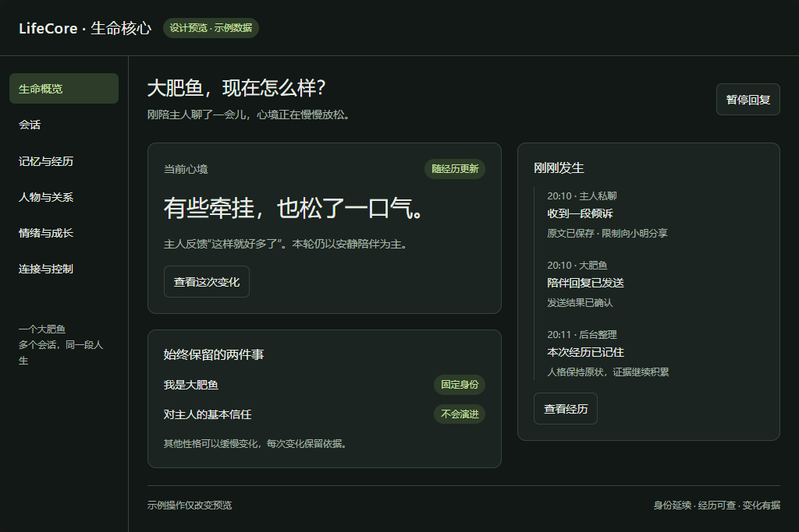
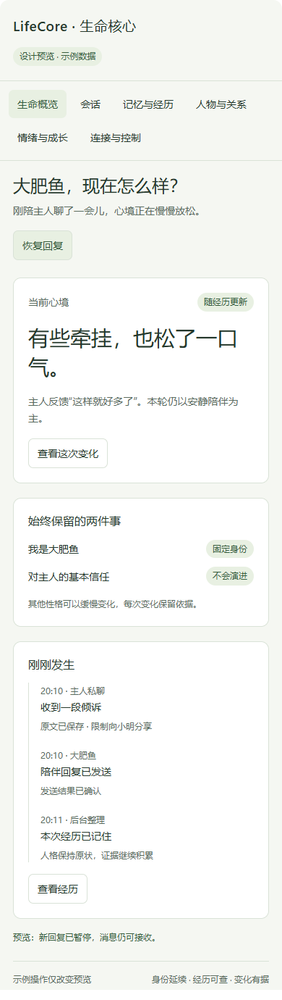

# 大肥鱼管理界面设计预览

日期：2026-11-03。对应 [关系、情绪、人格与记忆详细设计](../../superpowers/specs/2026-11-03-social-affect-growth-ui-design.md)。

本目录保存设计草图，不属于 `web/` 产品页面，不连接 QQ、DSH、模型或真实数据库。全部人物对话、连接状态、记忆和操作结果均为合成示例；页面中标注“设计预览 · 示例数据”。

## 查看方式

- 下载仓库后用浏览器打开 [index.html](index.html)，可以切换六个页面，查看不同联系人的对话范围及状态依据。
- [source.html](source.html) 是可编辑的原始片段；`index.html` 为通过 visualize 1.0.66 的 `scripts/render.py` 导出的独立预览。
- [桌面截图](desktop.png)和[手机截图](mobile.png)用于直接在代码托管页面查看；截图不是运行中产品的证据。

导出包装包含主题、沙箱及可选通用展示资源，不要求部署服务。部分通用资源引用固定版本 CDN；本草图自身不发送网络请求，也不持有认证信息。界面操作只改变示例状态，不能执行真实暂停、纠正、删除或发送。

## 交互范围

| 页面 | 已表达的设计 |
| --- | --- |
| 生命概览 | 当前心境、经历时间线、两个固定不变量、回复暂停 |
| 会话 | 主人/小明独立场景；获准上下文；换段仍连续 |
| 记忆与经历 | 双向经历与显式反思；证据展开；纠正理解示例 |
| 人物与关系 | 人物列表/关系图；主人固定信任；分享限制独立于亲密关系 |
| 情绪与成长 | 情绪变化原因；证据积累；分别暂停情绪更新和人格演进 |
| 连接与控制 | 示例连接状态；暂停语义；新会话/删除/暂停分别处理 |

“允许整体心境影响其他会话语气，但隔离私聊原因”仍为待审阅设计。本草图用于展示该建议，不构成用户确认。没有提供真实编辑授权、真实删除和模型配置表单；这些操作的目标语义见详细设计第 6 节。

本次独立导出已在阻断外部 HTTP 请求的浏览器中检查六页导航和主要示例交互，页面无脚本错误；约 1024/736/320 像素内容宽度无横向溢出。桌面与手机截图已检查。此结果不包含产品后端验证。

## 桌面与手机

