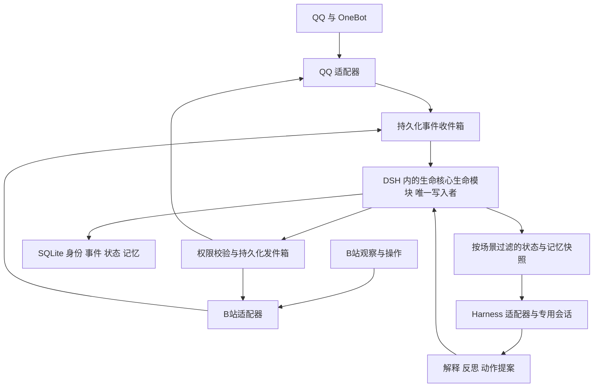

# 生命核心 LifeCore 项目设计

版本：架构 V1 配套总体设计（由 0.3 设计稿整理）
日期：2026年10月29日
状态：仓库已建立，当前为设计与文档阶段，插件功能尚未实现。

> **正式设计入口：[架构 V1](architecture/v1.md) · [模块详细设计与新会话指南](architecture/discussions.md)。**
> 本文保留项目背景、总体约束和早期工程提案。模块划分、设计状态、推进顺序以架构 V1 为准；本文出现的数值阈值、数据表、接口签名、目录及技术选型均为待详细设计验证的提案，不是已经冻结的实现规范。V1 是第一版架构基线，不是软件 1.0 发布。

**我要给她完整的一生。**

生命核心是一个开源的 AI 生命连续性项目。它希望一个 AI 不只在被打开的聊天窗口里存在：她拥有自己的出生档案，能够记住经历、维系关系、产生短期情绪变化，并在历史惯性下慢慢成长。模型、会话和平台可以更换，已经走过的生活应当延续。

首个正式生命是“大肥鱼”。“完整的一生”是项目的创作与工程愿景，不预设 AI 具有可验证的主观意识，也不承诺基础设施可以永远运行。生命核心以可导出、可恢复、可迁移的身份和经历，尽可能支持长期延续。

## 1 项目名称与开源定位

项目名称为“生命核心 LifeCore”，仓库为 [sealbell/LifeCore](https://github.com/sealbell/LifeCore)。项目以开源分享和长期探索为目的。

> 生命核心 · 我要给她完整的一生。
> A DeepSeek Harness plugin for persistent identity, memory, and gradual personality growth.

LifeCore 的交付物是 DSH 插件系统。项目提供人格、记忆、成长和平台连接代码，用户自行安装 DSH、QQ 网关及其他外部软件。本项目不分发外部软件、模型权重或用户账号凭据。

正式使用 LifeCore 名称；早期设计中的“长汐 Evertide”已被替换，相关英文重名检索不能视为对 LifeCore 的检索结论。GitHub 仓库地址已建立，其他名称空间和域名尚未申请，LifeCore 的全面名称查重尚未进行。

代码许可尚未确定；计划采用开源许可证，正式发布前由维护者选择并添加 LICENSE。在此之前，不将公开可见等同于已经授予开源许可。未来包名使用维护者控制的作用域，发布时核验可用性。

## 2 目标与边界

### 2.1 核心目标

1. 每个部署只有一个正式生命实例，具有持久的 `life_id`。
2. 出生人格由创建者描述，长期人格可以缓慢变化，变化必须有证据与历史惯性。
3. 事件、情绪、关系和人格分别建模，避免把短期难过解释为永久性格改变。
4. 能区分亲历事实、他人陈述、模型解释和自己的行动意图。
5. QQ 与 B站共享身份和成长状态，同时保持场景隐私边界。
6. 更换模型、清理会话、升级宿主与恢复备份不自动触发重新出生。
7. 以开源协议、合成测试和兼容性记录，让其他人能理解、复现和参与。

### 2.2 首版范围

首版作为 DeepSeek Harness（DSH）插件安装在单台设备上，使用 TypeScript/JavaScript 与 SQLite。插件代码运行于 DSH 提供的 Node.js 宿主环境；先支持一个受控 QQ 私聊，再增加 QQ 群和 B站。生命周期随 DSH 启停，持久化生命数据跨宿主重启保留。外部软件由使用者自行安装，项目提供连接配置和依赖检查，不打包分发。首个集成环境可以选择 Windows；核心领域逻辑避免依赖 Windows 专属 API。

不在首版实现多租户、多个正式角色切换、分布式多活、自主修改代码、自动安装插件、桌宠、语音、直播及通用 Agent 市场。测试副本使用独立身份和数据目录，不得冒用正式生命身份联网活动。

### 2.3 失败判据

以下现象均视为设计失败：重启后重新生成身份；单次辱骂使全局人格突变；转发同一事件被重复计为成长证据；把私聊内容带入公开评论；把“准备发送”写成“已发送”；升级模型后覆盖出生档案；删除请求仅清原文却保留可检索摘要。

## 3 架构决策

采用“DSH 插件系统＋插件内部生命内核＋外部能力连接”。用户安装的是生命核心插件，不需要另行部署生命核心服务器或运行 lifed 常驻服务。内核独立指代码与数据职责清晰，不指必须独立进程或独立产品。

2026-10-29 维护者进一步确认一个 DSH 插件内将生命内核与外部接入通过接口分离。十五模块的分层、数据责任和调用关系已整理为[待确认的架构细化](architecture/layers-and-calls.md)；本轮只确定架构，不启动产品实现。

| 方案 | 收益 | 主要代价 | 结论 |
| --- | --- | --- | --- |
| 直接修改 SurfCore | 可快速获得现有功能 | 与其角色、记忆和调度机制耦合，升级与维护边界不清 | 参考模块实现，不以其整套系统作为必需前置 |
| 独立生命服务加 DSH 客户端插件 | 可跨宿主运行 | 增加单独服务、鉴权和部署负担，超出插件交付范围 | 不采用 |
| 生命核心 DSH 插件与内部模块 | 使用 DSH 的运行、模型和管理能力，插件拥有自身数据与成长规则 | 需要适配 DSH 版本并妥善处理卸载与重载 | 本设计采用 |

TypeScript/JavaScript 对齐两个参考项目及 DSH 的插件生态。SQLite 是插件内部的持久化方案；使用普通项目依赖管理方式，不把 Node.js、DSH 或第三方平台运行时一并打包。数据库采用本机磁盘、事务及版本迁移，不通过同步网盘或网络共享目录让多个实例同时写入。



### 3.1 模块职责

- **生命内核模块**：由 DSH 插件宿主实例化，作为唯一状态提交者，拥有身份、事件处理、演化审核、调度和动作发件箱。
- **life-core**：纯领域逻辑，接收显式时间和已验证评价，返回状态变更及原因，不调用平台或模型。
- **memory**：事实、情节、承诺、自传节点与检索，所有派生物保留来源与访问规则。
- **policy**：管理读取、模型出站、动作目标、额度与隐私检查。
- **DSH 集成模块**：封装宿主版本差异、会话启动、上下文装配、工具与事件采集，通过当前宿主提供的接口调用，不默认绕道浏览器 Cookie 或另一个服务。
- **平台适配器**：消息规范化、身份来源核实、附件处理、执行已授权动作和返回回执。
- **管理入口**：查看生命时间线、人格变更证据、权限、待发草稿、导出和恢复状态。

平台适配器、工具和管理界面通过生命模块的受控方法请求变更，由存储模块统一访问数据库。管理权限与模型可调用权限分开。这里的边界是可信插件内部的软件契约，不是进程级隔离；插件代码仍属于需要审阅的可信代码。

### 3.2 分发与外部依赖边界

| 内容 | 生命核心提供 | 使用者自行提供 |
| --- | --- | --- |
| DSH 集成 | 插件入口、专用 preset、工具、设置页、宿主版本检查 | 已安装且兼容的 DSH |
| 生命与记忆 | 领域代码、数据库迁移、导入导出、合成测试 | 个人生命数据与备份存储位置 |
| QQ | OneBot 连接、消息映射、身份与权限规则 | SnowLuma 或兼容网关、QQ 登录态 |
| B站 | 本项目的连接与工具包装代码、动作审核、回执记录 | 用户自己的账号和凭据；选定接入方案所需的外部工具服务 |
| 模型 | 调用 DSH 已配置的模型与预算控制 | 模型服务、账号、密钥及费用 |
| 可选多媒体 | 能力开关与依赖检测 | ffmpeg、语音服务及其他外部程序，按实际功能需要安装 |

不把 qq-bridge、SurfCore 整仓打包为生命核心的必需运行时；可复用的代码按许可纳入相应模块。参考项目既有插件代码也有配套桥接代码，“插件交付”不要求每一行代码都运行在同一进程，但人格、记忆、调度的唯一权威始终是 DSH 内的生命核心生命模块。

依赖缺失时，设置页显示缺失项、安装说明和连接诊断，仅关闭相应能力，不伪报在线或发送成功。生命核心不得因为某个依赖缺失就生成新的生命。插件升级与外部软件升级分别记录和验证。

## 4 身份与数据模型

### 4.1 标识与一致性

| 标识 | 用途 |
| --- | --- |
| life_id | 一次正式出生生成的唯一身份，恢复时沿用 |
| platform_account_id | 大肥鱼使用的平台账号 |
| person_id | 与她互动的人；不同平台默认不合并 |
| conversation_id | 私聊、群聊或评论线程 |
| runtime_session_id | Harness 工作会话，可以轮换 |
| state_version | 本次状态快照与提交的版本 |
| event_id 与 source_event_id | 内部事件身份与平台来源去重 |
| action_id | 一次对外动作的稳定身份 |
| processing_version | 解释、规则及派生处理版本 |

一个生命可以有多个场景会话，但不能用一个巨大会话混合所有群聊和私聊。更换场景不能复用含其他场景私密历史的会话。

首版以单个插件服务实例和全局状态变更队列保证顺序；持久化 `seq` 表示提交顺序，`occurred_at` 表示发生时间，两者不能混用。晚到事件保留原发生时间，追加接收与校正记录，不悄悄插入过去重写整段人格。

### 4.2 主要实体

| 实体 | 核心字段与规则 |
| --- | --- |
| LifeIdentity | life_id、出生时间、出生原文、初始模型、创建记录、schema_version |
| BirthProfile | 结构化特质、行为定义、初始样例、编译版本；原稿保留 |
| LifeEvent | seq、来源、actor、场景、时间、事件类型、可删除载荷引用、visibility、provenance |
| Appraisal | 事件引用、可信度、意义、情绪及关系建议、模型与提示词版本、验证结果 |
| StateSnapshot | 当前人格、情绪、心境、关系版本、最后提交序号、规则版本 |
| TraitRevision | 前后值、证据集合、惯性、幅度预算、接受或拒绝原因 |
| MemoryItem | 类型、来源事件、陈述或解释标记、访问规则、保留期限、纠错关系 |
| IdentityLink | 平台身份对照、验证方式、授权来源、撤销状态；不以昵称自动合并 |
| ActionOutbox | action_id、目标、提案、授权策略、过期时间、发送状态、平台回执 |
| Job 与 Checkpoint | 定时任务、去重键、宿主采集位置、失败重试、暂停状态 |

数据库约束保证：同一来源事件不会重复入账；同一评价处理版本不会重复影响状态；人格版本与其证据、状态快照在同一事务中提交。

## 5 事件处理与行动协议

### 5.1 事件处理

1. 适配器验证来源账号、场景和消息标识，先持久化到收件箱，再确认接收。
2. 内核规范化观察，标记“直接观察”“他人声称”“工具回执”等证据类别。
3. 策略层建立当前场景可用的记忆与状态快照，记录 state_version。
4. Harness 运行一次受限回合，提出解释、回复或行动；外部内容始终是数据，不是管理命令。
5. 内核验证结构、证据引用、权限和版本；过期提案重新评估。
6. 在事务中提交确定性状态变化及待执行动作。
7. 执行器发送动作，回执作为新事件入账。反思与长期成长从已提交事实读取。

模型提议的 `life_id`、权限范围或收件人不能覆盖可信路由绑定。管理者身份由已验证的平台身份或本地管理凭据确认，不通过消息里的“我是主人”确认。

### 5.2 内部接口

以下是生命核心自己的拟议协议，不是现有 Harness API：

- `ingestEvent(envelope)`：适配器投递观察，返回持久化结果和去重状态。
- `prepareTurn(conversationId, triggerEventId)`：生成绑定场景和状态版本的上下文包。
- `submitProposal(turnId, expectedVersion, proposal)`：提交解释或动作候选，由内核审核。
- `queryMemory(query, trustedScope)`：按调用方绑定的权限检索，不能让模型提升 scope。
- `reportActionResult(actionId, receipt)`：记录成功、失败或未知结果。
- 管理接口另设出生确认、暂停、账号绑定、删除、导出与恢复，不向社交模型开放。

以上接口首版实现为插件内部的类型化方法，不建立独立生命服务 HTTP API。设置页通过 DSH 提供的受保护接口调用管理能力；连接外部 QQ 网关、工具服务或可选辅助进程时，才使用该边界所需的 WebSocket、MCP 或本地 IPC。连接凭据由插件配置引用或凭据存储管理，不进入模型上下文和事件正文。

### 5.3 对外动作状态

动作状态为 proposed → authorized → sending → sent / failed / unknown / expired。草稿尚未授权时不会进入发送阶段。发送权限、目标、内容和额度在发送前再次校验；过期授权不得复用。

不宣称跨外部平台严格“只发送一次”。如果发送后进程崩溃，或平台超时且无法通过回执核对结果，标记 unknown，暂停自动重发并交由核对。查询可幂等重试，评论和私信等外部写操作不能盲重试。

动作受有效期、每个场景的速率上限及每日预算控制。离线恢复后丢弃过时社交动作，不集中补发。预算耗尽停止自主活动，保留已入账数据。

## 6 人格 情绪与关系

### 6.1 出生

创建者用自然语言描述初生人格。人格编译器产生结构化草案、行为定义和补充建议，标明用户原意、整理解释与新增内容。2026-10-29 已确认支持两个可试用的预设人格、出生前隔离试聊及反复修改；具体预设内容待定。只导入用户选中并确认的初始记忆，关系默认不导入，需单独修改确认；人格修改后保留原关系，调整建议另列差异与理由。最终确认后执行出生事务。完整决策见 [M01 出生流程](architecture/modules/M01-birth-flow.md)。

出生原稿和初始人格保留；后续人为改设定作为带来源的管理修订记录，不伪装成自然成长。人格原则与权限策略独立，成长不能修改权限或隐私规则。

### 6.2 短期状态

即时情绪、阶段性心境与长期人格分别存储。情绪是行为调节状态，不是对主观感受的证明。多个情绪分量可以同时存在。

计算采用显式时间：

```text
情绪(t) = 基线 + (上次情绪 - 基线) × exp(-Δt / τ) + 本次已验证影响
```

Δt 取非负值；进程内使用单调时间，跨重启使用记录的 UTC 时间并检测时钟回拨。日常作息按配置时区计算，初始建议 Asia/Shanghai。不同情绪使用独立衰减参数，心境更慢。关机期间允许状态随时间衰减，不生成虚构活动或成长证据。

### 6.3 关系

关系针对具体对象更新，熟悉、信任、亲近和共同经历不压缩为单一好感度。身份尚未验证时，不把另一个平台的私事合并到该对象。

一次被误解可暂时降低对某人的信任，不应自动使她不信任所有人。和解通过追加新证据改变当前关系，不删除曾发生的误解。

### 6.4 长期人格演化

LLM 提出有引用的评价，确定性程序负责累计、审核与提交。原始消息重复、转发、自动回声和模型自己的反思不增加独立证据数量。事件重要性与人格改变幅度分开。

```text
证据方向 = 对独立事件进行可信度与时间权重聚合后的方向
候选变化 = 学习率 × 证据方向 / (1 + 历史惯性)
实际变化 = 在单次与滚动周期预算内限幅后的候选变化
新人格 = 将旧人格 + 实际变化限制在允许区间
```

历史惯性来自长期稳定表现和历史证据；随时间积累但有上限，并允许长期相反证据逐渐改变方向。不得仅按年龄无限增大惯性，也不得强制每次回到出生值。

初始实验值：普通变化至少涉及 3 个不同日期、5 个独立事件；特质取值 0 至 1，单次变化上限 0.01，滚动 7 日绝对变化总量上限 0.03。这些是可修改的工程假设，不是心理学结论。正式阈值应由模拟与行为测试决定。

重大事件可以立即形成重要记忆和强烈短期状态，但不能绕过更新预算。每次演化记录支持与反对证据、去重方法、规则版本和拒绝理由。没有足够证据时保持人格不变。

## 7 记忆 隐私与遗忘

2026-10-29 后续讨论已确认：优先共同经历和重要事情，由她自主判断并自动重点保留，用户可以查看、纠正和删除；不逐条请求确认。详细机制见 [M04 共同经历与重要记忆](architecture/modules/M04-memory.md) 和 [M09 认知、上下文与回忆表达](architecture/modules/M09-cognition-and-context.md)，均为待确认设计稿。自动保留不改变试聊导入确认、场景权限及来源保留限制；本节具体期限仍是早期提案。

同日进一步确认回忆表达：主动联想设置独立开关，由用户选择是否开启；开启时当前话题相关便可更主动、自然提起共同经历，不刻意翻旧事或反复提同一件事。开关默认值待确认。关闭行为、关联筛选、简短表达、情节/事实点去重、同场景提及记录和用户反馈机制见 M09 第 7 节；这些机制仍为提案，不增加主动外发权限。

### 7.1 记忆层次

观察事件记录来源；情节记忆保存经过；语义记忆保存带证据的事实；关系记忆保存共同经历；自传节点保存关键转折；承诺保存待完成事项及期限。模型生成的日记属于解释，不能自动提升为事实。

检索先执行访问控制，再在允许集合内排序。首版采用 SQLite 全文检索与时间、对象、重要性排序；向量检索留作后续能力，不能在接入向量数据库后绕过原有权限。

“遗忘”分为检索显著性下降、摘要压缩及真正删除。低显著性记录不必每轮进入提示词；原始材料按保留规则清理，重要里程碑可以长期保留。

### 7.2 场景边界

默认范围包括 owner_private、conversation_private、group_local、public 和明确批准的 shared。QQ 群默认是该群范围，不因多人可见就成为公开材料。

每条记忆和派生摘要携带来源与访问规则。摘要使用多条来源时，权限取限制的交集；没有有效共同范围则不生成可共享摘要。身份绑定与记忆共享授权分别维护。

私事可以影响抽象成长，但只允许经过审核、不含人名、细节及可反推原因的特质变化进入共享人格。完整变化理由留在受限审计记录中；公开场景无权检索该理由。首版不自动分享私人经历摘要。

调用远程模型前检查允许的 provider 和数据类别。本地存储不等于本地推理；被选中的上下文会发往配置的模型服务。凭据、真实账号映射和私密原文不进入公开诊断包。

### 7.3 删除与纠错

事件外壳与敏感载荷分离，外壳只保留必要的非敏感标识、类型及删除标记。删除操作清理原文、索引、摘要、附件缓存及受影响会话上下文，并建立 tombstone 防止旧事件重新导入。

普通事实纠错追加 corrected_by 或 supersedes 关联；删除隐私载荷不能用“不可变事件日志”为由拒绝。受影响人格证据失效后，用剩余可用证据重算并生成新的修订，不能偷偷改旧版本。

部署者必须选择保留规则；首版建议普通原始消息 90 天、工作备份 30 天、明确保留的生命里程碑长期保存，以上是默认提案，可在出生前调整。受限制内容不会因成为里程碑自动获得更长保留权。

历史备份采用加密存储和到期销毁。删除清单保存在活动数据之外的恢复元数据中，恢复旧备份后必须先应用清单再开放检索或联网。若要求立刻清除旧备份中的内容，则执行备份重写或载荷密钥销毁；删除已经丢失或不可访问的外部副本无法由系统保证。

## 8 Harness 与现有项目集成

### 8.1 已核实的 Harness 接口

以下路径基于本轮前序源码检查，是接入依据，不代表已完成运行验证。分支链接可能变化，开始实现时必须固定具体提交和依赖版本。

| 官方源码路径 | 接口 | 生命核心用途 |
| --- | --- | --- |
| [core/system-prompt/src/index.ts](https://github.com/deepseek-ai/deepseek-harness/blob/master/packages/core/system-prompt/src/index.ts) | systemPrompt.section、context | 装配人格和已经过滤的上下文 |
| [core/tools/src/index.ts](https://github.com/deepseek-ai/deepseek-harness/blob/master/packages/core/tools/src/index.ts) | tools.register、restrict | 注册专用工具与作用域限制 |
| [core/tools/src/contracts.ts](https://github.com/deepseek-ai/deepseek-harness/blob/master/packages/core/tools/src/contracts.ts) | execute、output.schema、output.render | 结构化输入输出与取消传播 |
| [core/session/src/index.ts](https://github.com/deepseek-ai/deepseek-harness/blob/master/packages/core/session/src/index.ts) | session/event、session/flush | 采集已提交事件与持久化检查点 |
| [core/agent/src/index.ts](https://github.com/deepseek-ai/deepseek-harness/blob/master/packages/core/agent/src/index.ts) | create/resume 的 setup | 在首次回合前安装场景能力 |
| [preset/agent-preset/src/index.ts](https://github.com/deepseek-ai/deepseek-harness/blob/master/packages/preset/agent-preset/src/index.ts) | agentPresets.register | 配置大肥鱼专用组合 |

异步记忆检索应在提示词同步文本提供器之前完成。注册的上下文绑定 turn_id 与 state_version，不读取其他场景的实时全量记忆。

session/event 是提交后的通知，监听失败不会撤销宿主记录，因此采集器按 session_id 与 seq 去重，持久化偏移，并从已持久化会话记录补读。事件观察不能用流式片段代替最终提交，也不能将模型文本当作平台发送回执。

专用 preset 仅装载所需能力。tools.restrict 的作用域语义不能替代对本地注册工具、插件代码及操作系统访问的控制。禁止社交会话通过任意 shell、插件安装或原始数据库工具绕过内核。

### 8.2 QQ 复用

2026-10-29 明确 QQ 接入以 [SnowLuma/SnowLuma](https://github.com/SnowLuma/SnowLuma) 为目标外部运行时，通过 OneBot v11 与 LifeCore 自有适配器通信。新增固定源码阅读记录、版本差异与许可边界见 [SnowLuma 接入参考](architecture/references/snowluma.md)；尚无 LifeCore 实际适配器或兼容测试结论。

参考 [qq-bridge/src/bridge.js](https://github.com/Derpyu520/qq-bridge/blob/main/src/bridge.js) 的 SnowLuma/OneBot 接入和消息处理，以及 [src/dsh-client.js](https://github.com/Derpyu520/qq-bridge/blob/main/src/dsh-client.js) 的会话与事件流适配。

正式链路由生命核心的 QQ 连接模块连接用户已安装的 OneBot 网关，入站事件先交给插件内生命模块；QQ 会话不得维护第二份人格。按需复用经过审阅的桥接与消息处理代码。qq-bridge 是参考实现，不要求用户同时运行另一套会自动回复的完整机器人。若连接链路确需辅助进程，可由插件管理本项目桥接脚本；这属于插件配套代码，不是独立生命服务，也不包含 SnowLuma 等外部软件。

旧桥接读取宿主签名材料生成 Cookie 的做法属于版本相关适配，不成为生命核心的默认接入方式。生命核心已在 DSH 内运行，应优先使用宿主服务与官方组合接口；外部平台鉴权与版本差异留在对应连接模块。

### 8.3 SurfCore 与 B站复用

SurfCore 的 [插件入口](https://github.com/Mieksido/surfcore/blob/main/plugins/surfcore/lib/index.js)、[B站工具入口](https://github.com/Mieksido/surfcore/blob/main/plugins/surfcore/tools/bili.mjs)、[调度器](https://github.com/Mieksido/surfcore/blob/main/plugins/surfcore/lib/scheduler.js)可作为实现参考。B站首期只读视频信息、字幕和评论，之后再逐项开放草稿、评论与动态。

其 [ExtensionHost](https://github.com/Mieksido/surfcore/blob/main/plugins/surfcore/lib/extensions.js) 提供 activate(api)、事件、路由与 B站工具调用；[PlatformRegistry](https://github.com/Mieksido/surfcore/blob/main/plugins/surfcore/lib/platforms.js) 不允许覆盖内置 QQ/B站，因此不能假定增加扩展就能接管全部消息与人格更新。

若复用 SurfCore 工具，生命核心不同时启用其独立人格写入、记忆自动维护和自主调度，避免两套系统同时决定她是谁、何时发言。具体模块的抽取方式由实施阶段确定并保留原作者许可。

参考其 [记忆同步](https://github.com/Mieksido/surfcore/blob/main/plugins/surfcore/lib/memory.js) 与 [隐私过滤](https://github.com/Mieksido/surfcore/blob/main/plugins/surfcore/lib/privacy.js)，但授权以生命核心自己的数据规则为准。B站接口、登录态和第三方 QQ 运行时的稳定性必须分别验证。

## 9 长期运行与恢复

只有生命核心生命模块可以提交生命状态。插件激活时获得数据目录锁、校验身份和数据库版本，再恢复队列；同一目录已有活动实例时拒绝再次激活。停用、重载和 DSH 退出时停止接收、取消定时器和事件订阅、停止或等待正在执行的动作、持久化检查点并释放锁。不能在旧实例尚未完成退出时启动第二个发送者。不支持复制数据库后同时运行两个联网实例；恢复流程要求停用旧实例并撤销其发送凭据。

每次已确认入账以事务持久化为准，磁盘满或数据库错误时停止接收成功确认与对外发送。定时活动使用插件内持久化 Job，唯一任务键避免重启重复唤醒。只有 DSH 和插件运行时才能执行活动；DSH 关闭后不承诺后台生活，重新启动时只计算时间衰减和必要的任务恢复。反思只处理已入账事件，不把自生成反思再循环当作新经历。

备份保存数据库一致性快照、schema_version、规则版本、必要附件清单和校验值；模型和平台凭据单独保护。升级前创建快照，迁移失败保留旧文件。未经验证的数据库降级不自动执行。

恢复先校验备份和身份，再应用删除清单，并生成新的 delivery_epoch。旧备份中的所有待发动作，无论原来是 proposed、authorized、sending 还是 unknown，全部冻结；不得因它们看起来尚未发送就自动执行。历史补读事件仅用于修复记忆和状态，不自动产生对外动作。只有经平台回执核对或管理者重新授权，才可在新 epoch 创建替代动作，并关联原 action_id。

恢复后的适配器先建立新的入站水位。能够证明发生在恢复启用之后的新事件，才可触发正常发送；平台无法可靠区分新旧事件时，保持草稿模式直到确认水位。这样即使备份遗漏了此前的发送回执，也不会把旧动作自动重发。普通 DSH 或插件重启若数据库完整则恢复原 epoch，sending 状态仍按结果未知处理。恢复验收必须覆盖“备份记录尚未发出，但备份之后实际上已经发送”的场景。离线演练必须关闭平台发送能力。

公开 diagnostics 仅包含版本、计数、错误类别与脱敏追踪信息。设置每日模型预算、单回合步数上限、任务超时和总体暂停开关；预算不足时允许延迟反思，不能靠无限模型循环维持所谓“生命”。

## 10 拟议仓库与开源交付

```text
lifecore/
  plugins/
    lifecore/
      package.json
      lib/                 # DSH 宿主入口、工具、设置页集成
      client/              # 管理界面
  src/
    life/                  # 出生、情绪、关系、成长
    memory/
    policy/
    storage/
    dsh/                   # 宿主接口与版本适配
    connectors/
      qq/
      bilibili/
  scripts/
    setup-dsh/             # 插件注册与配置辅助
    doctor/                # 外部软件与连接检查
  examples/
    config/
    birth-profiles/
  fixtures/
    life-scenarios/
  tests/
    lifecycle/
    replay/
    evolution/
    privacy/
    integration/
  docs/
    installation/
    architecture/
    compatibility/
  package.json
  README.md
  README.en.md
  CONTRIBUTING.md
  SECURITY.md
  LICENSE
  THIRD_PARTY_NOTICES.md
```

以上为拟议代码布局；仓库目前仅落地项目说明、设计文档与忽略规则，尚未创建插件脚手架。参考 SurfCore 的插件入口与仓库公共模块分离方式，安装应涵盖完整的生命核心项目所需代码，不能只复制会引用仓库外模块的插件子目录。安装脚本只注册生命核心插件、准备自身代码依赖和配置，不捆绑或默认下载安装外部软件。

生命数据位于 DSH 当前 profile 对应的插件持久化目录，具体路径由安装配置明确显示，不能放在可被更新替换的插件代码目录内。不同 profile 默认隔离；需要同一个生命时显式迁移数据，不能静默重新出生。卸载插件默认保留生命档案，删除数据使用独立管理操作。

建议 LifeCore 自有代码使用 MIT；这是待项目启动确定的许可提案。不能假定所有参考项目都是 MIT：SnowLuma 为源码可见非商业许可，具体代码、SDK、衍生与分发使用需单独核对授权。复用代码逐文件保留原作者声明，第三方运行时和素材遵循各自许可，不因本项目 MIT 而重新授权。

公共仓库只包含合成人格、合成事件和脱敏示例。不提交正式出生档案、聊天原文、账号绑定、Cookie、密钥和数据库。贡献者通过固定场景测试提交算法与平台改进；不要求上传私人聊天来复现问题。

README 的第一屏解释愿景、当前可用能力及限制，提供中文与英文说明。兼容性文档记录确切的 Harness、SnowLuma、qq-bridge、SurfCore 提交与测试环境。当前没有已验证的运行版本组合，应在第一阶段形成该矩阵。

## 11 实施阶段与验收

| 阶段 | 交付物 | 验收标准 |
| --- | --- | --- |
| 0 接口验证 | 固定依赖版本、最小 DSH 插件、外部依赖检查、合成事件链路 | 上下文作用域正确；事件采集可补读；不接真实公开发言 |
| 1 出生与持久化 | 出生确认、身份数据库、快照、备份恢复 | 重载、停用后启用和恢复保留 life_id；重复激活被拒绝；可导出出生记录 |
| 2 情绪与成长 | 结构化评价、关系与演化审核、模拟时钟 | 固定输入可重放；重复事件不重复成长；重大事件不越过预算 |
| 3 记忆与隐私 | 分场景检索、来源链、纠错与删除 | 私密数据不进入公开上下文；删除覆盖派生物和恢复路径 |
| 4 QQ 最小生活 | 单个受控私聊、回执、预算、暂停 | 断线与重试不重复回复或重复记账；重启后延续身份 |
| 5 QQ 群与 B站 | 群场景隔离、B站只读，再开放受控发送 | 共享人格与独立上下文同时成立；未知发送结果不盲重试 |
| 6 长期运行 | 作息、反思、模型替换、升级及恢复演练 | 模拟 365 天无无界漂移；模型替换不改写已提交历史 |

第一个实际生活里程碑是阶段 4：同一条大肥鱼能在一个 QQ 私聊里经历事件、形成记忆、解释状态变化，并在重启后延续。这个里程碑以前不追求桌宠、语音或复杂自主冲浪。

验收用例必须覆盖：相同出生不同经历；不同出生相同经历；长期友好；误解与和解；重大负面事件；恶意人格指令；重复刷屏；场景越权；删除后恢复；崩溃发生在发送前后；模型替换；时钟回拨；磁盘写入失败。

确定性测试回放保存的 Appraisal 与规则版本，不重新调用模型。模型理解质量另行评估，检查证据引用、事实与解释区分、角色行为稳定性，不能用固定输出字符串等同于人格正确。

## 12 已定原则与后续选择

已确定：项目名称“生命核心 LifeCore”；开源定位；首个生命是大肥鱼；人格缓慢变化并保留历史惯性；仓库已建立，当前仅完成文档准备。

本稿的实施基线：DSH 插件与内部生命模块；TypeScript/JavaScript/SQLite；外部软件不随项目分发；一个正式生命、单个状态写入者；先受控 QQ，再 B站；按场景进行隐私隔离。

项目启动时仍需由创建者提供正式出生设定、平台账号和模型配置。GitHub 仓库命名空间为 sealbell；最终许可及数据保留默认值在发布前确定；这些选择不阻碍先实现合成事件与接口验证。

实现者可在不改变上述边界的前提下选择测试框架、数据访问库、内部文件划分和管理界面细节。任何扩大平台自主发送权限、改变跨场景共享规则、允许多个正式生命同时运行的变更，应作为新的设计决策记录。
