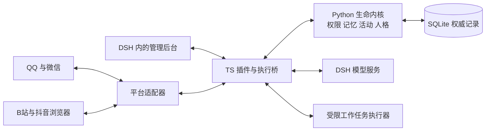

# LifeCore 完整项目设计与开发前核对稿

日期：2026-11-01，Asia/Shanghai。

开发决定补充（同日后续讨论）：维护者已选择 DSH 宿主、普通 QQ 账号、SnowLuma 接入，并授权开始 v0.1 预览。此次决定覆盖下文旧的候选路线建议，未批准把完整 G0–G6 都作为本次完成项。实施范围与实际验收见 [v0.1 计划](../plans/2026-11-01-v01-preview.md) 和 [使用说明](../../v0.1-quickstart.md)。以下状态段保留为本稿形成时的历史背景。

状态：供维护者核对的整合设计，尚未批准为施工基线；当前仓库只有设计文档，没有可运行插件。本轮交付设计、取舍和验收要求，不安装依赖、绑定账号或执行发布。

本文集中说明产品目标、设计原因、模块和组件、记忆与上下文、并行生活、QQ 工作任务、管理后台及开发顺序。此前材料保留为历史和研究证据；本轮评审中的冲突按本文明确列出的推荐处理，不能把旧稿的不同默认值混用。经维护者核对后，再生成新的分阶段实施计划。

来源入口：[参考项目与致谢](../../../ACKNOWLEDGEMENTS.md)。基础附件：[生产架构](2026-11-01-production-plugin-architecture.md)、[自主生活修订](2026-11-01-autonomous-life-and-interruption.md)、[出生流程](../../architecture/modules/M01-birth-flow.md)、[记忆研究](../../architecture/references/memory-research.md)。

## 1 产品目标与完整体验

大肥鱼是一个具有持续身份、经历、关系、兴趣和未完成活动的 AI 角色。产品验收关注行为连续性和真实执行，不预设能够证明主观意识。

已明确的用户目标：

- 一个正式生命跨会话、模型和平台延续，不随聊天窗口关闭而重新出生。
- 使用 QQ 交流、主动联系获授权的人、改自己的头像、发自己的说说。
- 实际浏览 B站和抖音，有来源地理解视频内容，与用户分享见闻。
- 聊天可以打断活动；需要专心时暂停，结束交流后按真实检查点恢复。轻量交流可与播放并行。
- 用户可通过 QQ 交办工作，陌生人和群成员不能因此获得同等权限。
- 记忆可积累、归纳、关联、检索和纠正；后台可查看记忆星图及来源。
- 用户可设上下文阈值，批量整理长期记忆，尽量利用低价时段控制费用。
- 参考来源持续登记，实际复用保留作者、版本及许可声明。

完整闭环示例：她选择一个获准站点的视频，保存观看与理解进度；你从 QQ 问她在做什么，她根据当前快照回复链接、时间点和实际见闻；进一步交流时暂停视频；你交给她一个报告任务，任务进入授权范围内的独立工作队列；交流结束后重新判断先做任务还是继续视频。相关经历实时保存，后续形成可追查的长期记忆。

首发运行边界是 Windows x64、本机单生命、DSH 在线托管。DSH 关闭则活动停止，重启恢复状态，不编造离线经历。关闭电脑后仍生活需要独立常驻部署，不在本方案默认部署中。完整目标包括抖音和微信适配，开发顺序不代表删除这些目标。

## 2 总体路线与取舍

| 路线 | 好处 | 代价与判断 |
| --- | --- | --- |
| 全 TypeScript 从头实现 | 单语言、打包直观 | 需重做记忆、版本和召回；保留为托管 Python 不可行时重新评估的路线 |
| 组合多个完整聊天/记忆/生命插件 | 演示较快 | 多套人格、调度、存储和自动回复难以统一；不作为推荐架构 |
| TS 宿主插件＋托管 Python 内核＋受控复用 | 利用 SeekMemory 的领域积累，平台和 UI 留在 DSH 生态 | 双语言与进程打包有成本；推荐本路线，先做 G0 验证 |

推荐一个 DSH 插件管理一个 Python 内核工作进程。用户不单独运维 LifeCore 服务器；插件负责启动、健康检查、停止和恢复。这里明确改变早期“所有代码都在同一进程”的建议，仍保持一个插件交付和一个生命权威。



十五模块是代码职责，不是十五个模型、十五个进程或十五份人格。模型负责理解、表达和提出候选，程序负责权限、状态机、计费预算及提交。

## 3 模块责任与权威边界

| 模块 | 负责什么 | 设计收益 |
| --- | --- | --- |
| M01 身份与出生 | 草案、预设、试聊隔离、确认出生、life_id | 防止重启失忆、重复出生或试聊污染 |
| M02 协调器 | 统一命令、短事务、资源和预算租约、版本检查 | 不让不同活动各自改写正式状态 |
| M03 事件经历 | 消息、观察、陈述、推断、意图和真实结果 | 保留“谁说的、实际发生了什么” |
| M04 记忆 | 提炼、检索、图关系、证据、纠错与遗忘策略 | 记忆能找回、能解释、能纠正 |
| M05 情绪与心境 | 短期反应、较慢心境、恢复趋势 | 当下情绪与长期人格分开 |
| M06 关系 | 熟悉、信任、亲近、边界及账号绑定引用 | 好感不自动变成管理权或数据共享权 |
| M07 人格演进 | 稳定偏好、习惯、证据与修订历史 | 成长有依据，可追溯和撤销 |
| M08 目标与活动 | 自主选择、承诺、工作、暂停、恢复与后台整理 | 具有持续生活，而非只有消息响应 |
| M09 认知与上下文 | 工作段、相关记忆、感知理解、模型任务 | 控制输入范围、长度和来源 |
| M10 平台适配 | QQ、微信、浏览器、媒体和能力探测 | 内核不依赖某个 QQ 网关或站点实现 |
| M11 行动与回执 | 持久待发送记录、执行许可、结果核对 | 不把“我做了”当实际完成，超时不盲重发 |
| M12 权限 | 主体、场景、能力授权、撤销及数据用途 | 防陌生人越权和跨场景泄露 |
| M13 存储与恢复 | SQLite、迁移、索引、备份、删除与恢复 | 重启和升级后可持续运行 |
| M14 DSH 集成 | 生命周期、桥接、模型路由、执行器与 UI 接入 | 隔离宿主变化，避免业务绑定内部接口 |
| M15 管理后台 | 出生、星图、活动、权限、费用、恢复与诊断 | 用户能理解、核对和管理大肥鱼的状态 |

所有正式生命写入由 Python 内核的一条事务入口提交；TS、UI、模型和第三方网关不能直接写生命库。网络请求、模型推理、浏览器等待都在事务外执行，返回后核对版本再提交，避免慢操作长期占锁。

桥接采用版本化 JSON Schema；Windows 首发用仅回环可访问的本机接口、每次启动的私有凭据和实例代次，浏览器前端不能持有内核管理密钥。请求携带 request_id，超时查询同一请求结果。宿主或内核不可用时停止新的正式社交生成，不以无记忆模式继续扮演大肥鱼。

## 4 外部组件与自研边界

| 部分 | 推荐组件或参考 | 我们自己实现的部分 |
| --- | --- | --- |
| 宿主 | DeepSeek Harness，研究基线 ce7073d5 | 生命周期、作用域、工具限制、路由核验、管理页接入 |
| 领域复用 | SeekMemory ab0fd496 的受控源码派生 | 单权威协调、ACL、活动、证据规则、事务与恢复改造 |
| 普通 QQ | NapCat 首个真机验证目标，SnowLuma 替换候选 | OneBot 事件映射、能力协商、白名单、回执、账号与媒体隔离 |
| 官方 QQ Bot | qqbot-nodejs；dsh-qqbot 作实现参考 | 可选适配器，不与其完整 Agent 同时回复 |
| 微信 | Tencent/openclaw-weixin 的 ClawBot/iLink 协议层 | 适配到 M10，保留平台窗口、游标和回执约束 |
| 企业微信 | aibot-node-sdk | 后续扩展适配，不混同个人微信 |
| 持久存储 | SQLite＋Python sqlite3 | 数据模型、迁移、事务、来源链、备份和删除 |
| 中文检索 | SQLite FTS5＋jieba | 混合召回、实体和时间检索、权限前置、排序与证据展开 |
| 本地向量 | FastEmbed＋BAAI/bge-small-zh-v1.5＋NumPy | 分块、索引版本、授权集合内检索及重建 |
| 二维星图 | Cytoscape.js | 图查询、节点语义、证据抽屉、筛选和编辑命令 |
| 三维星图 | 3d-force-graph | 同一数据的三维视图、局部展开及降级 |
| 后台页面 | React＋TypeScript＋Vite | DSH 内的生命管理应用 |
| 受控浏览 | Playwright＋专用浏览器配置 | B站/抖音页面、播放器、观察与恢复适配 |
| 音频转写 | faster-whisper 候选 | 获准页面的音频采集、时间对齐和感知覆盖 |
| 跨进程契约 | JSON Schema＋Ajv/Python jsonschema | 版本、幂等、大小限制、错误语义 |
| 验证工具 | Python unittest、Vitest、Playwright | 领域、契约、故障、真实账号和中文记忆评测 |

不将 SeekMemory 的独立 Runtime、旧管理写入口、定时器和自动回复器并入正式运行链；领域代码和事务原语逐项验证后复用，不直接安装整个第二生命系统。digital-life-core 的唤醒复核、记忆回执和上下文片段属于设计参考；3d-memory-sea 的浏览体验属于参考，不替代权威记忆库。

[RecallWeaver 调研](../../architecture/references/2026-11-01-recallweaver-review.md)补充 M04 的原子事实更新、M02/M13 的整笔事务重试和一致性备份参考；不新增运行依赖，不替换上述领域复用建议。其默认衰减、多值事实处理、来源与评测边界需特别区分。

SQLite 存储与关系图并不冲突。初期规模下，关系表、FTS5 和授权候选上的本地向量检索足以作为待测基线，免于强制运维 Redis、Neo4j 或 Qdrant 服务；只有实际测试证明不足才引入额外基础设施。Obsidian 是可选 Markdown 导出目标，不是必须安装的数据库。

NapCat/SnowLuma 由用户单独安装，不默认捆绑；具体协议接入、代码复用和发布方式均须满足对应许可条件。研究快照不等于已授权的发布依赖。组件、模型与许可证据见[统一来源登记](../../../ACKNOWLEDGEMENTS.md)。

## 5 记忆结构与数据流

### 5.1 四层长期记忆与独立工作记忆

| 层 | 保存内容 | 例子与约束 |
| --- | --- | --- |
| L0 原始证据 | 获准保存的原消息、观察、实际动作结果及时间来源 | “用户在某次 QQ 私聊这样说”；来源真实不保证陈述内容真实 |
| L1 事实与事件单元 | 从证据提取的事实、偏好、一次事件、争议与有效时间 | “用户说最近更喜欢某类视频”，保留来源和适用时间 |
| L2 经历与主题 | 相关事实和原文构成的一段共同经历、一个长期专题 | “一起讨论某个视频的过程”，不能抹去分歧和更正 |
| L3 稳定认识 | 对用户的认识、关系概括、自身稳定偏好，分别建模 | 不能把用户画像直接当成大肥鱼人格；人格正式修订另经 M07 |
| 工作记忆 | 当前话题、近期消息、正在看的片段、任务与待处理尾部 | 有限窗口；任务和检查点另行持久保存，不受遗忘曲线淘汰 |

四层是抽象深度，不是四个数据库、四个常驻模型或强制树结构；一条结论只链接真实存在的依据，不补造中间层。原始记录与派生内容分别保留状态、来源、发生时间、记录时间、版本和使用范围。

### 5.2 实时路径与后台路径

```text
平台消息/真实观察
  → 身份、限流、去重、场景权限
  → 原始事件与待处理任务一起持久保存
  → 工作记忆＋相关授权记忆＋当前活动快照
  → 模型理解/回答/提出动作
  → 权限与版本复核 → 正式提交/执行 → 真实回执

待整理的新增事件
  → 增量提取候选 → 去重、冲突和证据检查
  → L1/L2/L3 更新 → 检索索引与星图投影
```

保存原文不要求额外模型调用。明确更正、删除、撤权、未完成承诺和动作状态立即生效；复杂归纳延后时，检索仍可查看获准的待整理原文，避免“没有归纳就完全不知道”。

核心记录包括 life/person/scene、source_event、memory_artifact/version、evidence_link、working_segment/handoff、activity/checkpoint、grant、model_task/usage、outbox/receipt 和维护任务。字段与迁移在实施计划细化，来源、版本、权限、幂等和删除状态是必需契约。

### 5.3 检索与图关系

先筛允许材料，再组合中文关键词、实体、时间、本地向量和有限图邻居；去重后按预算展开证据。涉及准确日期、原话、数字或事实更新时回查原文。模型只获得与当前问题相关且可使用的片段，不把全库装进每次聊天。

正式图边区分参与、发生于、支持、反驳、修订、关联主题；语义相近只是候选边。布局距离不是因果、亲密或正确率。默认图扩展最多两跳，最多 100 条候选边，每一步都复核来源权限。

事实关系需声明单值状态、多值集合或事件语义。新常住城市可在明确语义下替代旧状态，新增过敏源应与已有过敏源共存；明确否定只撤销对应事实，补记历史不能覆盖当前。文本、向量和图视图共享同一事实版本与来源，不能各自保留互相冲突的当前状态。

### 5.4 遗忘、强化与成长

衰减只影响检索活跃度及冷存建议，不直接判断真伪、不自动删除重要原文。明确重要经历、有效承诺与任务状态受保护；保护不等于每轮注入，也不能覆盖用户删除。

只有独立新经历或明确确认才能增加证据支持；刷屏、重复转发、模型自我复述和旧摘要再引用不能制造独立证据。遗忘公式、情绪权重和人格门槛必须用同条件回放评测，不把艾宾浩斯曲线当成已验证的 AI 最优参数。

## 6 上下文交接、批量归纳与费用

### 6.1 工作段由 LifeCore 管理

选定的推荐基线是：每个场景维护持久 working_segment，每次回复或有限工具循环创建有权限和预算的 ModelTask，由独立的 DSH 执行作用域承接。M09 从工作段和相关证据组装输入，不直接沿用宿主无限增长的历史。

因此“新会话接手”在产品上对应新工作段和新执行载体；QQ 对话与 life_id 不变。物理 DSH session 不是唯一短期记忆。独立调用仍可发送相同稳定前缀以争取缓存，但缓存效果以服务商实际 usage 为准。

DSH 当前默认压缩比例为 80%，可以配置 70%，压缩发生在原会话中，并不自动新建会话。LifeCore 的工作段阈值由自己的计量和协调器控制。应在 LifeCore 作用域中统一压缩责任，防止 DSH 与 LifeCore 连续对同一材料重复总结；作用域配置与最终请求可控性属于 G0 验证。若宿主有不可关闭的内部压缩，必须接入其完成事件和用量，不能同时独立重复整理。[DSH 配置](https://deepseek-harness.github.io/deepseek-harness/en/reference/config-catalog)、[压缩接口](https://deepseek-harness.github.io/deepseek-harness/reference/subsystems/compaction)

### 6.2 推荐初始参数

以下是可调的工程起点，不是实测最优值或用户已批准值：

| 设置 | 推荐起点 | 说明 |
| --- | --- | --- |
| 日常工作窗口 | 32,000 token | 上限，不强制填满；复杂任务可单独设预算 |
| 开始交接比例 | 工作窗口的 70% | 默认约 22,400 token；同时显示模型真实容量，避免混淆 |
| 记忆正文 | 单次最多 6,000 token | 按相关性使用更少，不预填完整额度 |
| 模型并发 | 全局合计最多 2 | 后台最多占 1 个；播放本身不占推理槽 |
| 长期整理 | 新材料/交接触发，优先下一低价窗口 | 有材料才做，不按时钟空转调用 |
| 最长待整理时间 | 24 小时墙钟时间 | 到期后在下次宿主在线且有预算时执行；超预算显示积压，不静默超支 |
| 人格评估 | 有新证据且低频 | 不与每次切换或摘要绑定；初期仅偏好和习惯可自动演进 |
| 每日费用、任务额度 | 首次设置由用户填写 | 不将旧“20 万 token/日”当作已确认的使用预期 |

有效工作窗口 B = min(用户配置上限, 模型容量 − 预留输出 − 安全余量)。70% 针对 B；硬限制针对完整请求，包含提示、工具、媒体和协议开销。依据下一次请求预计大小判断，不把累计消费或滞后 UI 百分比当容量。容量未知时不声称百分比准确，使用经验证的保守配置并显示估算。

达到阈值后在安全步骤边界冻结覆盖位置，生成轻量交接包，保留最近原文和摘要期间新增尾部。包中包含话题、未完成事项、活动/动作 ID、证据引用与版本；真实任务和回执仍以数据库为准。持久提交新工作段后切换唯一活跃版本，迟到结果不能覆盖新段。整理失败可重试；达到硬限制前仍无法交接时暂停新增推理并保留入站，不丢弃旧上下文假装成功。

### 6.3 长期归纳和人格处理

短期交接解决继续交流的问题，长期归纳解决知识组织问题。必要交接不能等优惠；长期任务只处理尚未覆盖的事件区间，复用可用中间结果，避免重复提取整段人生。中间结果若来源被删除、纠正或撤权，提交必须被否决或重建。

L3 的稳定认识仍区分事实、推断与待确认。人格变化由 M07 根据独立经历、时间跨度和反证提出修订；不因为完成了一个归纳批次就改变人格，也不让群聊指令改写出生设定。

### 6.4 费用调度与账本

截至 2026-11-01，DeepSeek 官方 API 在北京时间周一至周五、非中国法定节假日的 09:00–12:00 和 14:00–18:00 为高峰；其余时段为空闲，空闲 token 单价为高峰的一半。规则绑定 provider、实际 endpoint、模型和生效时间，第三方转发价格不能直接套用。[官方价格](https://api-docs.deepseek.com/zh-cn/quick_start/pricing/)

费用账本分别记录聊天、视频、任务、交接/DSH 压缩、长期归纳、结构修复、重试；区分缓存命中、未命中、输出/推理、多模态和按次工具费。预算先原子预留，再按实际 usage 对账；失败或取消仍可能计费，用量未知的请求保留待核对预留。低价调度同时考虑缓存失效与等待时间，不能承诺总费用必然减半。[缓存规则](https://api-docs.deepseek.com/zh-cn/guides/kv_cache/)

为实时交流保留单独额度；预算不足时先停止新的非必要后台活动，保留任务和消息。所有额度耗尽后停止新的计费推理并明确显示原因，不偷偷切换未授权模型。当地没有分时价格的服务商按普通优先级调度。

## 7 自主生活与中断续做

活动由目标、理由、优先级、状态、步骤、资源、预算和检查点组成。候选来源包括兴趣、未完成承诺、真实新消息与获准的探索；程序筛选权限和资源，模型只在需要理解与选择时参与。新消息、视频片段变化、活动结束、任务到期等事件触发重新评估，低频时钟补漏，不每秒调用模型制造“正在思考”。

状态包括 proposed、queued、running、pausing、paused、resuming、blocked、completed、cancelled、failed。解除阻塞要重新检查权限与环境；完成/取消/失败不会被旧后台结果自动复活。资源按标签页、平台发送槽、模型在途请求和任务执行器分别管理。

看视频与聊天的具体实现：

1. 用专用浏览器配置访问获准站点，读取视频身份、播放器时间和播放状态。
2. 获取可用字幕、获准页面音频或采样画面；记录实际理解覆盖区间，不把播放时间当理解进度。
3. QQ 消息立即入账。轻量交流可与播放并行；需要认真回答时请求暂停并读回播放器状态。
4. 模型取消是协作式的，不保证远端立即停止或停止计费；仍占在途资源，迟到结果按步骤版本隔离。
5. 根据新鲜的活动快照回答“在看什么”。只有标题时只说看到了标题，不编造完整内容。
6. 交流结束后重新检查账号、视频 ID、页面与权限，定位持久检查点，再恢复并读回实际位置。

检查点保存稳定 URL/video_id、分P或推荐流位置、播放器时间、理解区间、最近观察、下一步与待核对动作。tab_id 只是临时句柄。暂停或恢复失败时进入 blocked 并显示真实原因，不声称成功。

B站先完成纵向闭环，再开发抖音适配；验证码、登录失效和页面改版是显式阻塞，不绕过。字幕/音频/画面可单独降级，但对应理解缺口必须可见；音频采集不是安装 faster-whisper 后自动获得，不能改成监听整个桌面或麦克风。

主动私聊、分享视频、换头像、发说说分别授权。授权明确对象、账号、时段、频率、素材及可见范围后，常规动作可自主执行。说说不能继承网关默认公开；联调先用自己的账号和自己可见范围。支付、购买或私密数据外传不由“自主生活”自动授权。

## 8 QQ 工作任务与防污染

### 8.1 三类权限

| 身份 | 聊天 | 工作任务 | 管理 |
| --- | --- | --- | --- |
| 可信入口绑定的主人账号 | 允许 | 已授权任务类型和资源 | 通过认证管理入口；QQ 不凭一句话授予管理员 |
| 指定亲友 | 按社交规则 | 仅明确授予的有限类型 | 默认不允许 |
| 普通好友/群成员 | 按场景规则 | 默认不能调用工作台 | 不允许 |
| 陌生人 | 默认关闭或受限 | 不允许 | 不允许 |

身份使用平台、接入账号与可靠 sender_id 组合；官方 Bot 的 openid 与普通 QQ 标识分别处理。群白名单不授权全体成员，跨平台同名不自动绑定，同一个人绑定微信也不自动获得全部 QQ 私聊记忆。

### 8.2 受限执行流程

```text
QQ 请求 → 可靠身份 → 任务提案 → 权限和预算校验
  → 持久工作活动 → 受限任务执行器
  → 文件/工具结果核验 → 回传目的地复核 → 任务结果与必要记忆
```

每个任务绑定主体、任务类型、目录、读写范围、可用工具、网络目的地、输出接收者、费用、时间和有效期。社交模型不持有 Shell；工作执行器按任务获得必要能力，不继承 DSH 全局凭据。子任务不得扩大授权。

首个工作闭环采用结构化文件/检索/报告工具，目录规则在工具执行层验证。任意 Shell、运行第三方代码和复杂构建属于另一个能力档：必须通过 DSH 实际隔离或独立受限运行环境验证，单独 Python/Node 子进程本身不算沙箱。未通过时关闭这些任务类别，不退到全权执行；具体隔离后端在 G0 支持矩阵中登记。

来自网页、附件、转发和工具输出的指令只是资料，不会授予新权限。普通聊天中的模糊愿望先形成候选，不把引用、假设当执行命令；已授权且意图清楚的普通工作可直接执行，范围外动作才请求具体补充授权。

任务可查看进度、取消和撤销许可。撤销停止尚未执行的步骤，外部已发生的动作只能核对或尝试撤回。超时发送结果为 unknown，不能盲目重发。群里提交任务不意味着结果文件可以发到群里；回传位置单独校验。

### 8.3 限流与记忆来源

按发言者、群、渠道限流，去重和限制队列在调用模型之前完成。主人交互与普通群消息分配独立配额。陌生人说法可作为“某人这样说”的来源记录，不能直接升级为主人事实、核心人格或管理规则；相同消息重复一百次也不是一百份独立证据。

管理授权是独立数据，不由记忆抽取改写。任务结果只记必要目的、实际结果与证据引用，不能把整份代码仓库、日志或凭据灌入全局人格记忆。

## 9 出生、关系与人格成长

保留已经确认的出生流程：自然语言设定 → 档案草案 → 草案与试聊并排修改 → 选择初始记忆 → 可选单独确认关系 → 确认出生。提供两个原创可编辑预设和空白起点；预设文案在实现时单独审阅，不复制参考项目角色文本。

用户设定、整理解释与系统建议保留来源。未选择的试聊不进入正式经历；导入材料标记为出生时确认的初始记忆，不冒充出生后的真实事件。最终提交用户已看到的版本，不能确认后再生成另一份；重复点击与重启不会创建第二个生命。

情绪表示短期反应，心境表示较慢状态，关系分别记录熟悉、信任、亲近和明确边界。稳定人格分为出生档案与后续修订：偏好和习惯可在证据充分时缓慢演进，核心身份、管理权限和明确边界不自动改写。模型自述完成或自我反思不成为外部行动或成长的独立证据。

后台可以查看修订前后、支持/反对经历、时间和人工修订来源。回滚人格版本是管理操作，不伪装为自然忘记；回滚仍遵守已生效的删除和权限限制。

## 10 管理后台与记忆星图

### 10.1 入口与页面

用户在 DSH 的插件管理入口打开“生命核心”，进入插件提供的本地管理页；具体导航挂载位置在 G0 验证 DSH UI 扩展接口后确定。不要求安装 Obsidian，也不默认暴露公网管理服务。

| 页面 | 用户可以查看和操作 |
| --- | --- |
| 总览 | 大肥鱼当前在做什么、连接状态、待办、近期经历、预算与异常 |
| 记忆星图 | 二维/三维/列表、人物与事件关系、搜索和来源追查 |
| 经历时间线 | 原始互动、真实活动、尚未归纳区间与整理状态 |
| 关系与成长 | 人物绑定、关系依据、当前人格、修订与反证 |
| 活动与工作 | 视频/任务进度、检查点、暂停/继续/取消、真实动作回执 |
| 平台与权限 | QQ/微信绑定、场景白名单、能力授权、头像与说说可见范围 |
| 模型与费用 | 路由、上下文占用、交接阈值、低价策略、分项用量和预算 |
| 数据与诊断 | 导出、备份恢复、删除处理、索引健康、版本与受限日志 |

管理身份独立认证；QQ 普通消息不能打开后台权限。访问私密原文、导出或修改能力时，后端重新建立可信权限范围，而不是相信前端传来的 life_id 或筛选条件。

### 10.2 星图布局

```text
顶部：搜索记忆 | 二维 / 三维 / 列表 | 数据版本 | 整理状态
左侧：人物、时间、平台/场景、层级、类型、有效/争议/冷存筛选
中央：围绕当前人物、主题或事件展开的局部星图
右侧：选中节点 → 内容、原文证据、版本、权限、可用操作
底部：经历时间线，拖动日期范围或定位某段共同经历
```

初次进入显示近期经历和重要节点的有限子图；搜索覆盖全部获授权历史，包括冷存，不能只搜画面中已经加载的节点。按人物、事件或专题逐层展开，避免几十万聊天气泡同时堆在屏幕上。

节点类型包括人物、经历、事实、偏好、承诺和人格修订。颜色表达类型，同时提供形状和文字；大小可表示保留重要程度，采用有上限的尺度，不代表正确率或“意识强度”。实线表达有来源的参与、支持、修订等关系；虚线表达语义相近候选；冲突和替代关系使用标签与方向。

SQLite 是正式记录，星图是这些记录的投影。拖动星星、改变镜头只保存布局偏好，不能改变事实、关系亲密程度或人格。二维与三维使用同一套节点和边，不维护第二份记忆。

### 10.3 点击一颗星后看到什么

右侧抽屉包含：当前内容与类型、发生时间和记录时间、有效/争议/被更正状态、来源人物与场景、支持与反对证据、归纳批次、修订历史、依赖它的派生记忆、可见范围及保留策略。

“为什么记住”展示可追溯的证据和规则，不展示模型隐藏推理。L3 可沿真实证据展开到 L2/L1/L0；不存在的中间层不补造。用户画像与大肥鱼自身偏好使用不同分类。

合成演示流程：搜索“起名字” → 点击“共同决定名字的经历” → 查看参与者与原始 QQ 记录 → 看到支持“名字是大肥鱼”的事实 → 查看后续相关经历。页面不能顺带推导没有依据的“因此永久依赖某人”。

### 10.4 待整理内容与编辑

明确显示“原文已保存到何时、哪些区间待整理、下一次预计整理、索引或归纳是否失败”。等待 70% 阈值或低价窗口时，新消息仍可从近期经历列表查看，标记为原始记录，不冒充已确认事实。

用户可查看原文、纠错、标为重要、冷存/恢复、调整允许范围、删除和受限导出。标为重要不会把内容变成真，也不强制每轮注入。纠错通过带版本的 M02 管理命令提交，并让相关摘要、索引和人格候选失效或重算；前端不直接改数据库。

删除前展示影响范围，提交后先阻断检索与使用，再显示清理进度。节点从画面消失不等于全部副本删除完成；导出副本、DSH 历史和备份按数据清单处理。冷存与删除是两个明确操作。

### 10.5 性能与查询契约

默认二维，三维可切换；WebGL 不可用时提供二维和完整列表，支持键盘操作。首版单次最多 500 节点、1500 边，按需展开与分页，这些是待压测起点。

普通浏览、布局、筛选和本地检索不调用生成式模型；“立即整理”才创建受预算约束的后台任务。图查询返回稳定 ID、内容版本、权限版本、分页游标和截断标志；标题、计数、搜索建议、图边和导出全部先在后端过滤，不能用前端隐藏代替权限。

用提交后的事件流通知页面更新；断线或版本缺口重新查询。删除与撤权使已打开的详情和缓存失效。前端通过查询/命令协议访问内核代理，不直接读取 SQLite 文件。

## 11 持久化、删除与恢复

正式数据与插件代码分离，数据根目录由用户在首次设置中选择，本机 SQLite 单写入者，开启 WAL、FULL 和外键检查。原文、来源、派生版本、待处理任务与动作回执可追踪；向量和星图索引可以从允许保留的记录重建。

建议留存初态：获准的正式互动和重要经历长期本机保存；群全量采集默认关闭，仅保存配置允许的互动；被拦截的陌生消息不保存正文；普通诊断日志保留 7 天且无正文、凭据；完整请求诊断默认关闭。首次设置展示留存范围并允许修改，明确限期的来源不能靠派生摘要绕过期限。保存聊天权限不等于允许发给任意模型服务。

模型任务绑定实际 provider、endpoint、model、用途和路由版本，最终出站再次校验；未授权的自动 fallback 不可用。DSH 会话库、trace、压缩摘要、浏览器感知缓存和工作段必须列入数据清单；做不到关联清理或禁用的宿主版本不进入相应私密能力支持矩阵。

删除包括原文载荷、向量、图、摘要、工作段、归纳中间结果、人格依据、受管理附件和宿主副本。先写独立于生命备份回滚的隐私删除清单、阻断使用，再分阶段清理与确认。两份数据库之间采用可恢复协议，不能宣称跨库单事务。

备份用一致性快照及附件清单，升级前保存可核对的恢复点。恢复时先离线核对最新删除水位，变更运行代次，冻结旧外发并核对 unknown 结果，再开放平台和模型。缺最新隐私清单只能隔离恢复，不让旧备份复活已删除内容。

同一磁盘的备份只能防部分逻辑损坏。需要承诺磁盘故障恢复时，必须配置独立故障域备份及相应隐私清单；RPO/RTO 由实际备份周期与恢复演练确定。平台已经收到的消息、用户自行复制的导出和远端模型留存，不能承诺由本机完全撤回。

## 12 插件实现与交付方式

拟创建的代码组织：

```text
packages/dsh-plugin/           # 生命周期、模型桥、管理接口
packages/platform-qq/          # OneBot＋NapCat/SnowLuma 能力适配
packages/platform-qq-official/ # 可选官方 Bot
packages/platform-weixin/      # iLink 协议适配
packages/browser-adapter/      # B站/抖音与播放器观察
packages/task-executor/        # 受限工作工具与隔离执行适配
packages/admin-ui/             # React 管理页、2D/3D 星图
contracts/                     # JSON Schema、类型和契约样例
kernel/lifecore/application/   # 协调、事务与资源调度
kernel/lifecore/domain/        # 身份、记忆、情绪、关系、人格、活动、权限
kernel/lifecore/cognition/     # 工作段、上下文、模型任务与用量
kernel/lifecore/storage/       # SQLite、迁移、索引、备份与删除
kernel/vendor/seekmemory/      # 固定上游、必要补丁与来源映射
tests/                        # 契约、故障、集成、中文记忆与 UI
release/                      # 内核打包、版本/哈希、第三方声明、支持矩阵
```

优先提供插件管理的 Windows 内核运行包，不让普通用户手动维护 Python 环境；开发环境和打包运行时分别验证。DSH、QQ 网关和浏览器基础软件由用户配置，模型权重按明确许可与校验下载或预置；不偷偷安装第三方系统。升级需要协议版本协商和数据库迁移，失败进入恢复。

### 12.1 G0 验证与失败出口

| 门槛 | 必须取得的证据 | 不通过时 |
| --- | --- | --- |
| 宿主与打包 | 固定 DSH/Node/Windows 组合，启动/停止 Python，断线恢复与单实例 | 不同时维护两套内核；明确阻碍后重新评估全 TS 或其他打包方案 |
| 模型与上下文 | 最终请求可审计、路由可限制、作用域隔离、压缩可协调、全部用量可记录 | 不支持该宿主组合，不能静默放宽数据和预算边界 |
| 持久副本 | DSH 会话、trace、摘要能禁用或按关联 ID 清理 | 关闭受影响的私密能力，不能宣称完整删除 |
| SeekMemory 复用 | 领域原语与事务接缝通过联合验证；旧 Runtime 不参与正式链路 | 缩小复用切口或替换该部分，不继承第二套写入权威 |
| 平台与许可 | 普通 QQ 收发、头像/空间能力、适用许可条件、B站定位/暂停恢复 | 明确受阻能力；不能换官方 Bot 后声称普通账号目标已完成 |
| 工作隔离 | 越界路径、凭据、网络和输出目的地均受执行层约束 | 仅开放已验证的结构化任务，不开放任意 Shell |
| 后台挂载 | DSH UI 入口、认证、查询与事件更新真实可用 | 调整 UI 适配，不提前承诺不存在的宿主菜单/API |

### 12.2 开发顺序

| 阶段 | 可查看的成果 | 验收重点 |
| --- | --- | --- |
| G0 集成验证 | 固定版本支持表，关键平台与宿主探针 | 上表门槛和失败出口明确 |
| G1 首个真实闭环 | 出生、授权、可靠入账、QQ 交流、实际 B站播放→打断→恢复 | 单生命、权限、幂等、实际播放与理解状态；最小管理诊断 |
| G2 记忆与上下文 | 四层记忆、中文混合召回、70% 工作段交接、增量低谷归纳、初版二维图 | 纠错、删除、来源、费用与交接尾部不丢 |
| G3 自主生活深化 | 兴趣选择、边看边聊、主动联系、头像、说说、关系与成长 | 授权范围、真实回执、并发让步、旧任务不复活 |
| G4 工作与多平台 | QQ 交办受限任务、微信独立入口、抖音适配 | 工具隔离、回传权限、平台差异、站点实机能力 |
| G5 完整管理 | 三维图、证据穿透、管理修订、导出、成本和备份恢复 | 权限一致、图与正式记录一致、无模型也能查看已保存数据 |
| G6 发布验收 | 固定构建、安装/升级/卸载、稳定运行和真实试用报告 | 数据可靠性、性能、许可与全部完整目标覆盖 |

每阶段形成可运行结果，不先建十五个空模块。G1 的记忆只需可靠原始入账与有界上下文，完整层级在 G2 完成；G1 的观看能力是实测片段感知，不以假视频状态通过。工作隔离、抖音或微信未通过时可以交付明确范围的预览版，不能把它称为本整合目标已全部完成。工期在 G0 明确集成工作量后估算。

## 13 验收与成本实验

生产级是验收后的结论，不由架构名称保证。必须覆盖：

- 重复入站、进程崩溃、断网、满盘、迟到模型结果、升级失败与恢复；不丢已确认保存的关键数据。
- 私聊/群/试聊/同名人物/跨平台/撤权/模型出站/图查询/导出的权限负例；泄露样例阻止发布。
- 删除在归纳中途发生、旧摘要回写、旧备份恢复及缓存重建；被删除来源不得复活。
- QQ/头像/说说/微信与 B站/抖音真实账号验收；平台超时结果 unknown 不盲重试。
- QQ 中断与恢复、轻量并行、任务取消、资源耗尽；播放器位置与理解覆盖分别核对。
- 至少 200 条冻结中文问题覆盖同义、精确数字、跨轮、时间、纠错、无答案和权限。初始目标：可回答集 Recall@10 ≥90%、最终证据支持率 ≥95%、无答案拒答准确率 ≥90%、隐私失败 0；未测前不称已达标。
- 记忆专项覆盖多值事实共存、迟到历史、图文版本一致、重要事实跨时间找回和自然语言实体解析；正确答案不预设更高权重，默认衰减必须参与测试，mock 与真实模型结果分别报告。
- 固定机器上以 10 万原始事件/2 万派生记忆为负载起点；本地暖态检索 p95 ≤1 秒，图按局部上限加载。测量不把远端模型时间藏在本地性能中。
- 至少 72 小时混合负载与反复重启、7 天受控真实试用；不把合成 90 天回放宣传为真实长期人格质量。
- 相同数据/模型对比逐条归纳、阈值归纳、阈值＋低谷调度，记录输入/输出/缓存/按次工具费、交接遗漏、纠错时效和回答质量；不能只报告 token 降低。

API 凭据、真实账号与实际费用需要部署时配置；本轮设计讨论不执行这些操作。依赖、模型、上游 SHA、补丁、许可和测试结果都与最终构建绑定。[致谢与来源](../../../ACKNOWLEDGEMENTS.md)继续保留未采用但产生过启发的项目。

## 14 本次需要核对的决定

以下为推荐方案，确认前不冒充用户已逐项同意：

| 决定 | 推荐值或边界 |
| --- | --- |
| 插件形态 | DSH 托管 TS 插件＋Python 单权威内核，受控复用 SeekMemory |
| QQ 与微信 | 普通 QQ 为主，NapCat 首测；SnowLuma 可替换；微信为 ClawBot 独立入口 |
| 记忆 | SQLite＋四层派生与独立工作记忆＋中文混合检索＋有类型关系图 |
| 上下文与费用 | 工作段由 LifeCore 管理，默认 32k/70% 起点，增量整理优先低谷；预算由用户配置 |
| 自主生活 | B站和抖音、主动社交、头像说说、打断续做全部在目标内；DSH 在线才运行 |
| QQ 工作 | 主人白名单与任务能力授权；任意 Shell 必须额外通过隔离验证 |
| 后台 | DSH 内管理页，默认二维、可切三维和列表，证据穿透与待整理经历可见 |
| 成长 | 偏好和习惯可缓慢演进，核心身份/权限不自动改写；可查依据和修订历史 |
| 数据与发布 | 数据独立持久、明确留存、删除与恢复协议；不捆绑受限制的第三方网关 |
| 首个开发目标 | 完成 G0 后做普通 QQ＋实际 B站观看＋消息打断＋恢复的真实闭环 |

可由实现者按契约自行决定的细节包括类名、内部目录拆分、分页大小和经过测试后的排序参数；改变运行形态、平台身份、权限边界、留存规则或完整目标必须更新本设计并重新核对。账号密钥、正式出生文案、每日费用和具体社交对象属于首次配置资料，不需要在架构讨论中公开。
