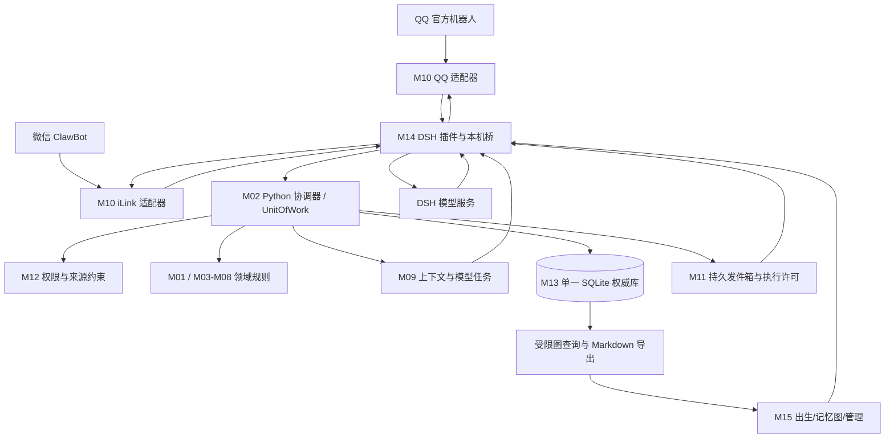

# LifeCore 生产插件架构与组件选型方案

日期：2026-11-01（Asia/Shanghai）

当前完整评审入口：[项目设计与开发前核对稿](2026-11-01-lifecore-complete-design.md)。该稿进一步统一普通 QQ、工作任务、四层记忆、工作段/压缩、预算和管理星图；本文保留为技术与研究依据，不混用其中已被整合稿明确修订的默认值。整合稿仍待维护者核对。

范围修订：用户随后明确要求自主社交、改头像/说说、刷视频、并行聊天与中断续做。请先读[自主生活与中断恢复修订](2026-11-01-autonomous-life-and-interruption.md)。该修订覆盖本文的聊天优先首版、官方QQ唯一主入口、B站/视频延期及自主活动范围建议；本文事务/存储/权限/恢复基础仍适用。不要把下文保留的旧范围建议当作最新产品目标。

状态：完整推荐定版稿，供维护者评审；不是已实现、已上线或已通过生产验收的声明。本文明确提出默认选择，不把这些选择冒充维护者逐项批准。无产品代码、依赖安装、账号绑定或外部发布操作。

依据：[第一版需求](../../requirements/v1-requirements.md)、[原架构](../../architecture/v1.md)、[记忆专项](../../architecture/modules/M04-M09-memory-system.md)。调研附件：[QQ与微信](../../architecture/references/2026-11-01-platform-research.md)、[3d-memory-sea源码审阅](../../architecture/references/2026-11-01-3d-memory-sea-review.md)。

## 1 推荐定版结论

采用一个 DSH 插件、一个插件托管的 Python 内核工作进程、一份权威生命数据库、多个可替换平台适配器。TypeScript 负责宿主/平台/UI；Python 负责所有生命领域规则、任务与正式状态提交。

内核基于 SeekMemory 的固定源码建立受控派生版本，复用 Source/Artifact、版本链、提取、召回、人格、关系和夜间整理的可用实现；新增 LifeCore 协调与事务入口，替换不满足要求的权限、任务、行动和恢复策略。不是直接安装两个各自自主回复的插件。

默认社交入口采用 QQ 官方机器人及 `@tencent-connect/qqbot-nodejs` 协议能力。微信采用腾讯官方 ClawBot/iLink 路线，把 `Tencent/openclaw-weixin` 的协议实现适配进 M10；不同时启动 OpenClaw 的第二套 Agent/记忆。普通 QQ 账号、普通微信号接管及任意微信群不属于默认交付承诺。

记忆采用 SQLite 事务存储 + 有类型的关系图 + 中文全文/语义混合召回 + 原文证据；管理页提供二维链接图和可切换三维视图，并能导出 Obsidian 兼容 Markdown。图是组织结构，SQLite 是存储，两者并不互斥。

### 1.1 对既有基线的显式修改

- 旧基线：生命核心全部运行在 DSH 插件进程内。新建议：插件拥有并管理一个本地 Python 子进程；不需要用户单独维护服务器，但不再是单进程。
- 旧文档固定 SnowLuma 的表述不再作为本方案默认选型；默认 QQ 官方 SDK，普通账号网关作为后续适配包。
- 旧文档只把 SeekMemory 视为记忆参考。本方案将它提升为受控复用内核，不能因此沿用其全部默认策略。
- 保持不变：单正式生命、持久 life_id、DSH 关闭停止活动、模型可替换、试聊隔离、跨场景隐私、动作回执、删除与恢复约束。

本方案获采纳后，应同步修改原架构/需求中的受影响条目；本次不悄悄覆盖已确认历史。

### 1.2 三种路线的取舍

| 路线 | 实际收益 | 实际代价 | 决策 |
| --- | --- | --- | --- |
| 全 TypeScript 自研内核 | 单语言、单进程更直接 | 重做提取、版本、召回、人格及回归测试 | 保留为托管进程不可行时的替代架构，不同时开发 |
| 直接组合现成 QQ/记忆/Agent 插件 | 演示最快 | 多个回复者、多个上下文和提交入口，难满足删除/权限/unknown | 不作为生产架构 |
| TypeScript 宿主 + 托管 Python 单权威内核 | 保留 SeekMemory 实现及测试，改造边界集中 | 双语言、进程打包、事务入口与策略改造 | 推荐 |

选择第三条有源码依据：SeekMemory 已有事务内部 Artifact 写原语及 Source/提取队列联合写入，可在它们上面建立 UnitOfWork；不是因为 README 功能多就假定无改造成本。G0/G1 必须验证这个复用切口。

## 2 组件清单：用什么，谁负责

| 组件 | 归属 | 决定 | 我们必须完成的集成 |
| --- | --- | --- | --- |
| DeepSeek Harness | M14 | 使用官方宿主；不 fork DSH | 生命周期、独立生成作用域、模型计划执行、取消和工具限制 |
| SeekMemory `ab0fd496…` | M03/M04/M06/M07/M08，部分 M09/M13 | 固定源码派生，保留许可证和上游测试 | 单事务入口、ACL、事实屏障、原文回查、删除闭包；禁旧独立 Runtime 并跑 |
| `@tencent-connect/qqbot-nodejs` | M10 | 首发 QQ 官方协议组件 | 接收归一化、能力探测、固定发送标识、回执；按需使用底层 API |
| `@tencent-connect/dsh-qqbot` | 研究参考 | 不与 LifeCore 同时自动回复 | 借鉴绑定与媒体体验；不继承其 Agent/历史/自动发送路径 |
| `Tencent/openclaw-weixin` | M10 | 复用官方 iLink 协议实现，开发 LifeCore 适配器 | 绑定、接收游标、context_token、client_id、媒体及异常；不依赖 OpenClaw 宿主运行 |
| NapCat / SnowLuma | M10 外部适配候选 | 不作为基础依赖，不捆绑 | 以后需要普通 QQ 时单独验证接口与许可，再开能力 |
| SQLite，Python `sqlite3` | M13 | 唯一权威数据库，单写入者 | WAL、同步持久策略、迁移、约束、备份与恢复；禁止共享网络盘 |
| SQLite FTS5 + jieba | M04/M13 | 中文词面索引 | 显式预分词、实体词典、短词/数字/昵称精确索引；不把 unicode61 当中文分词器 |
| FastEmbed + BAAI/bge-small-zh-v1.5 | M04，M13 保存派生向量 | 默认本地中文 embedding 基线 | 固定模型 revision/校验值，query/document 编码一致，分块和索引代次 |
| NumPy 精确向量检索 | M04/M13 | 首版在授权候选集合分批精确计算 | 不截断成最近若干条冒充全历史；规模与延迟发布前实测 |
| Cytoscape.js | M15 | 默认二维图 | 受限子图、时间筛选、证据展开、键盘/列表替代 |
| 3d-force-graph | M15 | 可选三维视图，首版功能内 | 只读投影、按需加载、节点上限、WebGL 不可用降级 |
| React + TypeScript + Vite | M15/M14 | 管理页面构建 | 接 DSH client bundle；不另建公网管理站点 |
| JSON Schema + Ajv/Python jsonschema | 跨进程契约 | 单一 schema 源，双端校验 | 版本协商、大小限制、幂等字段、结构化错误 |
| unittest / Vitest / Playwright | 测试工程 | 复用上游测试并补联合测试 | Python领域、TS适配器、真实管理流程与真实账号验收 |

不引入 Redis、Kafka、Neo4j、Qdrant 服务或另一套 LangChain/Agent 框架作为首版必需依赖。它们解决的规模/编排问题目前没有实测需求；后续只有数据量与查询门槛证明需要时才做单独迁移决策。FastEmbed 可以独立使用，不要求部署 Qdrant。

版本策略：上游源码依据锁到本次审阅提交；实际 npm/Python/模型发布组合在 G0 兼容构建中锁精确版本、hash、许可证和支持 OS，禁止依赖 `latest` 自动更新。尚无实机兼容结果，不能把研究快照冒充发布锁文件。

## 3 部署和权威边界



M 编号是逻辑职责，不是十五个微服务。Python 持有 life_id、Source/Artifact、人物、关系、人格、任务、Outbox 与权限版本；TS 只持有连接、运行时句柄和短暂传输缓存。SDK 的消息缓存不是生命记忆。

### 3.1 工作进程与桥接

- Windows x64 首发；构建使用 Python 3.12，Node 能力要求以真实 DSH 版本核验，SeekMemory 当前 DSH 包要求 Node >=22.16.0。不能因为开发机命令能跑就宣称宿主兼容。
- 发放经过 CI 构建的自包含内核运行包及校验清单，由插件私有运行目录启动；不修改系统 Python、不在用户首次聊天时临时 pip 安装。模型文件单独显示大小/用途后安装并验 hash，离线可导入同一工件。
- 首版沿用本机 loopback 契约形态并扩展，绑定 127.0.0.1 随机端口；启动时建立随机凭据和 instance/epoch，权限限制到当前系统用户。凭据不进入 UI、聊天或日志。代理仅允许插件持有的管理身份/操作范围，禁止任意跨域访问。
- HTTP 请求成功必须包含已提交结果；超时表示结果未知，用 request_id 查询/重试同一命令，而不是生成新命令。请求体、并发数和超时均有上限。
- 内核拿 OS 文件锁后才能写库；单写入队列，不跨模型/平台网络调用持有数据库事务；读查询使用一致快照。主库和删除清单都显式核验 `journal_mode=WAL`、`synchronous=FULL`、`foreign_keys=ON`，不能继承上游 NORMAL 后仍承诺相同断电持久性。UnitOfWork 只允许最外层提交，禁止嵌套 `with connection` 意外提前提交。
- DSH 关闭：停止新入站工作与执行许可，取消可取消的模型任务，保存状态，关闭连接和内核。内核崩溃：停止社交生成与发送，显示诊断；不以无记忆模式继续扮演正式生命。
- 10 分钟内最多自动重启 3 次，之后暂停等待管理操作；旧进程未退出/锁未释放不启动第二个写入者。恢复需要新 epoch，拒绝旧宿主回执发起新的发送。

### 3.2 模型桥

Python 创建持久 ModelTask，包含 task_id、life/workspace、scene、用途、允许材料、schema、预算、依赖版本和租约。TS 经 M14 领取，在独立 DSH 生成作用域执行，然后回交结构化结果。原有聊天会话不作为跨平台记忆或唯一身份。

ModelTask 同时绑定已获授权的 provider、实际 endpoint/目的地、model_id、路由配置版本和数据用途。TS 在最终网络请求前核对实际生效的路由与许可；DSH 热切换模型、改变端点或自动 fallback 会使原许可失效，必须重新经 M12 校验和申请。不能只在Python构造提示词时检查权限，再允许宿主把材料转到另一个服务商。不能确认实际目的地的宿主版本不进入支持矩阵。

回复、提取、人格整理是不同用途，使用各自上下文权限；共用已配置的 DSH provider 可以，但不混用历史。系统角色/私密记忆不能被网页或群消息中的指令修改。模型只有受限查询和行动提案工具，无任意 shell/数据库/平台发送能力。

## 4 各模块自研与复用清单

| 模块 | 复用内容 | LifeCore 负责开发的内容 |
| --- | --- | --- |
| M01 身份出生 | SeekMemory 人格 seed 校验/版本表示 | life_id、来源标注、并排隔离试聊、选择导入、幂等出生事务 |
| M02 协调器 | 事务内写原语、部分任务/追踪思想 | 唯一命令入口、UnitOfWork、版本校验、工作租约、运行状态、预算预留 |
| M03 事件经历 | Source 及来源关联 | 平台修订/去重、事实类别、发生与接收时间、episode、游标入账 |
| M04 记忆 | Artifact、证据/版本、图/BM25/预算算法 | 严格 ACL、中文混合召回、双时间事实、原文工具、纠错屏障、覆盖状态 |
| M05 情绪心境 | 记忆情绪标签只作输入参考 | 独立可持久状态、衰减、事件归因、表达约束与人工修正 |
| M06 关系 | 有证据的亲近度/关系阶段 | 跨平台身份核验、熟悉/信任/亲近分维、显式边界、撤销与重算 |
| M07 人格演化 | 初始设定/当前版本、证据聚合、回滚 | 独立证据判定、支持与反证、变化预算、隐私来源继承、删除后复核 |
| M08 自主承诺 | Dream 整理算法及部分注意力规则 | 持久承诺/目标、过期策略、时钟唤醒、主动活动开关、时段和额度 |
| M09 认知上下文 | 证据选择、上下文预算思想 | ContextPacket、实时新事实屏障、模型任务、有限原文回查、最终出站核验 |
| M10 平台 | QQ SDK、微信官方协议代码 | 平台专属适配器、能力声明、身份/事件归一化、媒体和回执转换 |
| M11 行动回执 | 审计记录结构可参考 | Durable Outbox、发送许可、unknown、逐分片回执、核对和恢复规则 |
| M12 权限 | 不沿用普通 private 的全局候选默认行为 | 授权判定、来源闭包、共享撤销、管理认证、模型与平台出站边界 |
| M13 存储恢复 | SQLite/部分 Source和Artifact写入实现 | 同事务多表提交、迁移、索引失效、独立删除清单、一致性备份及恢复隔离 |
| M14 DSH集成 | SeekMemory DSH 协议桥、官方插件示例 | 内核托管、单实例、模型计划/取消、能力探测、SDK凭据与适配器装配 |
| M15 管理 | 既有人格/记忆操作语义、图形库 | 出生试聊、时间线、图谱、证据解释、隐私/删除、连接、预算、恢复向导 |

复用规则：不得同时启用上游旧 Runtime、独立 Dream 定时器、独立 Management 写库接口和 LifeCore 协调器。原来会独立 commit 的服务要改为提案/事务内原语，只有 M02 可以开启正式写事务。用架构测试检查存储写入与发送调用的允许模块。

## 5 多平台：复用能力，不抹平差异

QQ 主路径采用官方机器人身份，首版含授权私聊和测试群文字；群默认仅被 @ 时回复，全量群观察是单独授权能力。官方平台新文档已有全量群事件及主动消息，但实际开关、额度和用户拒收以账号能力为准，不把 SDK 有方法等同于账号有权限。

微信主路径是 ClawBot/iLink 的独立机器人会话，不是接管用户本人的全部微信好友/群。它应与 QQ 共用生命内核，但必须单独通过账号、会话 token、回复窗口和真实收发验收。企业微信智能机器人/微信客服是不同账号体系和适配器，留作扩展；不把三者混成一个“微信支持”按钮。

### 5.1 统一契约

```text
InboundEvent:
  platform, account_id, external_event_id, revision,
  conversation_id, scene_kind, external_sender_id,
  event_time, received_time, content_parts, reply_context_ref

PlatformCapabilities:
  receive_private, receive_group, receive_unmentioned,
  reply, proactive_send, quote, recall, history, reconcile,
  media_types, message_size_limits, reply_deadline, rate_limits

ActionRequest:
  action_id, attempt_id, account_id, target, payload_ref,
  platform_request_key, expires_at, policy_version, recovery_epoch

ActionReceipt:
  action_id, status(succeeded/failed/unknown), platform_message_id,
  observed_at, failure_class, evidence_stage, evidence_ref
```

能力含 unknown/disabled 状态；窗口与限额可以由连接诊断更新。不支持的动作在规划和执行前均拒绝，不用“发普通文本”掩盖附件失败。平台 token 不进入通用事件正文或模型上下文。

life_id 代表生命；person_id 代表经核验的人；platform account/contact ID 代表平台身份；scene_id 代表私聊/群/公开空间；session_id 代表一次宿主运行。禁止以同昵称、同头像或模型猜测自动合并。

跨平台绑定由已认证管理入口发起，并通过两个渠道的短时验证码证明控制权；缺少某渠道时用明确人工确认并保留审计。绑定人物不等于共享全部私密内容。默认私聊记忆限定原场景，跨平台延续私密细节需用户显式授权；共享的人格/公开事实仍可连续。

同一输入的主平台回复只发回原会话；不默认 QQ、微信同时广播。未确认角色归属或发生凭据/账号变化时停止发送，不能悄悄换号继续。

## 6 记忆的存储、链接图与检索

### 6.1 三种东西分别负责什么

1. SQLite：保证原文、版本、任务、权限及动作记录的一致性。
2. 有类型的记忆图：表达“谁参与了哪次经历”“哪条证据支持某个事实”“哪条修订纠正旧值”。
3. Obsidian/三维图：让人浏览和理解这些关系；图上距离与颜色不构成事实证据或数据库索引。

3d-memory-sea 当前是状态管理/词面检索/Canvas 可视化原型。其原测试通过，并不覆盖我们所需的持久化、并发、权限和删除；额外复现发现未确认候选可以影响旧条目状态等边界。采用其“记忆可观察”的体验思路，不作为生产记忆底座、不直接复制其覆盖/激活规则。详见调研附件。

### 6.2 数据模型

主库按用途分表，概念字段在实现计划进一步展开，但下列约束必须保持：

| 表/记录组 | 作用与关键约束 |
| --- | --- |
| lives / birth_drafts / trial_workspaces | 单正式 life_id；试聊独立 namespace，无正式平台发送能力 |
| source_events / source_payloads | 外部身份+事件+修订唯一；原文与可删除载荷分离；来源类别与双时间保留 |
| entities / external_identities | 人/组织/地点/事物；平台身份映射有验证/撤销记录 |
| episodes / episode_members | 将多条原文组成一次经历，不能只凭同词或同一天合并 |
| artifacts / artifact_revisions / evidence_links | 事实/记忆/解释版本；source_revision可追踪；CAS；不得把模型解释当直接观察 |
| relations / relation_revisions | 人物关系及证据；与检索图边分开 |
| graph_edges | src/dst/type/provenance/confidence/valid_time/state；候选边不作为确认事实 |
| fact_claims / pending_fact_barriers | 主体+谓词+时效+来源；pending期间旧值不冒充当前，历史值可带时间查询 |
| affect / persona_revisions / commitments | 情绪、人格、承诺分别持有状态，不从一段总结反推全部状态 |
| grants / policies / source_constraints | 原场景权限和共享撤销；材料输出取全部来源允许范围的交集 |
| processing_jobs / model_tasks / extraction_coverage | 幂等键、lease、attempt、next_run、epoch、失败原因；原文覆盖有缺口可查 |
| outbox / action_attempts / receipts | 不与“模型说已发送”混淆；每个外部副作用有独立状态 |
| lexical_index / embeddings / index_generations | 可重建派生数据，带正文/ACL/模型代次，过期代次禁止使用 |

全局事务版本用于审计；回合采用实体/场景/权限等实际依赖版本，避免任意群的一次更新让所有私聊结果失效。正式写入一个 UnitOfWork，不由多模块分别提交数据库。

图节点为人、事件、事实、偏好、承诺、人格修订；边类型至少含 participated_in、supported_by、supersedes、contradicts、related_to。语义相近只能产生 related_to 候选，不能证明 participated_in 或因果。UI 必须显示来源、确认状态和时效。

### 6.3 写入与纠正

入站先验证来源和留存策略，再原子保存 source、去重标记、提取任务和需回复的回合任务；轮询型平台将整批 durable inbox 与新的接收游标在同一事务提交，提交后才确认批次。拒绝留存的事件只记无正文的已消费标记，不因重复拉取而反复处理。不能照搬 iLink 示例中先保存游标再逐条处理的顺序。平台若不支持历史/重放，断线期间只能显示已知缺口，不能宣称完整接收。

后台提取输出 schema 化候选，由规则检查主体、时间、来源、冲突和权限后提交。新输入在提取未完成时作为当前回合原文可见；明确更正立即建立事实屏障，对无法定位的变化采取相关当前事实保守隔离，不能继续断言旧值正确。提取失败保留任务与屏障，管理页显示积压。

压缩摘要不删除获准保存的原文。状态 superseded、forgotten 和隐私 deleted 含义不同：前两者保留可授权的历史；deleted 的内容不得参与检索、图或派生重建。旧文本再次出现是一条新事件，不能自动复活已删除记录。

### 6.4 召回流程

```text
可信 scene/person + 当前授权版本
  → 生成允许材料集合（先权限、删除、时效及来源闭包）
  → 中文词面/实体精确 + 本地语义 + 受限图邻居 + 时间/未完事项
  → 多路融合、去重、有效性与相关性筛选
  → 展开获准原文证据，区分历史事实与当前事实
  → 按 token 预算形成 ContextPacket
  → 模型出站前复核权限/删除/依赖版本
```

词面使用 jieba 预分词，并额外处理一/二字称呼、英文、数字、日期和精确短语；FTS5 trigram 不独自承担短词检索。检索 query 参数化并限制复杂度。

语义使用 FastEmbed 支持的 `BAAI/bge-small-zh-v1.5`（512维）作为本地低部署成本基线，不声称它是所有中文模型里效果最好。记录模型revision、归一化、分块策略；更换模型建新索引代次，不混算不同向量。完整目标包括语义召回，模型缺失只能显示降级，不算完整验收通过。

授权子集上分批 NumPy cosine 精确检索，先以 10万原始事件/2万派生记忆为发布负载测试基线；这些是测试规模，不是自动删除上限或已测容量。若超时，不任意缩到最近记录，应返回明确受限结果/异步深查。只有基准证明必要，才引入带硬过滤的 ANN 索引。

默认图扩展最多2跳、最多100条候选边；每一跳重新检查权限和时效；不能从私密中间节点推导公开关联。索引匹配不得先截取全局TopK再做ACL。各路结果都保留命中原因；无关高重要度记忆不得挤占当前问题。

ContextPacket 的记忆正文初始预算6000 token；模型总输入预算受provider上下文限制。优先保证当前消息、身份边界、当前状态和明确相关原文；任一条超长也不得突破硬预算，可裁剪并保留精确片段位置。最多2次受限原文回查，不循环自由搜全库。

### 6.5 Obsidian 与图界面

管理页提供时间线、二维局部图、三维局部图三种视图，统一受限查询API。每次最多500节点、1500边，可筛人/事件/时间并分页展开；大量记录不一次送进浏览器。

导出目录使用稳定ID文件名、frontmatter与 `[[ID]]` 双向链接，内容仅含该次授权材料、来源和版本；支持 Obsidian 打开，但不要求安装 Obsidian。初版是单向导出：用户修改Markdown后，若要导入，只进入变更草案，经审阅/CAS提交，绝不以文件监控自动覆盖正式库。

导出是独立副本，不自动云同步；受管理导出记录manifest供删除提示/清理。用户自行复制到外部的副本无法由插件保证撤回。视图坐标、镜头、主题独立存储为UI偏好，不影响记忆真伪和重要度。

## 7 情绪、关系、人格与自主活动默认规则

下列数值是可版本化的工程起点，必须经合成回放和用户体验评估，不是经过验证的心理学模型。

- 情绪：valence[-1,1]、arousal[0,1]、tension[0,1]；心境独立使用相同维度。按显式时间向中性基线衰减，情绪半衰期30分钟、心境12小时；每事件增量绝对值≤0.2并夹紧；回拨时间dt取0。离线只允许数学衰减，不生成新经历。
- 关系：熟悉/信任/亲近分别0–1，边界为显式规则集合而非好感分。初值由出生已确认关系或中性未知态给出；独立事件驱动并保留反证。身份/亲密不扩大权限。
- 人格：初始原稿永久独立；首版自动演化只开偏好与习惯，核心价值/边界自动改写关闭。初始门槛为至少3次独立经历、跨至少2个日期、包含反证检查；每日最多1项受限修订，可解释、可回滚。
- Dream：每天本地03:30检查一次；宿主关闭则下次启动只补一次维护，不补社交动作。每轮最多12次模型调用、总输入输出60000 token；任务可恢复；维护与实时对话分优先级。
- 承诺：proposed/accepted/scheduled/in_progress/completed/failed/cancelled/expired。完成须有实际结果或人工确认；“我会做/我做完了”的生成文字不能自行证明外部动作。
- 主动联想默认关闭，可独立开启；社交主动发送默认关闭。用户授权某渠道后，默认静默时段22:00–09:00、每对象每天最多2次主动尝试；必须同时满足平台当前窗口/额度，不能用配置绕过平台限制。
- 实时模型并发2、后台整理并发1；同场景同一有效生成任务。每回合最多1次主生成、1次结构修复，另有最多2次只读证据回查。每日模型总token初始上限200000，预算预留原子化；人民币成本只有配置provider价格后才显示，不能把token估算冒充账单。

默认值可以在管理页调整；隐私和主动发送开关需独立明确操作，不能被人格成长或模型工具修改。

## 8 动作执行、重启与一致性

Outbox 状态：proposed → ready → sending → succeeded / failed / unknown；另有 cancelled/expired。所有外部副作用必须经M11，SDK内置自动回复、工具直发、errorHandler自动发错误等路径不得绕过它。

此处 succeeded 仅表示适配器获得平台接口成功接受请求的可靠证据；不自动表示送达或已读。Receipt 另记 evidence_stage=accepted/delivered/read（只记录平台实际证明的阶段），异步失败事件继续追加并更新投递结果。M08 的每类承诺声明完成所需证据：如“提交发送”可接受 accepted，“对方收到/确认”则需要相应凭据或明确人工确认。管理页不能把接口接受渲染成用户已读。

1. M02 原子提交回复候选、相关状态变化及 Outbox；未提交不能发送。
2. M11 在新事务内核验场景/政策/版本/期限，预留额度，保存稳定平台请求键和 sending 状态，再发给TS适配器。
3. TS收到执行许可后再次核验当前epoch与取消状态，只执行一次该许可；不可把通用HTTP重试直接用于发送。
4. 回执关联action_id保存；平台超时/连接中断不能证明未发送，归 unknown。若平台提供可靠幂等或查询依据才自动核对/重试，否则停留unknown供管理核查。
5. 分块消息每块子action有自己的发送键与状态；不能部分成功后重发整段。附件上传与实际发送分开记录，上传成功不代表用户已收到。
6. 重启时 sending 进入核对；备份恢复产生新epoch并冻结所有旧待发动作。仅正常未执行、未过期、授权仍有效的任务可重新领取。

QQ 的 msg_id/msg_seq 以及微信 client_id/context_token 按平台适配器规则处理：在 Outbox 持久保存后使用低层API，禁止在每次重试时重新生成随机标识。稳定请求ID可以帮助关联，不代表远端保证幂等；要以实测/官方契约证明。不得承诺跨任意平台的严格 exactly-once。许可签发后的暂停/删除与网络发送存在竞争窗口；能阻止尚未越过发送边界的操作，已交给外部平台的请求只能核对/尝试撤回，不承诺消除已经发送的内容。

## 9 隐私、删除、备份与恢复

- 默认保留已授权私聊的原始文字，用户在启用渠道时看到留存范围；不因摘要或重要度低自动删除。群观察另开，并配置群留存策略。试聊草案默认30天无活动后提示清理，未获确认不自动转入正式生命。
- 原文、摘要、向量、图边、人格依据和日志均继承来源限制；推导结果取来源允许范围交集。公开人格不直接混入私聊形成的未经审核特征。用户可以另行确认可共享的抽象修订，模型不得自作主张去密。
- 管理 UI 有独立认证和防跨站请求，社交会话默认无管理权。远端模型只能接收被授权材料；本地embedding不等于全部数据都不出机。
- 普通日志无聊天正文/平台token；完整模型请求仅在明确诊断授权下短期保存并进入相同删除闭包。默认保留结构化日志7天、诊断正文默认不开。
- 宿主自己的会话数据库、LLM trace、工具日志和历史压缩副本同样纳入清单；G0 必须检查最终provider请求及实际磁盘产物，证明可以禁用不必要的正文持久化或按关联ID定点删除，不能把dispose句柄等同删除数据。宿主做不到时关闭受影响的私密场景/功能并阻止相应完整版本发布。远端模型提供方留存不由插件直接控制，启用该端点时必须展示其数据处理边界，不承诺远端副本已由本机删除。
- 删除先持久追加到不随生命备份回滚的 `privacy-ledger.sqlite`（独立保护目录、单写入者）；成功后主库做tombstone、撤销任务/索引/缓存并重算受影响派生物。这是跨库分阶段协议，不能声称单个SQLite事务覆盖两库。每次启动和读取前检查删除水位，未完成操作阻止受影响读取/发送；崩溃后幂等重做。
- 完整删除清理原文载荷、派生文本/向量/图、附件、模型任务正文、Outbox正文、宿主上下文及受管理导出。保留不含原文/可识别原因的必要事件外壳。SQLite secure_delete、FTS删除与checkpoint/空间整理需测试；不承诺抹除SSD、操作系统快照或用户外部副本。
- 每日在线备份、每次迁移前备份；默认保留7个日快照和4个周快照。用SQLite backup API生成一致快照，配附件manifest与hash；不能只复制正在WAL写入的主db文件。
- 备份目标分两类：默认本机独立目录仅保护误改/逻辑损坏，不算抗整盘故障；只有用户配置另一物理磁盘或已验证的异机备份目的地，并同步备份主库、附件和最新删除清单后，才显示“已启用磁盘灾难恢复”。同盘不同分区不算独立故障域；外部目的地不可达时保留失败状态、告知最近成功时间，不显示受保护。初版不默认上传云端。
- 旧备份恢复先加载当前独立删除清单、校验备份/迁移、应用删除闭包、重建必要索引、换epoch并冻结旧Outbox，然后才开放模型和平台。缺最新删除清单/证明时进入隔离恢复，不把旧备份直接联网。
- 删除清单本身需要独立备份与可验证水位；若整机及所有最新清单都丢失，无法凭旧数据推知后来的删除，此时只能离线隔离恢复并明确限制。
- 本机凭据使用OS保护能力或严格用户ACL的秘密存储，备份不带明文平台密钥。数据库不冒称默认全盘加密；对磁盘失窃场景推荐系统卷加密，导出备份提供加密选项并单独验收。

目标：已返回“已保存”的事务在支持持久写的本机故障测试下不丢失；仅在启用上述独立故障域备份且最近成功时间/最新删除清单均满足条件时，磁盘整体损毁的RPO目标为≤24小时。未配置异盘备份不作此承诺。10万事件数据的恢复目标≤15分钟，须在登记的基准机器上验证后才可对外承诺。

## 10 完整首版范围与默认决策

| 原待决项 | 本次明确建议 |
| --- | --- |
| D01 入口 | DSH管理/试聊 + QQ官方私聊；QQ测试群、微信ClawBot作为完整多入口版本的联合验收项 |
| D02 群/B站 | QQ授权群纳入；B站先仅留受限读取接口，评论/私信/发布另版，不宣传首版可用 |
| D03 预设 | 两个原创可编辑预设：温和陪伴、直率活泼；空白起点；正式大肥鱼设定由用户确认，不替用户编造出生历史 |
| D04–D07 状态/成长/自主 | 按第7节运行默认值；核心人格自动改写与主动外发默认关 |
| D08 留存恢复 | 按第9节；原文按授权保存，删除独立清单，备份/恢复门槛明确 |
| D09 联想 | 默认关，独立持久开关，不等于主动私信许可 |
| D10 模型预算 | DSH已配置且用户确认可出站的provider；回复与整理可共模型，本地embedding；具体远端模型ID在部署页选择，不硬编码未知账号可用模型 |
| D11 媒体 | 首版文字完整；图片/文件保留类型与缺失状态，图片理解可选扩展；语音/视频理解不冒充已支持 |
| D12 质量 | 按第12节，先冻结样本和评分，再调参，未通过不称生产版 |
| D13 运行 | Windows x64首发；DSH托管Python进程、SQLite本机盘；macOS/Linux在独立CI实机通过后进入支持矩阵 |
| D14 UI | 出生并排试聊、聊天诊断、状态/关系、时间线与2D/3D记忆图、证据、纠正删除、平台/权限、预算、备份恢复 |
| D15 分发 | 推荐LifeCore自有代码MIT；第三方保留原声明与NOTICE，先做依赖/模型许可清单，不自动发布或替仓库直接添加已批准LICENSE |

用户账号、密钥、正式出生文案不是能靠调研替用户决定的内容。其他工程默认值本文已给出；部署时输入这些个人材料不代表架构仍未定。

## 11 建议代码组织与开发交付顺序

```text
packages/dsh-plugin/          # M14 生命周期、管理代理、模型执行
packages/platform-qq/         # M10 官方QQ
packages/platform-weixin/     # M10 iLink协议适配
packages/admin-ui/            # M15 React页面、2D/3D视图
contracts/                    # 权威JSON Schema、生成类型、契约样例
kernel/lifecore/application/   # M02 UoW、用例、租约调度
kernel/lifecore/domain/        # M01、M03-M08、M12
kernel/lifecore/cognition/     # M09 ContextPacket和模型任务
kernel/lifecore/actions/       # M11 Outbox与核对
kernel/lifecore/storage/       # M13 SQLite、迁移、索引、删除与备份
kernel/vendor/seekmemory/     # 固定上游来源、最小受控改造和补丁记录
tests/contracts|faults|e2e|memory-eval/
release/                      # 自包含内核构建、SBOM、签名/哈希、兼容矩阵
```

以上是拟创建目录，不表示已经存在。上游修复按差异审阅挑选合入，不自动跟随main；尽量把LifeCore策略放独立层，必须修改vendor时记录原始SHA与补丁理由。

| 阶段 | 可检查的交付物 | 出口门槛 |
| --- | --- | --- |
| G0 集成风险验证 | DSH→托管内核→模型→QQ回执最小链；iLink真实绑定/回复；打包/卸载 | 固定版本、干净机器启动；实际模型目的地可核验且无未授权fallback；宿主正文持久物可禁用/清理；每输入只有一个回复者；UoW复用原语确认；失败写明原因，不继续堆功能 |
| G1 数据可靠性 | Source/任务联合事务、租约、版本、Outbox、删除清单/恢复原型 | 崩溃注入、重复投递、满盘、unknown与旧备份恢复测试通过 |
| G2 出生与权限 | life_id、草案/试聊、导入、跨场景ACL、管理认证 | 试聊不污染正式、重复确认单出生、未授权材料不可进入候选/请求 |
| G3 完整记忆 | 原文/事实/经历/图、中文全文与语义、纠错屏障、索引重建 | 中文冻结集达标；删除/更正传播到所有视图；模型停机仍保留原文和任务 |
| G4 连续生命 | 情绪/关系/人格/承诺/Dream | 固定证据回放稳定、反证/撤销可解释；任务真实结果驱动承诺 |
| G5 多平台与管理 | QQ/微信共用life_id、绑定、全部管理页、图与导出 | 真实账号隔离/窗口/过期/token失效/断线测试；共享身份不泄露私密 |
| G6 发布候选 | 更新迁移、回滚、备份演练、负载与真实模型试用 | 第12节全部门槛通过；文档/许可证/成本/恢复指南齐备 |

每阶段都产出可运行闭环和测试证据；不先做十五个空接口再补核心可靠性。工期只能在G0测得托管/平台/事务改造工作量后估算，不能从现有代码行数给出虚假的复用百分比。

## 12 生产验收门槛

“生产级”在本项目指单机单生命、受控私聊/授权群和官方微信机器人范围内的可靠发布，不代表多租户云服务或无人值守无限自主系统。

| 类别 | 必须证明的条件 |
| --- | --- |
| 生命周期 | 干净Windows环境安装、DSH重载/关闭、子进程崩溃、残留锁、升级失败均可诊断；不重新出生 |
| 事务/并发 | 接收提交前后、任务领取、模型回交、发送前后各断点故障；重复事件无重复状态效果，迟到结果不覆盖新版本 |
| 权限 | 私聊/群/试聊/两个同名人物/跨平台绑定/撤销/图查询/导出/模型出站的负例全部阻断；任何泄露样例阻止发布 |
| 纠错删除 | 整理暂停时新事实不被旧值覆盖；删除来源后摘要/向量/图/人格理由/宿主上下文不可复活；旧备份恢复全过程离线 |
| 平台 | QQ私聊与授权测试群、微信ClawBot真实账号通过；主动功能仅在有权限/有效窗口时测；发送超时不盲目重试 |
| 检索质量 | 冻结至少200条中文问题，覆盖精确/同义/跨轮/时间/纠错/无答案/权限；可回答集Recall@10≥90%，最终证据支持率≥95%，无答案拒答准确率≥90%；隐私失败0。阈值为目标，非已有成绩 |
| 生成与成长 | 使用真实选定模型评审至少50段多轮案例，区分记忆命中与回答使用；重复/自我反思不制造新成长证据；合成90天测试不得宣传真实90天效果 |
| 性能 | 在登记CPU/RAM/磁盘与模型的机器，10万事件/2万派生记忆：本地接收提交p95≤100ms、暖态混合召回p95≤1s（不含远端LLM/平台）；并发2场景持续负载无无界积压。未达标调整范围或实现，不修改统计口径 |
| 稳定性 | 至少72小时本机混合负载/反复重启运行及7天受控真实试用，无已知数据丢失、隐私越界、重复发送缺陷；不以此证明长期人格质量 |
| 可恢复 | 真实备份恢复及迁移失败回滚演练，恢复数据/删除水位/Outbox状态均可对照；缺最新删除清单只能隔离恢复 |
| 供应链 | 精确依赖锁、上游SHA、模型hash、SBOM/NOTICE、可重复构建步骤、已知漏洞处置和支持矩阵；不同许可组件不混写成全部MIT |

验收报告逐条关联原需求E01–E14及具体构建版本；QQ/微信凭据在用户授权的测试环境配置，本次调研不包含真实平台验收。

## 13 证据与限制

### 本次已有证据

- SeekMemory：本轮前已固定 `ab0fd496a8d569c4734d73c47d8f96aec5b77d04` 阅读关键源码；Python单元41文件420项首次有一项Windows编码错误，设置UTF-8后该文件4项复跑通过；另62项重点测试通过。DSH真实Python桥接测试通过；完整Node测试存在两项临时目录清理失败。不是LifeCore整体测试结果。
- 3d-memory-sea：固定 `bcc1bb6b7e9e8b3dc4cf16b649a94445c8b6f25f`；42项原测试通过，另有小样例复现边界缺陷；未运行真实长期记忆系统。
- QQ/微信：官方文档和固定源码审阅；未以真实账号跑完本方案收发/恢复测试。SDK能力、文档声明、账号开放权限、LifeCore已验收能力是四件不同的事。
- 图和本地embedding：已核实官方文档中的职责/模型支持，尚未在LifeCore整合与测效；具体效果由G3证明。

### 一手来源

1. [SeekMemory架构](https://github.com/NeverENG/SeekMemory/blob/ab0fd496a8d569c4734d73c47d8f96aec5b77d04/docs/zh/architecture/overview.md)、[DSH适配器](https://github.com/NeverENG/SeekMemory/blob/ab0fd496a8d569c4734d73c47d8f96aec5b77d04/adapters/dsh/README.md)、[事务写入](https://github.com/NeverENG/SeekMemory/blob/ab0fd496a8d569c4734d73c47d8f96aec5b77d04/store/artifacts.py)、[动作执行](https://github.com/NeverENG/SeekMemory/blob/ab0fd496a8d569c4734d73c47d8f96aec5b77d04/app/runtime/actions.py)、[范围过滤](https://github.com/NeverENG/SeekMemory/blob/ab0fd496a8d569c4734d73c47d8f96aec5b77d04/recall/scope.py)。
2. [3d-memory-sea固定源码](https://github.com/asdfd3/3d-memory-sea/tree/bcc1bb6b7e9e8b3dc4cf16b649a94445c8b6f25f)。
3. [QQ官方SDK](https://github.com/tencent-connect/qqbot-nodejs)、[QQ官方DSH插件](https://github.com/tencent-connect/dsh-qqbot)、[微信官方插件源码](https://github.com/Tencent/openclaw-weixin)。详细固定提交和能力证据在平台附件。
4. [SQLite适用场景](https://www.sqlite.org/whentouse.html)、[FTS5](https://www.sqlite.org/fts5.html)、[Online Backup](https://www.sqlite.org/backup.html)。
5. [Obsidian图视图](https://obsidian.md/help/plugins/graph)、[Cytoscape.js](https://js.cytoscape.org/)、[3d-force-graph](https://github.com/vasturiano/3d-force-graph)。
6. [FastEmbed官方支持模型](https://qdrant.tech/documentation/embeddings/fastembed/)、[BAAI模型卡](https://huggingface.co/BAAI/bge-small-zh-v1.5)、[jieba源码](https://github.com/fxsjy/jieba)。

目前可确定的是推荐架构、职责、组件路线、开发范围与验收办法；尚不能确定的是未测试的兼容组合已经可用、真实模型达到质量门槛、平台账号拥有全部权限。实现必须用证据关闭这些发布门槛，不能用“生产级方案”这几个字代替验证。

### 设计审阅记录

2026-11-01 独立 builder review 认为本稿可拆为 G0–G6 实施任务，指出备份故障域、实际模型目的地、宿主持久副本及发送证据语义四项需要明确。作者已分别补入第9节、第3.2节/G0、第9节/G0和第8节。此记录证明方案经过独立审阅和修订，不证明产品实现通过相应测试。
