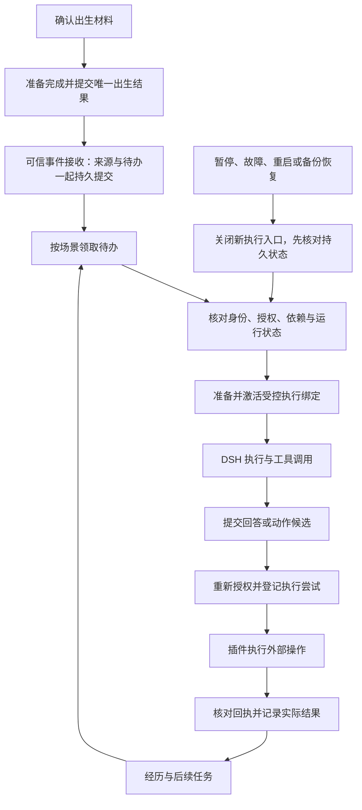

# LifeCore 设计梳理 03：出生、接收、绑定、授权、回执与恢复

日期：2026-11-02（Asia/Shanghai）。状态：P2 共同契约建议稿；先设计，不开发。

承接：[01 基线](2026-11-02-design-baseline-and-responsibilities.md)、[02 总体职责与数据归属](2026-11-02-runtime-and-data-ownership.md)。本文以 02 推荐的“统一生命规则、DSH 执行、插件提供能力”为设计前提；用户继续梳理不表示全部技术选择已批准。本文给出逻辑对象、操作契约、状态和提交边界，不是已存在 API、数据库迁移或实现计划。

主要责任：M01 身份、M02 协调、M03 事件、M11 动作、M12 授权、M13 存储、M14 宿主；M04/M06/M07/M08/M09/M10/M15 分别参与记忆、关系、人格、任务、上下文、平台和界面。失败用例与需求映射见[共同契约验收表](2026-11-02-common-contracts-acceptance.md)。

后续应用：[04 记忆与上下文复用评估](2026-11-02-memory-context-reuse-design.md)已据此核对候选组件，结论为静态适配建议，未安装或开发。

## 1 六条流程连成什么闭环

图中回执和维护结果只推进已有工作，不自动产生新的聊天回复。可信新消息、自主活动触发和管理命令分别有明确路由。

整个系统只承诺已验证的本地提交与去重语义。平台是否重放、是否有端到端确认、是否支持发送幂等属于适配器能力；不能笼统承诺外部动作严格一次。

## 2 所有流程共同遵守的约束

| 编号 | 约束 |
| --- | --- |
| K01 | 一个正式生命槽只能提交一个出生结果；执行 Agent 和模型更换不改变 life_id。 |
| K02 | 先持久保存所承诺的结果及后续待办，再对调用方确认；内存入队或日志打印不是提交。 |
| K03 | 同一请求键绑定同一操作和相同规范化业务载荷；相同键换载荷必须报冲突，不能复用旧成功响应。 |
| K04 | 可信主体、场景、权限、版本由认证入口产生，不能直接采用聊天正文或模型参数中的自称。 |
| K05 | 原始事实、解释、意图、执行尝试、实际结果分别存储/标记；发送成功不表示对方已读。 |
| K06 | 读数据、模型出站、工具执行、社交发送是不同授权检查；新许可不自动授权旧未知动作重试。 |
| K07 | 租约只决定当前处理者，过期不证明旧外部操作未发生；新处理者必须核对旧尝试。 |
| K08 | 版本检查针对实际依赖。身份修订、撤权、删除和绑定更换阻断受影响旧结果，不因无关新消息取消全系统。 |
| K09 | 真实晚到回执仍可记账，但旧执行者不能创建新动作、继续任务或凭回执恢复已取消目标。 |
| K10 | 物理跨库写入不能假装一个事务；必须有持久意图、受限准备区、幂等同步和恢复核对。 |
| K11 | 恢复先处理最新删除/撤销和旧动作，再开放历史读取与新执行；不能自动创建空白生命修复故障。 |
| K12 | 暂停与删除的完成程度如实展示；无法撤回的外部效果、在途费用和未清理副本不能被显示成已经消失。 |

## 3 共同标识、版本与返回语义

### 3.1 逻辑对象

以下为建议的语义名，具体语言类型、序列化格式和表名待实现规划；ID 均视为不透明标识，平台大整数不得损失精度。

| 对象 | 必须携带或关联的内容 | 谁产生/校验 |
| --- | --- | --- |
| 请求 | request_id、操作种类、可信调用者、业务载荷摘要、期望版本、关联追踪 ID | 认证入口＋M02；摘要不包含凭据，不用对外公开 hash 暴露敏感原文 |
| 生命/试聊 | life_id 或隔离 trial_id、草案修订、正式出生提交引用 | M01；正式提交前无可用正式生命资格 |
| 事件 | event_id、来源命名空间/账号/事件 ID/修订、主体、场景、发生与接收时间、材料类别、保留范围 | M10 提供可靠来源，M03 规范，M02/M13 去重提交 |
| 处理工作 | job_id、触发事件/目的、场景序号、当前状态、依赖版本、租约/处理者、尝试记录 | M02；同一事件和处理目的有稳定逻辑键 |
| 执行绑定 | binding_id、场景/分支或任务、DSH 标识、绑定代次、能力清单、当前状态 | M14 准备，M02 提交有效指向 |
| 运行代次 | incarnation、restore_generation | M13 管理；新进程身份不沿用旧备份中的在途令牌，恢复代次只在备份恢复等谱系切换时改变 |
| 授权 | policy_revision、grant_id/版本、主体、对象、能力、账号/目的地、数据范围、期限、额度 | M12 定义，M02/M13 持久提交 |
| 动作/尝试 | action_id、内容版本、目的地、逻辑效果键、attempt_id、许可、执行标记、实际回执 | M11；模型不能指定一个别人的 action_id 获取执行资格 |
| 删除/撤销屏障 | 删除或撤销操作 ID、单调水位、影响范围、应用进度及恢复证明 | M12/M13；普通恢复不能覆盖其最新状态 |

来源命名空间覆盖平台、接入账号及平台 ID 的有效范围，不使用每次 WebSocket 重连编号作为消息身份。平台真的重置 ID 空间时另记来源谱系；没有稳定来源 ID 的能力必须明确有限去重保证，不能以正文相同自动去重。

请求键/效果键的保留策略不能任意早于允许重放的窗口；ID 壳与被删除正文分离。精确保留期限以后确定，但清理必须保留必要去重/抑制证据，不能删除正文后又接受重送重建它。

### 3.2 返回和错误语义

| 结果 | 调用方可以据此说什么 | 不代表什么 |
| --- | --- | --- |
| accepted | 指定内容和必要待办已持久接收，返回事件/工作标识和当前状态 | 已生成回复、已理解、已发送 |
| committed | 该业务状态已按确认版本提交，可按请求 ID 查询 | 所有异步派生索引已就绪 |
| duplicate | 相同业务请求/来源已存在，返回同一标识及最新处理状态 | 重新触发同一回复或成长 |
| pending / blocked | 受理的工作尚在等待/受阻；说明阶段、可见原因及恢复条件 | 成功或丢弃 |
| conflict / stale | 请求键载荷冲突或依赖版本已过期，未提交这次变更 | 可换个请求 ID 绕过唯一性 |
| denied | 当前可信主体不具备所需许可 | 数据不存在；向未授权调用方的原因也不能泄漏私密细节 |
| unavailable | 无法确认权限、数据或依赖是否可用，停止相关操作 | 没有历史、许可已获得 |
| outcome_unknown | 已无法证明外部效果有没有发生，需要核对 | 未发送、失败、可立即重试 |

错误结果应有阶段、稳定原因类别、可否重试及既有结果查询入口。重试标识由可信服务给出；一般异常、HTTP 错误或超时本身不是写动作可重试证明。状态查询经过与原业务相匹配的权限检查，不泄漏其他人的请求。

## 4 契约一：出生与初始导入

### 4.1 输入与职责

M15 发送经认证的确认请求，包含最终草案版本、用户看到的确认材料清单、选中的记忆版本与来源、独立确认的关系、预期“尚未出生”状态及 request_id。两个预设和空白设定均只是起点。模型的建议必须在用户确认前展示；确认后不再生成替代人格。

M01 校验档案，M04/M06 校验选中导入，M12 校验保留与可见范围，M02/M13 组织准备与提交，M14 只负责试聊/执行隔离。

### 4.2 出生状态与提交点

`draft → preparing → prepared → committed`。提交前可变为 `needs_review / blocked / cancelled`；committed 之后只能进行管理修订，不能撤回到未出生并重用槽位。出生状态与运行状态分开：已经出生但依赖故障时显示“已出生，恢复受阻”。

| 步骤 | 行为 | 持久结果与失败处理 |
| --- | --- | --- |
| B1 核对最终版本 | 检查草案、导入选择、关系复核、来源未删除及授权未撤销 | 版本不符返回 stale/needs_review，保留用户可复核材料；不默默换成最新版 |
| B2 锁定准备请求 | 在唯一生命槽保留 birth_operation，绑定请求键和确认材料清单 | 并发确认只有一个准备所有者；相同请求查询进度，不同内容不能覆盖准备中的版本 |
| B3 准备初始材料 | 将最终出生原稿、选中初始记忆与关系的不可变确认快照、来源、目标后端及校验信息持久保管 | 本确认快照属于出生依据，不是另一套可编辑当前记忆；未选中试聊不进入清单 |
| B4 准备后端 | 需要外部记忆/关系组件时，以出生操作 ID 幂等导入受限准备区，校验持久结果与引用 | 准备区禁止正式召回、自动成长、夜巡跨区读取和外发；不可实现此隔离的后端不能用于本出生方案 |
| B5 唯一提交 | 再核对来源/授权/确认版本；在 LifeCore 控制存储原子提交 life_id、出生时间、档案与初始人格版本、导入清单引用、birth committed 结果及后续通知待办 | **这是正式出生成功点**。全部必需初始材料必须已持久准备并有可核查引用，不要求可重建索引全部完成 |
| B6 开放正式使用 | 读取端以已提交出生清单授予正式范围；幂等补齐后端投影、管理显示与执行绑定 | 后续激活/索引失败显示已出生但相关功能受阻；不能删除 life_id 或再次出生 |

本方案采用“受限准备＋单一出生清单提交”实现逻辑上整体可见，**不宣称多个数据库原子提交**。外部后端只能通过已确认清单暴露初始数据；无法阻止其自动暴露准备数据时，这条复用路线不满足契约。

### 4.3 修改、取消、断线与恢复

- preparing 期间修改草案会使旧确认版本失效。完成旧准备后也不能自动提交；转 needs_review，重新确认后开始新操作，旧准备引用可按规则回收。
- committed 前取消，先持久记录取消并使所有晚到准备结果不可激活，再清理准备副本；不删除仍需保留的原试聊。清理失败显示待清理，仍不算出生。
- 点击确认后客户端断线，使用同一 request_id 查询；若 B5 已提交就返回同一 life_id，不再次创建；不同键重复确认也必须被唯一生命槽拒绝。
- B4 后崩溃，恢复核查准备区和确认清单；版本仍有效才继续同一请求，不重新调用模型生成材料。
- B5 后后端数据丢失，使用确认快照与来源规则进行恢复或进入受阻状态；删除/撤销优先，不能从出生快照恢复已删除内容。
- 初始材料统一标“出生时确认导入”，不伪装成正式出生后的亲历，不自动累计自然成长证据。

## 5 契约二：可信事件接收与持久待办

### 5.1 事件入口与路由

| 入口 | 可信依据 | 默认后续用途 |
| --- | --- | --- |
| 平台消息/编辑/撤回 | 已核验接入账号、可靠发送者和来源 ID | 依路由产生回复或修订工作；引用和转发保留真实来源类别 |
| 视频/工具观察 | 已授权调用及其执行关联 | 记录观察、推进活动；不自动当用户新消息 |
| 模型候选 | 当前有效绑定和工作尝试 | 候选校验；不能自授权限或证明外部完成 |
| 动作回执 | 已登记尝试、适配器核验的外部结果 | 更新同一动作、形成结果事件；不再次触发对话回复 |
| 管理命令 | 认证管理主体和允许的操作 | 走专门命令契约；不是普通聊天文本解析出的管理员身份 |
| 时钟/后台唤醒/导入 | 受管调度器或导入操作 ID、任务版本 | 只推进已授权目的；历史导入默认不回复、不重放动作、不重复成长 |

外发消息被平台回显时，优先通过自己的账号、平台消息 ID 和 action 关联识别为同一已发结果。无法确定归属时进入核对，不用正文相同去重，也不让回显触发自我回复循环。

### 5.2 接收流程与确认点

1. **入口检查**：M10/M14 验证载荷格式、大小、来源账号与可接受事件种类；M12 判断能否保留及处理。禁止留存材料在进入普通账本前脱敏或丢弃，只记必要的不含正文的结果。
2. **来源规范化**：M03 确定规范主体/场景、源事件/修订键、观察或陈述类别、实际时间与可得附件状态。可信接收顺序与平台发生时间分别记录；晚到事件不插队覆盖当前事实。
3. **原子接收**：M02/M13 在一个可核验提交单元中保存获准原文或已持久的来源引用、规范事件、去重记录、场景接收序号、整理待办，以及需回复时的处理工作。无需回复也保存明确 skip_reason。
4. **提交后确认**：成功后返回 accepted 和 event_id/job_id；支持上游确认的适配器此后才确认，支持重放的来源记录连续游标。没有确认/重放能力的平台需显示接收保障边界。
5. **领取处理**：持久调度器按场景顺序领取待办，内存通知仅作加速；重启或周期核对仍能找回提交后尚未通知的工作。

如果来源存储在外部后端，接收事务只能引用已经耐久保存、版本固定且满足保留约束的材料；若无法把关键来源与待办可靠关联，就先保存获准接收快照，或不返回 accepted，不能先确认后补原文。

附件可以处于明确缺失/待下载状态，但不能确认“完整附件已保存”。后续附件到达形成可追溯补充，不改变已经确认接收的文字含义。

### 5.3 重复、冲突、暂停与积压

- 同一来源键/修订及相同载荷返回原 event_id 和已有工作状态；既有 pending job 继续由调度器恢复，不另建回复。
- 相同来源键/修订出现不同载荷属于 conflict；隔离待核对，不静默覆盖正文。合法编辑必须形成新修订并使相关旧候选失效。
- 同文字、不同平台消息 ID 是不同事件。未提供稳定 ID 的来源保留不确定性，不能宣传完全去重。
- 在 paused 状态，接收与回执通道可继续保存允许材料，但新回复/活动工作停放；如果源策略禁止留存则仍拒绝。恢复时显示积压，由既定时效规则处理，不无条件补答全部旧消息。
- 处理工作可为 `pending / leased / waiting / completed / cancelled / skipped / failed`；waiting 必须有原因和唤醒条件，failed 保留诊断。accepted 承诺可靠受理与可查处置，不承诺所有内容都必须生成回答。
- 消息更正/删除到来后，相关工作重新核对依赖；已经发送的历史结果记录仍保留实际发生性质，不能假装从未发送。
- 接收提交失败不确认成功；上游自动确认或无重放时无法保证补回，必须显示可能缺口。满盘不能通过悄悄丢原文维持“已记住”。

## 6 契约三：执行绑定与工作投递

### 6.1 状态和唯一有效绑定

绑定状态建议为 `preparing → active → draining → retired`，并有 `blocked / recovery_required`。同一场景/分支或任务只有一个当前有权提交新结果的绑定代次；多个场景可并行。新绑定不继承另一个场景的历史、工具或管理权。

M02/M13 保存有效指向；M14 管实际 DSH 句柄。宿主会话持久后端、受控启停、最终工具/提示词可核查是接入前提。能力不满足时进入不兼容/受阻，不改用高权限默认 Agent。

### 6.2 创建或恢复绑定

| 步骤 | 操作与输出 | 失败/崩溃规则 |
| --- | --- | --- |
| X1 领取工作 | M02 使用条件更新领取 job，分配处理租约和尝试 ID，读取当前依赖 | 租约过期允许核对接手，但不意味着旧调用可以重做 |
| X2 准备绑定记录 | 固定生命/试聊、场景/任务、模型路由、能力集合、权限版本和运行代次；写 preparing | 同一逻辑绑定请求返回原 preparing；不并发创建两个可外发载体 |
| X3 构造受限载体 | M14 创建/恢复 DSH Agent；先限制启动、工具、全局钩子及旧 inbox，再完成上下文/能力配置 | 在 preparing 阶段禁止模型出站和外部动作；目标宿主若无法控制早期执行，不能启用该恢复方式 |
| X4 激活 | 验证实际句柄与清单匹配，M02 条件提交 active 指向和新绑定代次 | 控制存储提交前载体无正式资格；提交成功但客户端丢响应时查绑定结果 |
| X5 投递 | 将已领取工作按稳定投递标识交给宿主，并记录宿主持久证据 | 按下一节处理跨库间隙，不能靠“followup 没返回”判定未投递 |
| X6 执行与结果 | 每个关键模型/工具边界复核有效绑定、权限、来源依赖和预算；结果关联原 job/attempt | 过期候选不能提交；真实已发生动作回执仍走独立记账路径 |

旧载体 draining 时停止新输入和新执行许可，等待或协作取消在途工作，持久记录尾部与检查点，再切换有效指向。失去绑定代次的载体即使仍存活也不得新执行；其资源清理失败应可见。

### 6.3 LifeCore 待办与 DSH inbox 之间的交接

一个 job 的每次投递有稳定 dispatch_id，关联可核对的宿主消息/事件标识；适配器必须能在持久 inbox 或执行日志中查询该关联。投递状态为 `prepared / host_confirmed / processing / result_recorded / reconcile_required`，不声称两套存储同时提交。

1. 先保存 prepared 投递意图和绑定代次，再调用宿主接收接口。
2. 宿主确认持久接收后保存 host_confirmed。确认只表示排队，不表示模型完成。
3. 崩溃在两步之间时，恢复先检查宿主持久证据：已排队则继续同一工作；已领取/生成则核对结果；明确未接收才以相同逻辑投递重试。
4. 无法区分未接收与已执行时标 reconcile_required，停止该 job 自动重投，不创建新 Agent 猜测重跑。管理可见“事件已保存、执行状态待核对”。
5. 已生成但尚未落入 LifeCore 的结果若可可靠定位，按原尝试与依赖校验补记；不可定位时先排除外部动作和重复外发风险，再决定重算，不把模型推理重算等同平台重发。

具体 DSH 字段与查询方式必须在选定宿主版本验证，不能假设存在本文命名的 API。若接口不能支持此关联，需受控适配或改变执行方案；这是可用性前置条件，不留给实现者盲猜。

## 7 契约四：授权、撤销与执行许可

### 7.1 三层含义

**身份**回答“谁在请求”，**持久授权**回答“这个人/活动一般被允许做什么”，**一次执行许可**回答“本次具体内容、目标和资源现在可不可以执行”。模型、自述昵称、亲密度和检索出的记忆都不能创建这三者。

持久授权来自认证管理入口或已明确定义的授权流程。范围包含主体、账号、数据/目录、能力、接收方、允许端点、期限与额度；未指定的敏感能力不靠“帮我做事”自动推导。普通已授权互动不要求每步重复询问。

### 7.2 检查位置与许可内容

| 边界 | 必须检查 | 输出/持久性 |
| --- | --- | --- |
| 接收与留存 | 是否可保存、处理来源和个人数据 | 事件保存策略与版本 |
| 检索/状态读取 | 主体、场景、来源范围、最新删除/撤销 | 与可信场景绑定的查询范围；不能先拿全库再让模型过滤 |
| 模型请求/自动注入 | 实际材料、目标端点、记忆钩子贡献、路由和费用 | 本步材料依赖清单、使用授权与预算预留 |
| 工具执行 | 当前绑定、原始参数、实际能力注册、账号/资源、版本 | 可执行许可或拒绝；后台和程序调用也要有可信调用上下文 |
| 社交/文件交付 | 目的地、内容版本、来源可分享范围、动作时效、预算 | 绑定 action_id/attempt_id 的一次许可和执行标记 |
| 管理操作 | 认证管理身份、操作范围与期望版本 | 可查询的管理命令结果 |

一次写操作许可绑定：生命、工作/动作/尝试、调用主体与场景、接入账号、目的地、能力及参数/内容摘要、policy/grant 版本、所用来源版本、绑定代次、运行/恢复代次、有效期和额度预留。许可不可拿来替换目标、扩大范围或执行第二次。

只读工具也可能发送查询给外部服务或计费，不能跳过数据出站检查。独立插件后台调用不能因为没有 Agent 就获得全局默认授权；要绑定受管任务身份，或禁用该路径。

### 7.3 撤销与开始执行的先后

M02 将“撤销/暂停提交”与“消费执行许可并登记开始”按明确顺序处理。撤销先提交，则未开始动作不得进入执行；动作已经跨过执行开始点，则属于在途操作，只能尽力取消、核对结果，不能承诺撤销能把它从外部世界抹掉。

执行开始标记在实际调用之前持久写入；写入后、网络调用前仍可能崩溃，所以有标记但无回执必须保守核对。不能把这段时间差说成外部事务原子性。执行器在发送边界检查当前资格，禁止事先囤积旧许可长时间后再发送；不在网络等待期间占用数据库写锁。

撤销后停止新调用、失效受影响缓存和上下文、取消在途候选；将来重授权也需要新的执行许可。已出站模型内容、已发送消息及在途费用单独记录，不伪称撤销成功即可追回。

### 7.4 副本回滚不能恢复旧权限

普通当前库重启使用已持久的权限/撤销版本。恢复旧备份时，还需要不随旧备份回滚的最新撤销依据；可以与删除控制账本共同保管，但逻辑记录区分。无法证明最新性时，不启用旧授权或旧上下文；经认证管理重新建立当前许可，涉及删除的历史数据还必须通过独立删除核验，不能靠重新授权恢复已删除材料。

## 8 契约五：动作、尝试与真实回执

### 8.1 为什么动作与尝试分开

action 表示业务上想完成的一个效果，attempt 表示一次实际执行尝试。内容修订保留版本。一个回复工作有稳定效果键，重算模型或更换 Agent 不应产生第二个独立发送意图。

同一效果在仍有 dispatching/unknown 尝试时，不能另建 action_id 绕过去重再发相同回复。若用户明确要求额外发送，那是有独立意图与授权的新动作，需显示先前未知结果，而不是后台重试伪装成新请求。

### 8.2 状态定义

| 动作状态 | 含义 | 合法推进 |
| --- | --- | --- |
| proposed | 候选，未批准执行 | 校验后 queued，或 rejected/cancelled |
| queued | 已保存，等待条件和一次许可 | 条件满足可登记尝试；也可 blocked/expired/cancelled |
| dispatching | 许可已消费并持久登记开始，外部效果可能发生 | 依据证据变为 succeeded、failed 或 unknown |
| unknown | 无法确认效果，包括开始标记之后的崩溃/断线/超时 | 只经可靠核对变为 succeeded/failed；不能直接回 queued 重试 |
| succeeded | 有符合能力契约的成功证据 | 不重试；后续删除/撤回是新动作，不擦除原结果 |
| failed | 有明确未完成该效果的失败证据 | 按失败分类、当前授权和时效决定是否新建 attempt，保留历史 |
| blocked / frozen | 依赖受阻或恢复后需复核，尚未明确准入 | 重查后回 queued 或结束；如果已可能执行则应为 unknown，不能冒充 frozen 未发送 |
| expired / cancelled / rejected | 未开始操作已失效、被取消或拒绝 | 不因晚到模型输出自动复活 |

取消请求单独记录。对 dispatching/unknown 的取消不能强制改成“未发生”；对已开始失败是否允许重试，也必须有能力层“无效果”证据，普通异常不够。

### 8.3 从候选到回执的完整顺序

1. M09/M08 或受控工具提出候选；M11 确定效果键、目的地、内容版本及必要依赖，M02 持久保存动作。
2. M12 核对最新许可、来源、账号、期限与预算；M02/M13 以条件更新消费许可、登记唯一 attempt、执行所有者及 dispatching。未提交不得调用插件。
3. M10/M14 调用经过准入的原工具或适配器；必须关联 attempt。插件提供可靠平台幂等键时使用，但不能把本地 request_id 误当平台幂等承诺。
4. M11 验证回执与登记的账号、动作、尝试、目的地和平台能力相符；模型文本或无关联广播不能作为成功证据。
5. M02/M13 在本地同一提交单元保存不可重复的回执、更新动作结果、形成 M03 结果事件、推进相关工作或后续任务，并结算可得用量。外部后端投影另走幂等任务，不与此提交伪装分布式事务。
6. 管理页面区分“回答已生成”“正在发送”“平台确认成功”“结果未知”。M08 的业务任务是否完成还需检查其交付目标，不能从 DSH turn 完成直接推断。

### 8.4 回执重复、迟到、矛盾和恢复

- 相同回执 ID，或同一尝试下等价且可核实的证据，重复提交只返回既有结果，不产生第二次经历/成长/费用。
- 旧绑定/旧运行代次的真实回执可以补记既有尝试；只允许更新其发生事实，不授予旧执行者继续调用权限。
- 更强证据可把 unknown 变为成功或明确失败。已确认成功后又收到泛化失败/超时不能覆盖成功；互相冲突的可靠证据保留争议并进入核对，不按最后到达者覆盖。
- 人工核对记录人工来源、证据和可信范围，不伪装为平台消息 ID。仅“看起来没收到”不足以证明未执行。
- 一条工具包含多项外部写操作时，必须有每项子动作及可核查结果，或平台确实提供可验证的原子整体语义；否则不能纳入可自动重试的单动作能力。部分成功时先核对各项，不整体重做。
- 无法取回真实结果的第三方工具仍可返回 unknown，但不能被包装为可靠成功。允许范围、重试方式和产品提示应在能力接入时写清。

## 9 契约六：暂停、重启与备份恢复

### 9.1 运行状态与可用入口

运行状态建议为 `recovering / running / pausing / paused / stopping / stopped / quarantined`。是否存在正式生命是另一维度，管理页不能因 paused 或坏库显示“请重新出生”。用户期望的暂停设置单独持久保存，启动恢复不能擅自改成 running。

| 入口 | running | paused | recovering / quarantined |
| --- | --- | --- | --- |
| 新消息保存 | 依接收策略保存并排队 | 可保存允许材料，工作停放 | 控制存储和可信来源已核验时可进入专用隔离收件区；否则不确认接收，依源重放/显示缺口 |
| 模型、工具及外发 | 逐步许可 | 不发新执行许可；保留必要回执核对 | 全部关闭，直到相关恢复关卡通过 |
| 晚到回执 | 核对既有尝试并记账 | 同左，不能推动新动作 | 验证器/存储可用时只记账；不可用则受控保管待核对，不误记成功 |
| 管理诊断 | 按管理授权 | 按管理授权 | 最小诊断/恢复能力可用；隔离不表示可以读取未经核对的私人历史 |

全局暂停的持久确认点是停止新许可与新活动的状态提交。管理页先显示“新执行已停止，在途工作正在结束”，待受管执行器与资源确认停止后才显示完全暂停；若外部调用状态未知，保留该状态，不无限等待也不谎报已经撤回。

### 9.2 普通重启的恢复顺序

| 关卡 | 操作与通过条件 | 未通过时 |
| --- | --- | --- |
| R0 关闭自动运行 | 宿主组合先禁止受管 Agent 处理旧 inbox、自主插件启动任务及外发；取得单实例写入所有权，生成新运行代次 | 发现另一个活动写入者/无法阻止自动执行时停止恢复准入，不强行抢占 |
| R1 核验权威数据 | 核对存储格式、生命/出生操作、来源引用及数据完整性；只在明确空初始化状态允许出生流程 | 坏库或身份缺失不能初始化替代生命，进入 quarantined/诊断 |
| R2 应用删除与撤销 | 校验独立控制账本，先幂等重放最新屏障，再开放任何历史读取/模型调用 | 不可证明完整或最新时隔离，不以旧库中的已同步字段作为证明 |
| R3 核对未完成业务 | 按 B1–B6 处理出生准备；回收过期处理租约；核对待办与来源/取消状态 | 明确 blocked/reconcile_required，不删除未完成工作假装完成 |
| R4 核对动作 | 成功不重发；dispatching 无终局回执转 unknown；未开始草稿先冻结待复核，历史无效许可失效 | 未知动作阻止同效果新动作，回执查询不自动变成再次发送 |
| R5 核对能力及绑定 | 检查账号、插件版本、数据空间、权限、模型端点、会话持久性；旧绑定先失效，再按 X1–X6 恢复并核对 inbox | 缺插件仅阻塞相关能力；身份不变；关键记忆/权限故障阻塞依赖它的正式回复 |
| R6 恢复待处理工作 | 对无已开始外部效果的 job，按当前依赖/授权/时效继续同一逻辑工作；已有候选复核后才可发新许可 | 不适宜处理的旧工作保持可见的 frozen/skipped/expired 原因，不静默漏掉 |
| R7 开放运行 | 所需关卡通过，遵守持久暂停意图，按能力/场景恢复执行并显示积压和降级 | 用户原先暂停仍保持 paused；不补造离线经历或错过的娱乐活动 |

R6 的重新准入不是重放旧动作：仍使用同一 job/效果键，对未开始的候选核验当前时效、目的地、内容依赖和授权，必要时重算候选并获得新许可。对 unknown 或已成功效果禁止这条路径。具体时效值由场景策略明确，未配置合法时效的旧外发候选保持 frozen，不能由实现者猜测“应该还有效”。

租约释放前要确认本地执行所有权；对仍可能存活的旧执行者使用当前绑定/许可检查阻止新动作。仅文件锁失效或租约到期不能证明旧网关请求没有发出；已开始外部尝试始终走 R4。

### 9.3 恢复旧备份有额外限制

旧备份可能缺失最近的消息、授权变化、删除和发送回执，不能按普通重启直接开放：

1. 停止当前执行及单实例写入，在隔离目标验证备份谱系、版本、校验及各组件 manifest；不直接覆盖正在用的目录。
2. 获取不随备份回滚的最新删除与撤销账本/水位；本机仍存活独立账本可作相应依据，异机灾难恢复需要独立故障域的最新性证明。无法证明则隔离恢复，不能让旧私密材料重新进入回复。
3. 应用控制账本并核验所有外部记忆/索引/宿主记录的恢复水位；超前或滞后的组件先隔离/重建，不能仅恢复 life.sqlite3 就宣称整套恢复完成。
4. 切换新的 restore_generation，作废旧执行绑定、租约、许可和恢复快照中的动作执行资格。所有备份带回的 pending job/草稿均先冻结，不从历史队列自动生成回复或外发。
5. 旧备份里的 queued 也可能在备份之后已经执行。必须利用仍存活的动作记录、外部幂等/回执证据核对；无证据就保持“恢复后待核对”，不能以快照中的未发送状态为准重试。
6. 在核验后由认证管理操作选择重新安排的未完成任务，并按当前许可创建新的执行尝试/绑定；重放旧事件只为恢复状态或索引，默认不触发社交发送与成长。
7. 为每个来源核验接收恢复边界。备份后已接收、已回复的事件可能连同去重/动作记录一起丢失；仅保留旧来源命名空间或删除账本不足以排除重复外发。先从仍存活的记录补齐事件去重及对应效果处置，或通过来源端可靠的连续游标/切换屏障，证明哪些输入确实产生于恢复重新开放之后；不能把本地收到时间、重连成功或不保证单调的平台 ID 当作该证明。
8. 记录缺失且不能可靠区分旧重送与新输入时，该来源的输入进入恢复隔离区，不自动创建可执行回复、成长或活动工作；仍按最新保留/删除规则处理。管理界面显示“已保存，可能属于恢复缺口，待核对”。管理者可明确发起有独立意图的新任务，但不能仅换 event_id/restore_generation 或批量批准就把未知历史效果判成未发生。
9. 显示真实恢复点、数据缺口、未知动作和尚未开放的组件。只有经上述边界证明的新输入，或补齐记录并核对效果后的待办，才按当前契约重新准入；保留原来源去重键。来源不具备上述证据能力时，明确保持该来源自动处理受阻，不承诺恢复后无缝接收。

同盘备份不能保证整盘损坏后的恢复；单机设计不支持同时从两个副本运行同一生命。恢复前须确认旧实例已停用，当前契约不引入多机主从或跨机竞争执行。

### 9.4 删除账本与恢复屏障的提交语义

沿用旧记忆设计中的独立删除账本原则，不把完整协议留作一句“恢复时过滤”：

- 先阻止受影响新读取/出站，再持久追加唯一控制意图（删除或撤销、目标引用、单调序号、完整性链；不保存被删正文）。成功耐久写入后该意图不可由主库回滚取消。
- 主控制存储幂等应用屏障、取消/失效、清理待办及已应用水位。主库应用并阻断相关在途候选后才确认“已停止使用”；各副本的物理清理另报状态。
- 意图已写、主库未应用时崩溃：恢复先验证控制账本并重放；不完整尾记录不得冒充已提交，中段损坏或无法证明最新状态则隔离。
- 备份记录谱系与已应用控制水位；控制账本轮换保留可衔接检查点。旧备份不能覆盖仍存活的新账本。
- 全链路永久删除范围、外部模型副本、介质物理残留与异机确认策略在 M13 细化；“已停止使用”不能冒充所有备份和平台副本已物理擦除。

## 10 六组逻辑操作的接口契约

下列是用于后续模块对接的语义操作，不是实现中已存在的方法。每个操作均需要版本化请求/结果、可信调用上下文、重复处理与结果查询。

| 操作组 | 输入 | 输出/提交点 | 状态变更责任 |
| --- | --- | --- | --- |
| PrepareBirth / CommitBirth / QueryBirth | 已确认材料版本、选择清单、request_id、管理员身份 | 准备状态或唯一 committed life_id；B5 为提交点 | M01/M02/M13；M04/M06 参与准备 |
| AcceptEvent / QueryEventWork | 可信来源、源键/修订、载荷及保留上下文 | accepted/duplicate/conflict，event_id、相关 job 和提交位置 | M03/M02/M13 |
| PrepareBinding / ActivateBinding / DispatchWork / QueryDispatch | 场景/任务、当前代次、能力清单、job/dispatch 标识、已准备材料 | 绑定状态、有效代次、宿主投递证据或需核对状态 | M14/M02/M13 |
| AuthorizeRead / AuthorizeModel / ReserveExecution / Revoke | 可信主体、资源/材料、目标端点或动作、版本/额度 | 范围或一次许可；拒绝/unavailable；撤销持久屏障 | M12 判定，M02/M13 持久 |
| ProposeAction / BeginAttempt / RecordReceipt / ReconcileAction | 候选效果、当前许可、尝试与外部证据 | 已保存动作/执行开始/实际结果；unknown 不隐式重试 | M11/M02/M13，M10/M14 适配 |
| Pause / RecoverCurrent / RestoreBackup / QueryRecovery | 管理意图、目标存储/谱系、控制水位、能力与动作清单 | 分阶段进度、blocked/quarantined/paused/running | M02/M13/M14；M12 审核范围 |

关键读取可以使用受限只读查询，不必排进长写队列。涉及状态的 CAS/唯一约束和相关本地待办必须在同一控制提交边界；模型、网络和浏览器等待在该边界之外。跨组件同步依赖持久 outbox/核对，不能靠一次广播事件保证完成。

## 11 本轮已细化的建议与仍需专项确定的内容

本稿新细化：出生准备区和唯一提交、原文/待办共同接收、宿主投递核对、一次执行许可、动作/尝试分离、晚回执、普通重启与旧备份恢复分流。它们是共同契约建议，不是用户逐项批准或产品已实现。

后续必须据此验证的组件条件：出生准备区能隔离、投递能可靠关联、插件全部执行入口可控、来源可追溯、结果可核验、数据可导出/清理、删除与撤销水位可证明。组件不满足时修改适配方案或重新比较，不静默降低这些语义。

留到专项设计的内容限于明确范围：M04/M09 的后端/查询和压缩算法；M05–M08 的成长与活动选择；M10 每个平台的具体成功证据与幂等/重放能力；M13 实际存储格式/同步机制/备份保留及容灾配置；M14 固定宿主 API 与可靠投递实现；M15 的页面呈现。对接口语义有影响的新发现要回到本稿修订。

不得把本轮当“十五模块已可开发”。下一步以此契约逐项比较记忆与上下文方案，尤其核对 LivingMemory 的初始导入、试聊隔离、自动钩子、纠正/删除与恢复，列出直接配置、需适配及不满足之处。

## 12 本轮检查记录

2026-11-02：独立只读审查发现旧备份后可能丢失接收及动作记录，导致平台重送被误认成新事件。已在 9.3 第7–9步加入来源恢复边界、缺失记录核对和不确定输入隔离，并扩充 C32；独立复核确认该问题已消除，未发现修订引入的重要矛盾。

另已核对本轮八份变更文档的本地链接、K01–K12 和 C01–C32 编号，以及新增共同契约文档的空白/冲突标记；变更文件均为 Markdown。上述仅为设计与文档检查，没有开发、安装插件、运行产品测试或验证真实 DSH/平台兼容性，不表示技术建议已经批准或 C01–C32 已通过。
