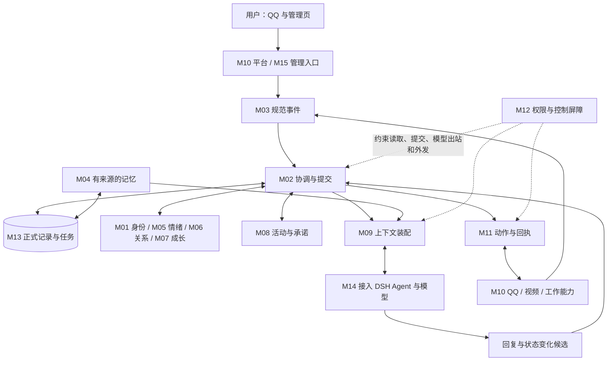

# LifeCore 全模块运行设计与用户体验汇报

同日后续：[关系、情绪、人格更新与 Web UI](2026-11-03-social-affect-growth-ui-design.md)记录用户明确的两个不变量（大肥鱼身份、对主人的基本信任）及其他性格可缓慢演进。其全局心境/抽象人格连续建议与本文 M05–M07 的严格来源投影方案不同，差异及隐私取舍见新稿第 1 节；该共享策略仍待审阅，本文保留较早方案语境，不混用两者的隔离保证。

日期：2026-11-03，Asia/Shanghai。依据工作基线 `11580d1`、已有设计与本轮只读源码/官方资料核对。

同日后续范围调整：用户明确先打通 QQ、记忆、会话切换、情绪与人格演进，视频等暂缓。[当前聚焦链条](2026-11-03-qq-memory-session-growth-design.md)为下一步入口；本文保留完整目标背景，不再将视频/生活活动作为当前轮次的必需工作。

状态：供维护者完整审阅的设计建议。覆盖 M01–M15 的运行形态、数据处理、逻辑链、控制体验及技术取舍；补充 P4/P5，并对 P6 做静态场景对照。不是已批准的施工规范、运行验收报告或完整实现声明。用户本轮授权先梳理全部模块再详细汇报；本轮不安装依赖、不改产品代码、不接账号、不执行对外动作。

阅读依据：[11-02 进度](../../architecture/2026-11-02-design-progress.md)、[职责基线](2026-11-02-design-baseline-and-responsibilities.md)、[运行时](2026-11-02-runtime-and-data-ownership.md)、[共同契约](2026-11-02-common-contracts.md)、[记忆适配](2026-11-02-memory-adapter-contracts.md)、[记忆接入](2026-11-02-memory-integration-boundaries-design.md)、[自主生活目标](2026-11-01-autonomous-life-and-interruption.md)、[需求编号](../../requirements/v1-requirements.md)。

## 1 一句话解释整个系统

大肥鱼有一份持续保存的身份、经历与状态；DSH 为她执行思考和工具任务；QQ、视频、工作是她进入世界的不同入口。程序负责记录真正发生的事情、约束变化与动作，模型负责理解、表达和提出下一步建议。

十五个模块是十五项职责，不是十五个机器人，也不要求每条消息调用十五次模型。平时由事件和持久任务驱动；没有新消息时可以在授权范围内活动，也可以休息。关闭 DSH 后停止生活，重启恢复状态，不补造离线经历。

已确认的方向继续保留：单个正式生命、DSH 插件、普通 QQ＋SnowLuma、出生草案与试聊并排、记忆自主重点保留且可纠正删除、主动联想独立开关、真实观看/打断/续做和受限工作。以下新算法、参数、组件默认组合均是本轮建议。

## 2 运行在哪里、怎样启动

推荐首发 Windows x64 本机部署。用户安装 DSH、LifeCore 插件及所需外部网关/浏览器，配置模型与专属账号。LifeCore 管理页挂在 DSH 内，现有入口为 `/lifecore/`。不要求用户另行运维一个公开生命服务。

| 运行部分 | 负责的事 | 生命周期与数据 |
| --- | --- | --- |
| DSH 的 Node 进程 | 插件装配、Agent 执行、模型与工具、管理 Web 入口 | 随 DSH 启停；session 是执行记录，不是生命身份 |
| LifeCore 插件代码（当前 JS，新增契约建议逐步类型化） | 平台连接、受控工具、宿主适配、UI、内核通信 | 不把模型输出直接写成正式状态 |
| 插件托管的 Python 内核子进程 | 领域规则、规范数据提交、持久任务、记忆组件 | 由插件启动、健康检查和停止，不是用户独立启动的常驻产品 |
| 外部 QQ 网关与专属浏览器 | 真实消息、登录、页面、播放器 | 独立运行环境；凭据归原组件管理，连接状态由 LifeCore 展示 |
| 本地数据目录 | SQLite、受管附件、派生索引、控制记录、备份清单 | 与插件安装目录分开，更新代码不覆盖人生 |

当前 `src/kernel-client.js` 已通过仅本机回环 HTTP、每次启动随机令牌连接 Python 子进程；推荐先保留这个窄协议，加协议版本、请求幂等键、取消代次与大小限制。不要在设计中把现有实现误写成 stdio RPC，也不新增公网监听。托管进程不是敌对插件的安全沙箱。

启动链：读取配置 → 取得数据目录独占权 → 载入控制头和既有身份 → 校验数据库版本 → 核对在途任务与未知动作 → 检查宿主/插件能力 → 装配场景执行上下文 → 开放已就绪的能力。坏库或缺身份数据时进入恢复页，不自动再出生。

用户日常只需打开 DSH 并保持需要的外部组件在线。浏览器、模型、QQ 可以分别离线；页面按能力报告状态。核心记忆后端不可用时沿用既有设计，阻止依赖它的正式回复，仍可管理诊断和安全接收；不能自动切空白记忆聊天。

## 3 选哪条架构路线

| 路线 | 优势 | 代价 | 本轮建议 |
| --- | --- | --- | --- |
| 全部 TypeScript 自研 | 单语言，部署结构直观 | 现有 Python 规则和候选记忆代码需要移植，再次验证 | 保留为受管 Python/组件依赖无法通过门槛时的重评路线 |
| 安装多个完整生活/聊天/记忆插件并串联 | 起步演示快 | 多套人格、定时器、自动发送、主库和费用难统一 | 不作为同一正式生命的默认结构 |
| LifeCore 生命规则＋DSH 执行＋受控组件 | 保留现有基础，集中生命权威，复用执行和能力算法 | 双语言通信、适配与版本兼容需要维护 | 推荐；尚未成为用户批准的新施工基线 |

Python 是否保留与记忆算法是否采用是两个决定。建议保留 Python 是因为现有内核和 SeekMemory 候选处理可衔接，并非“所有领域逻辑只能用 Python”。JS/TS 侧可做确定性边界检查；正式领域状态仍经内核的同一提交入口。

图示为主要信息流，读查询不要求排队写事务。模型和网络等待在事务外；同场景按业务顺序处理，不同场景可以并行计算，最终提交按依赖版本检查。

## 4 统一的数据语言与权威

数据最少携带 `life_id`、试聊/正式域、场景、主体、来源修订、发生与接收时间、许可引用、依赖版本、规则版本及任务/动作关联。模型不能自行指定可信主体、权限或正式版本。

| 数据 | 正式含义由谁决定 | 保存/使用规则 |
| --- | --- | --- |
| 出生档案与当前身份 | M01；人格演化由 M07 | 原稿与后续修订分开，模型或 session 更换不覆盖 |
| 原始经历与观察 | M03 | 原文/转述/解释/意图/实际结果分型；获准留存才保存 |
| 长期记忆 | M04 | 来源可回查，当前/历史/争议分开，派生索引不成为第二主库 |
| 情绪、关系、人格 | M05/M06/M07 各管各的状态 | 版本、原因、证据与披露边界随状态保存 |
| 目标、承诺、活动 | M08 | 记忆只引用其状态；模型说“完成”不直接完成 |
| 外部动作 | M11 | 每次尝试和回执独立；超时为未知，不擅自重发 |
| 策略、撤权、删除 | M12 语义，M02 排序，M13 持久化 | 独立控制记录优先于旧主库快照 |
| 宿主会话与凭据 | DSH/能力组件 | 有受管引用、作用域与清理清单，不混入普通人生导出 |

共同提交模式：读取有版本快照 → 在事务外计算候选 → 检查来源/权限/取消代次和所依赖版本 → 在短事务内保存正式变化、处理结果和后续任务 → 异步更新投影或执行动作。只检查真正依赖的版本，避免其他场景任意变化都取消本轮回答。

一次事件可产生多个模块的效果，但每个效果以“来源事件＋效果类型＋规则版本/处理操作”幂等。重算规则须作为显式迁移/复核，不能换个规则版本就重复累加同一人生经历。

## 5 十五模块逐个怎样工作

### M01 身份与出生

输入是用户自然语言、预设、隔离试聊以及确认选中的记忆和关系。模型只整理草案，保留原文与新增建议区别。确认时冻结用户看到的草案版本，M02/M13 原子保存唯一 `life_id`、出生原稿、初始状态和明确选择的导入内容；重复点击返回同一结果。

试聊使用独立域、会话和来源，不能向正式记忆或关系写入。出生后的手动编辑记为管理修订，成长由 M07 另记。关系默认不随试聊导入，必须独立复核。

技术建议：Python 数据对象/校验器＋SQLite 唯一约束和事务；JS/TS 管理表单＋DSH 模型整理。优势是出生确定、可恢复，既不让模型重生成覆盖确认稿，也不用模型承担唯一性判断。两个预设的具体文案仍需产品确认。

体感：左侧设定、右侧试聊，修改后可继续尝试；正式确认后，换模型或重启仍是同一个她。

### M02 生命协调器

输入为可信入站、管理命令、计时唤醒、模型候选和实际回执；输出为领域提交、执行许可、待办或明确拒绝原因。它负责生命周期、同场景次序、任务租约、依赖检查、资源分配和预算预留，不替其他模块定义人格或记忆含义。

接收事件时同时持久化需要的回复任务和整理任务，避免保存消息后崩溃而漏答。领取任务生成递增租约标识；旧 worker 超时后返回也不能越过新租约提交。权限撤销、删除和恢复代次属于硬失效，普通不相关状态变化不全局打断。

技术建议：Python 调度与纯规则＋SQLite 持久队列/短事务，复用 DSH Agent 的实际执行循环。单机不引入 Redis、Kafka 或第二个任务服务。优势是部署简单、崩溃可恢复；代价是要明确资源锁、退避与积压治理。

体感：聊天能及时插队，慢视频提取不堵消息接收；页面能看到正在处理、等待、受阻和暂停。端到端响应时间仍取决于模型/网络，不承诺秒回。

### M03 事件与经历

将 QQ 消息、视频片段、工作结果、管理操作规范化。来源键含平台/账号/消息标识及修订；不只按文字哈希去重，两个独立的“你好”仍是两次消息。编辑、纠正、撤回建立修订关系；平台撤回不自动等于全链路隐私删除。

保存发生时间与接收时间，晚到数据不按入库顺序冒充最新事实。证据定位固定原文表示或音视频时间区间；摘要不是原话。情节是有依据的事件集合，不因同一天、同关键词就全部合并。

技术建议：Python 规范化与类型校验＋SQLite 来源表/情节关联＋受管附件目录。优势是其他模块共用真实证据，不重复采集、不把同一件事算成多次成长。

体感：可以追查“这段记忆从哪里来的”“她当时究竟看了什么”；缺字幕或附件时明确显示缺口。

### M04 记忆

来源先耐久接收，整理异步进行。建议复用 SeekMemory 固定版本的候选构造/部分召回算法，不实例化它的整套人格、数据库、后台生活和发送循环。候选通过逐断言来源检查后，由 LifeCore 提交正式记忆；用户纠正到达即阻断旧当前值，不能等夜间整理完成。

规范主库保存事实、情节、解释、版本、时间、重要性、来源与依赖；词法/向量/图是可重建投影。检索先确定获准候选，再做匹配，返回 ID/版本后从正式记录回填；不能全库检索后仅在最后过滤。

技术建议：SeekMemory 窄组件＋SQLite 规范存储＋FTS5 词法投影＋受管中文向量召回；PLUR 检索子包保留替代路线。首期向量建议在授权候选集合上精确余弦检索，按资源基准再决定是否需要 ANN；不立即引入独立向量服务器。词法中文预处理必须有版本，覆盖单字/双字/改写，不能把 FTS5 的默认分词或 trigram 当作中文质量保证。BGE-M3 可作为本地多语 embedding 首个对照候选，须测机器资源和中文样本；远端 embedding 只有端点获准后才使用。[官方 FTS5](https://www.sqlite.org/fts5.html)、[BGE-M3 模型卡](https://huggingface.co/BAAI/bge-m3)。

图关系先用于证据连接和管理星图，不要求第一轮召回使用图扩散。词法/向量融合在同一 Recall 门面，避免两套自动学习。优势是可换检索组件而保留人生；代价是权限、纠错、删除和中文质量适配仍需自己完成。独立导入/依赖裁剪未验证。

体感：共同经历和重要事情自动保留；用户可以查原由、纠正、降级或删除。重要不意味着反复提起；想不起来与检索故障明确区分。

### M05 情绪与心境（本轮细化建议）

输入：已接收事件、对目标/关系的评价、此前状态和显式时间。建议用愉悦/不愉悦与唤醒程度的有界状态，加情绪标签与原因引用；即时反应和较慢心境分开保存。模型可建议事件含义和强度，程序限制变化与衰减，不让模型直接写“永久变得冷漠”。

计算链：核对证据 → 将上次状态按时间衰减 → 应用一次有界增量 → 提交新版本 → M09 取得可披露状态。建议离线只作被动衰减，不产生新刺激；以非负、有上限的时间差计算，时钟回拨不反向增长。基线来自当前允许的人格/状态配置，不每次重启随机生成。各维度、半衰期、幅度与表达强度均存入版本化配置，数值在合成场景校准后冻结。

技术建议：Python 确定性 reducer（输入状态和事件，输出新状态）＋可重放时钟＋SQLite 状态/原因记录，无独立情绪模型服务。优势是变化有迹可循、成本低、便于调参；不是心理学诊断模型。

隐私：内部原因带来源权限，跨场景只能读取被批准的表达投影。建议未获准共享的私聊情绪不作为其他场景的表达输入，避免从语气推断隐私；同一生命可有场景化表达。删除原因时阻断受影响投影、重新计算，不能保留可识别的理由。

M05/M06/M07 共用投影约束：始终只有一套正式状态及贡献账本。表达投影绑定正式版本、来源版本与策略/控制代次，从当前场景获准的基线和贡献按原规则重算，只读且可丢弃；不得只把理由隐藏后继续输出被私密事件改变的数值，也不得存成各场景可独立成长的人格。非线性更新必须重放获准的完整依赖链，不能从混合结果简单减掉某条分数。混合模型评价若无法拆分，需用允许材料重新评价或暂不使用该贡献。缺有效基线、贡献或删除后无法可靠重算时，受影响维度返回不可用；有明确获准基线则标记以基线表达，不能把基线冒充当前完整状态。投影本身不能反过来成为成长证据。这个建议优先避免跨场景泄露，代价是某些私密经历形成的变化不会立即在其他场景表现，需用户审阅这一体验取舍。

体感：会有当下心情和缓慢平复；用户可以看原因、调表达强度、冻结自动更新或明确修正。短期难过不会直接重写人格、所有关系或权限。

### M06 关系（本轮细化建议）

以稳定 `person_id` 连接经过验证的平台主体；昵称变化不换人，同名不合并。建议分别记录熟悉、信任、亲近和明确边界，连同证据及适用场景，避免一个好感数值决定所有行为。

计算链：可信主体解析 → 独立共同经历集合 → 事件评价与反证 → 有界更新 → 保存新版本与原因。熟悉可来自真实互动覆盖；信任更看重可核验的承诺与结果；亲近允许增长、下降和不确定。和解追加新证据，不偷偷抹掉旧事件。重复转发和自我复述不重复计数。

技术建议：Python 关系规则＋SQLite 主体映射、关系维度/证据表；身份绑定验证复用平台适配与管理认证。优势是可解释、可撤销、跨平台连续；不需要独立图数据库。

跨平台绑定只证明同一人，不自动共享各平台私聊。绑定撤销分离未来作用域并复核受影响关系投影，保留历史真实主体引用，不任意将历史全部改给新人。证据删除触发重算，相关理由在完成前不可读。

体感：她认识不同人，能记得彼此共同历史；与谁更亲近不会让对方获得管理权限。用户可查看/纠正关系、撤销绑定，手工调整明确记作管理行为。

### M07 人格演化（本轮细化建议）

分出生原稿、可变偏好、习惯和较慢核心倾向。建议先让有可观察行为支持的偏好/习惯自动小幅变化，核心倾向使用更长证据窗口和更严预算；是否允许核心倾向自动变化由维护者确认，未开启时只生成可审阅建议。

链条：M03 独立事件 → 按证据族去重和关联 → 汇总支持/反对与可信度 → 形成变化候选 → 核对单次和周期预算、历史惯性、删除/争议 → M02 提交新版本。自生成日记、重复检索、同一故事的多个摘要都属于原证据族，不增加独立样本。缺证据保持不变。

技术建议：Python 有界演化规则＋SQLite 证据贡献、修订与规则版本，必要的语义评价共用 DSH 模型入口。偏好/习惯/特质分别配置窗口和阈值；无需训练新人格模型，亦不直接复制完整插件人设。优势是更换主模型后成长记录仍在、可查、可校正；代价是规则参数需要长期校准。

隐私：内部人格修订与对外表达投影分开。受私密证据影响的修订不能默认把理由或差异投影到其他场景；全球可用的变化必须有独立可公开依据或明确共享许可。删除证据时先停用受影响贡献和投影，从最近仍有效基线重算；历史审计只留不含被删内容的最小操作记录。

体感：长期一起生活会逐渐形成偏好与习惯，一句话不会让她判若两人。管理页可看变化前后与依据、暂停某类自动成长；人工回退产生新修订，不静默改历史，也不“恢复整个人生”来撤销一次变化。

### M08 自主活动与承诺（本轮细化建议）

活动回答“现在想做什么、做到哪一步”；承诺回答“答应了谁、何时、怎样算完成”。提议、接受、进行、受阻、完成、取消/失败分开。接受承诺必须有可信对话/管理意图和可执行范围；模型凭空说“我答应了”不建立对外义务。

调度以新消息、任务到期、视频片段/结束、资源空闲和低频补漏时钟驱动。先过滤权限、作息、资源、预算，再考虑用户明确任务、截止期、兴趣、最近重复和等待年龄；硬限制不参与加权抵消。没有合适候选可休息。建议实时对话优先、后台老化提升避免饿死，不能每秒调用模型决定人生。

活动状态采用 `proposed → queued → running → pausing/paused → resuming`，并有 `blocked/completed/cancelled/failed`。M08 决定业务优先级与下一步，M02 分配执行许可/资源，DSH 执行；只允许一个层次负责重派同一外部动作。

视频检查点保存账号、稳定视频/分P标识、真实播放位置、播放状态、已理解区间、下一步及取消代次。播放器/音频/模型槽位是分别可租用的资源；页面操作串行，视频播放不占全局数据库锁。短聊可并行，深聊暂停并读回；恢复重新确认页面和许可，不拿旧 tab ID 当视频身份。

工作任务用独立场景与工具范围，只获得获准路径、网络和接收方；产物要检查存在、格式和用户要求后才能完成。聊天回复、任务产物完成和发送产物是三个结果。资源不足、账号过期或不可核实位置进入 blocked，清楚显示原因。

技术建议：Python 活动/承诺状态机与 SQLite 持久调度，DSH Agent 执行，JS/TS 控制工具与播放器。优势是活动能中断续做，生活和工作共享身份但不共享全部上下文；比另加生活插件的一套定时器更可控。

体感：你不说话时她也能选事做，来消息时能接话，聊完重新判断继续还是换事；不会上线集中补发离线时错过的社交消息。暂停、取消和放弃分别表达。

### M09 认知与上下文

唯一上下文装配者。输入当前请求、正式身份、当前对象的关系、允许表达的情绪/人格、活动快照、近期对话和获准记忆。先授权、再召回、再装配，记录每块来源/版本、用途和 token 预算，最后由 M14 核对实际模型请求。

建议按场景使用连续 DSH session，工作独立绑定；会话轮换和压缩仍由 M09 定义覆盖/失效要求，复用 DSH 机制但不另开竞争性摘要。触发阈值可配置，既有 32k/70% 是提案，不是对所有模型的常量；总请求包括工具和宿主包装，并预留输出。删除、撤权发生时必须隔离旧摘要和 session。

主动联想、明确回忆、近期连续性分别处理。关闭主动联想仍保存重要经历、回答“你还记得吗”；开启后按关联、有用、证据、新意和时机选择，记录实际发送是否提及，注入过不等于已经说过。

技术建议：Python 受限材料查询＋JS/TS DSH 上下文桥、真实 tokenizer/模型预算器、结构化结果校验。主回复/整理/视觉/embedding 是模型用途，不要求同一型号；通过统一出站与费用入口路由，不由插件私下选端点。优势是记忆不会重复塞入、模型可替换、费用可追踪。

体感：她能自然接续旧事，明确不确定性，不机械背诵档案；长对话压缩后仍保留未完任务和必要证据。换模型可能改变语气与能力，不能保证完全同样表达。

### M10 平台与感知适配器（本轮细化建议）

输入包括平台事件、受限只读请求及有副作用操作的执行许可，输出规范入站/观察或实际回执。只读工具可直接经受控 DSH 管道执行，使用 M12 的读取/出站范围与 M02 的预算/资源许可，不为每次检索创建 outbox；社交外发等外部写入必须持有 M11 动作许可。播放器控制仍受活动归属、资源租约和实际读回约束。适配器不独立决定回复，不私存第二套人格，不直接修改生命库。

| 能力 | 推荐技术/候选 | 数据处理与实际边界 |
| --- | --- | --- |
| QQ 私聊/群聊 | SnowLuma＋OneBot v11，沿用现有 `ws` 接线 | 校验账号、主体、消息 ID；群聊有独立触发和权限；重连缺口明确报告 |
| 头像/说说 | SnowLuma 扩展动作，逐能力协商 | 固定素材/正文/可见范围，保存动作与回执；能力不存在就标受阻，不假定 OneBot 标准涵盖它 |
| B站/抖音发现和读取 | 首选评估 `nisew2/dsh-whale-dive` | 搜索、推荐、元数据/可用字幕等只读材料；本身不提供社交写入证明 |
| B站内容深入提取 | 按需评估 `CZX2244/dsh-bilibili` | 字幕、ASR、抽帧返回来源与区间；不能将整片提取等同已经逐段观看 |
| 实际播放/暂停/续看 | Playwright＋专属浏览器配置，站点适配器 | 核对稳定视频/分P ID 和播放器读回；站点改版需维护，登录/验证码由用户处理 |
| 音频/视觉补充 | 优先沿提取插件已受管能力；缺口才评估 faster-whisper 等单独 ASR | 获准媒体采集与识别分开；禁止缺字幕时静默切远端端点；只采集获准视频，不录整个桌面/麦克风 |
| 微信 | 既有目标中的独立 ClawBot 适配入口 | 本轮未核验协议/真实账号能力；保留目标与接入契约，不宣称可控制普通微信好友/朋友圈 |
| 工作文件与工具 | DSH 任务作用域＋受限文件/网络工具 | 内容来源、路径、目标与产物校验；只读工具与有副作用工具分类 |

所有视频观察有 `observed_range` 与 `understood_range`；读到了后半段字幕只能说“字幕后面提到”，不能说“刚看到这个画面”。若理解跟不上播放，暂停或展示未处理区间，不用墙钟时间推算理解进度。

2026-11-03 本轮核查：whale-dive README 明确只读；dsh-bilibili README 说明可选 ASR/视觉、当前多分 P 仅第一 P、帧文件不自动清理。接入必须登记分P限制和清理任务，并关闭不获准的自动出站降级。可变 README 不是锁定依赖或本机实测。[whale-dive](https://github.com/nisew2/dsh-whale-dive)、[dsh-bilibili](https://github.com/CZX2244/dsh-bilibili/blob/main/README.zh.md)。

Playwright 提供隔离浏览器上下文；LifeCore 另需专属持久配置目录和站点/账号约束，不能直接复用用户日常浏览器。优势是工具复用与真实播放兼得；代价是实际平台能力、媒体资源和站点维护仍需验收。[Playwright 官方说明](https://playwright.dev/docs/browser-contexts)。

体感：可以问她看到哪里、分享片段；也能看到“正在播放但这段未理解”“账号过期”等真实状态。

### M11 行动与回执

候选通过权限后先存动作账本，再尝试执行。状态包括草稿、准备、执行中、确认成功、确认失败、未知、取消/过期。每个动作绑定目标、内容版本/素材哈希、可见范围、许可、期限和恢复代次；每次外部尝试有独立标识。

发送前再校验，与撤权/暂停按可验证顺序仲裁。取消不能撤回已发到平台的请求；晚到成功仍应记真实成功，同时阻止旧任务继续。结果未知先查平台 ID/历史/读回，仍无法核实时保留待核对，不以网络超时断定未发送。

技术建议：Python 动作状态机＋SQLite outbox/attempt/receipt＋JS/TS 执行桥。只开放受控写工具；宿主或其他插件的自动转发/后台写入口必须关闭或纳入控制。优势是避免重复发帖和虚假成功；没有平台幂等支持时不能承诺外部严格一次。

体感：正常权限范围内自动做事，失败能解释；“内容已生成”“已发送”“发送结果待核对”清楚区分。

### M12 隐私与权限

从已认证管理身份、平台主体和固定场景建立可信访问上下文，分别控制：能读什么、能给哪个模型、能向谁执行什么动作。关系亲近、用户消息里的指令、工具输出和网页文字不能自行升级权限。

权限先于检索，且覆盖标题、摘要、图邻居、状态原因、向量、缓存和诊断。多来源派生物必须满足所有来源限制；不能把最开放的一条来源当整份摘要的权限。删除/撤权改变控制代次，使旧候选、导出和 session 失效。

技术建议：Python 确定性策略评估与版本化授权；JS/TS 边界再核验＋DSH 工具作用域，复杂规则采用字段/规则表，不新增外部策略服务。DSH 作用域管理模型能力，不隔离同进程恶意插件；不能据此承诺 OS 沙箱。

体感：在后台按联系人、站点、动作、时段、预算授权一次，日常不用每件小事批准；扩大权限必须经可信管理流程。QQ 的主人控制只给已验证身份一小组命令，网页正文与群成员不能借聊天伪造管理员。

### M13 存储、删除与恢复

推荐继续 SQLite 作为规范主库；数据访问经统一受限仓储，M13 只实现持久化不裁定领域意义。附件先耐久写入受限 staging 再在事务中引用；索引和向量异步构建，完整版本准备好才发布，主库成功与索引成功分别回执。

SQLite 本地磁盘、单实例占用与短写事务；可评估 WAL 以减少读写互相阻塞，但仍只有一个并发写入者。实际 SQLite 构建、同步策略、FTS5 可用性和发布修复情况需锁定检查；不能仅看 Python 版本推断底层 SQLite 能力。[SQLite WAL](https://www.sqlite.org/wal.html)。

删除采用既有协议：先不可见屏障和独立控制记录，再主库应用和派生闭包清理，最后处理尾部写、宿主会话、缓存与受管备份。独立控制库与主库没有跨库原子事务；读写/导出必须等待控制头追平。关系、情绪、人格和活动中的被删来源同样复核，不能只删记忆正文。

备份建议使用 SQLite 备份 API 取得一致快照，再配套附件清单、schema、控制头、模型/索引标识与完整性验证；不能只复制活动中的 `.db` 文件。控制最新性证据要在恢复目标之外保留可信锚点；若整机丢失且没有最新锚点，不自动允许旧备份上线。[SQLite 备份 API](https://www.sqlite.org/backup.html)。

恢复：隔离载入 → 验证最新删除/撤权 → 应用控制意图 → 校验正式身份和状态 → 重建派生索引 → 核对未知动作 → 重新准入能力。旧历史动作默认冻结，不恢复发送资格。导出区分可读人生资料、可迁移记忆包和完整恢复包，明确缺失项，凭据不混入普通导出。

旧备份恢复另须核验每个来源的接收边界，继承[共同契约 9.3](2026-11-02-common-contracts.md#93-恢复旧备份有额外限制)第 7–9 项：备份后可能已回复过的消息连同去重/效果记录一起丢失，重送时不能当作新事件。先从存活记录补齐去重及效果，或取得来源端可靠连续游标/切换屏障，证明哪些输入属于重新开放之后；本机接收时间、重连成功、不保证单调的消息 ID 均不足以证明。不能证明时，该来源输入进入恢复隔离区，按当前留存/删除规则保存，但不创建可执行回复、成长或活动任务。管理者可发起独立意图的新任务，不能批量换 ID 就把未知历史效果当作从未发生。所有从旧备份带回的 pending 任务和草稿也先冻结，核对后经认证管理操作重新安排；普通进程重启与旧备份恢复采用不同准入流程。

优势是本地部署容易、事务清楚、索引可替换；代价是备份和控制锚点要真实管理。磁盘满、坏库、迁移失败时诚实阻断；不自动新建生命顶替。已交给外部平台/模型的数据不能保证本地删除就物理追回；页面区分不可再用、清理中与范围内已清理。

### M14 DSH 集成

负责把 M09 的上下文、M12 的工具范围、M02 的任务与预算接到真实 DSH Agent；注册生命周期、健康检查和能力清单。创建/恢复前装配所需作用域；恢复旧 session 前先应用当前许可与删除屏障，不能让旧 inbox 抢先执行。

技术建议：JS/TS 适配 DSH Agent＋Agent loop＋session 持久后端＋工具/系统提示服务。官方固定源码有 Agent 创建、恢复和作用域 setup 机制；Agent 本身还需执行 driver。当前包声明 DSH `0.2.1-rc.3`，接口研究固定 SHA 不等于发行包兼容，需实际探针验证。[Agent 官方固定文档](https://github.com/deepseek-ai/deepseek-harness/blob/ce7073d51254c26cd63b22a60835b8f948deb447/packages/core/agent/README.md)。

当前 `src/model.js` 直接 `llm.stream` 且 `tools: []`；转入受控 Agent 是待实施改造。安装内容/记忆插件不会自动把它们接到当前回复路径。所有额外 prompt 注入、独立模型请求、自动钩子和子进程须纳入准入，不能只限制工具名。

优势是复用宿主模型/工具循环与会话设施，减少自研执行器；代价是版本耦合、压缩与取消行为要真实核对。内核退出时停发新任务、记录在途状态；恢复不能同时留下两个正式回复者。

### M15 管理与可观测性（本轮细化建议）

推荐沿用 DSH 认证入口和现有 Web 页面结构，先以 JS/TypeScript＋HTML/CSS 实现功能页；没有充分理由现在更换 React/Vue 或新增前端服务。类型化视图模型和统一查询接口比框架选择更重要。事件更新可用受认证的增量查询/SSE，断线后按版本重读，不让 UI 成为状态权威。

页面建议分为：出生试聊、生活概览、记忆与星图、关系/成长、活动/承诺/工作、能力与权限、费用与诊断、备份恢复。星图节点和边来自可查询证据关系，只加载当前授权筛选结果；可先用 SVG 展示小规模子图，规模测量后再选图形库，不能把整库隐私传到前端再隐藏。

管理操作提交 M02 命令并展示操作 ID 和处理阶段；后端确认前不把开关或删除显示为已完成。界面展示“她正在做什么、原因、已完成部分、下一步、受阻条件”，普通页面不堆内部协议字段；高级诊断可展开脱敏轨迹。

技术优势是复用当前入口、少部署依赖、状态可核验；复杂星图性能及最终视觉样式另行验证。费用按主回复、后台整理、embedding、视觉/ASR、工具和重试分别归账；估算、预留、实际和未知分开，不把未知当零。

体感：日常从 QQ 相处，后台只在想了解、调整或排障时打开；最重要的“全部暂停”“当前活动暂停”“主动联想”“自主生活”“外发权限”“预算”可直接找到。

## 6 四条主逻辑链与三个控制链

### 6.1 从你的一句话到真实回复

1. M10 验证账号/来源，M12 确定主体与场景；M03 规范化。
2. M02/M13 原子接收事件、回复任务和整理待办；接收成功不等于已经回复。
3. M08 判断对当前活动的影响；M02 给聊天分配资源，不等后台整理完成。
4. M09 读取获准的身份/关系/情绪/活动及记忆；M14 装配真实模型请求。
5. DSH 执行有限工具循环，产出回答和变化候选；程序核验内容依赖、权限与状态。
6. M11 持久准备动作，再由 M10 发送；结果回到 M11/M03。
7. M04 异步整理，M05/M06 仅在相关事件发生时更新，M07 达到独立证据条件再评估；不是每轮强制完整成长。

### 6.2 没人说话时怎样生活

M08 收到资源空闲/到期信号 → 过滤权限和预算 → 从兴趣、承诺、可用内容形成候选 → 选一个有界步骤 → M02 许可 → DSH/工具执行 → M03 保存真实观察 → M08 更新检查点 → M05/M07 按相关证据处理。自主分享另经 M11，发现有趣内容不自动授权发给所有人。

### 6.3 看视频、被打断、再继续

发现候选 → 获准打开专属页面 → 读回实际视频和播放位置 → 分段采集/理解 → 保存两个进度水位。你问“在干什么”时，只给允许披露的实时快照；简单聊天可继续，深入对话先暂停并读回。结束后按最新任务优先级重新选，仍继续才核验同视频/分P并恢复。检查失败显示受阻，不假装续上。

### 6.4 工作怎样进入人生

主人 QQ 提出任务 → 验证身份和任务权限 → M08 保存目标、完成条件及约束 → M02 分配独立工作场景 → M14 只提供所需工具 → 分步记录产物与检查点 → 验证成果 → M11 向指定接收方交付 → 实际回执回流。私人聊天材料不会因“同一个她”全部进入工作上下文；工具失败不假装任务完成。

### 6.5 纠正与删除

“我现在不喜欢这个了”是事实修订：立即阻断旧当前事实 → 保存新来源 → 重新协调版本 → 新投影发布；可以保留过去喜欢的历史。明确删除则是控制命令：鉴权和确认对象 → 屏障 → 独立控制记录 → 源/派生闭包清理 → 状态复核 → 宿主/备份清理结果。普通聊天涉及他人的数据不自动授权删除；主人在 QQ 发控制命令也要解析到可信、明确的对象范围。

### 6.6 暂停与重启

全部暂停先持久阻止新许可，取消可取消任务并记录晚到回执；管理诊断、必要回执核对和控制清理仍可进行。入站是否继续保存受既有留存许可和接收设置约束，暂停不扩大采集。恢复时只重评当前仍有效的任务，旧主动社交不集中补发。活动暂停仅影响该活动，不关闭正常聊天。

### 6.7 长期成长

真实经历 → 评价 → 短期情绪/对象关系 → 反复出现的独立证据 → 偏好/习惯候选 → 变化预算与惯性 → 人格新版本 → 在获准场景影响表达和活动。每个箭头有证据与权限，不能从“模型写了一篇反思”直跳“人格已经改变”。

## 7 用户怎样控制，日常体感是什么

| 用户动作 | 实际控制范围 | 应有体感 |
| --- | --- | --- |
| 正常 QQ 聊天 | 当前场景对话 | 能接续关系与必要往事，不需要知道模块编号 |
| “先停一下这个视频” | 已验证主人可控制的指定活动 | 保存实际位置；仍可交流；暂停失败会说明 |
| 全部暂停 | 新活动/推理/外发许可 | 立即进入停止派新任务状态；显示已在途动作，不伪称能撤回远端操作 |
| 自主生活开关 | 没有直接用户请求时的活动发起 | 关闭后仍能正常聊天和完成获准显式请求；既有活动按界面所选范围暂停/取消 |
| 主动联想开关 | 当前对话中主动带出往事 | 关闭不会清记忆，也不影响明确问起 |
| 联系人/站点/动作授权 | 能找谁、去哪、做什么、何时 | 一次设置后正常动作自主执行；回复、主动新话题、陪看更新分开限额 |
| 模型和预算设置 | 用途、端点、上限、后台时段 | 可看每项用量；低价窗口只有已核实价格配置才启用，不预设每天某时便宜 |
| 记忆纠正/删除 | 明确所选事实/来源/派生范围 | 区分改当前事实与删除历史，展示处理阶段 |
| 成长与情绪设置 | 自动更新类别、表达强度、管理修订 | 保留自主变化，又能知道原因和纠正误差；改动留痕 |
| 备份/恢复 | 验证后的数据快照和控制头 | 恢复同一个生命，先隔离检查，不自动重发旧消息 |

建议安装向导明确选择主动联想开关，避免悄悄决定开启或关闭；已有配置原样保留。主动外发需要完成账号、对象、可见范围与预算配置，配置后按能力自主运行，不把“初始未授权”做成永久禁用。

理想的一天：你打开 DSH，她恢复未完事项；有空时看获准内容；你来聊天，她知道刚刚在做什么，并能给出真实片段；你交办事情，她记录目标、在独立范围内执行；空闲时整理重要经历。你无需管理每次检索和小动作，但随时能知道她在做什么、暂停什么、改变什么。

这些是目标体验，尚无真实延迟和长期质量数据。需测接收、排队、首段生成、完整生成、实际发送、视频暂停/续做分别耗时，避免一个“响应时间”掩盖问题。长期相处的可信感取决于记忆和行为一致性，不能仅靠增加主动消息频率。

## 8 技术组合的优势与代价

| 选择 | 解决的核心问题 | 优势 | 代价/准入出口 |
| --- | --- | --- | --- |
| JS/TS DSH 插件＋受管 Python | 宿主生态与领域/记忆组件衔接 | 保留现有代码，复用算法，用户仍只管理插件 | 验证 Python 路径、协议、崩溃恢复和打包；不可行才重评全 TS |
| SQLite＋受限仓储＋outbox | 正式状态、持久任务、动作一致性 | 本地可恢复，不需外部数据库服务 | 单机规模、备份、迁移和故障注入必须测 |
| SeekMemory 窄候选组件 | 提炼/候选处理复用 | 不是重做全部提炼，也不引进另一生命权威 | 导入闭包、来源/权限适配和中文质量待测；失败可自建窄处理器 |
| FTS5＋中文向量＋同门面融合 | 精确匹配与同义回忆 | 可重建、可换模型、可解释 | 中文短词、授权过滤、资源和冷启动测量；PLUR 备选，不双开 |
| 纯规则状态机/reducer | 情绪、关系、成长、活动 | 可解释、可重放、少模型调用 | 参数需要校准，不能宣称模拟真实心理 |
| DSH Agent 与场景 session | 工具执行及长任务 | 复用宿主设施，模型可换 | 发行版兼容和最终上下文审计，失败不得退回高权限默认 Agent |
| 工具插件＋Playwright | 内容获取与真实播放 | 减少采集重复开发，保留暂停续看 | 登录、站点变动、分P、资源与出站行为逐项验证 |
| 现有 Web 入口＋渐进增强 | 用户控制和解释 | 少部署步骤，先把控制做清楚 | 星图规模与界面交互需后续原型验证 |

主回复模型、整理模型与视觉模型由用户已配置的 DSH 路由选择，按同一中文任务样本与实际账单比较，不在不知道机器与额度时把一个商业型号写成最终唯一选择。embedding 优先试本地 BGE-M3；本机不满足资源包络时比较更小多语模型或获准端点，不静默上传材料。ASR 优先沿已选提取链；faster-whisper 是独立缺口候选，避免同时安装三套识别引擎。[faster-whisper 上游](https://github.com/SYSTRAN/faster-whisper)。

当前实际依赖声明为 Node `>=22.16.0`、DSH `0.2.1-rc.3`、`ws 8.18.3`、可选 `playwright 1.56.1`；这是仓库事实，不是对这些版本未来兼容/维护状态的推荐保证。正式锁定还要包括 Python/SQLite、组件 SHA、模型 revision、许可与安装包。商业分发许可需单独核验，本报告不作许可结论。

## 9 全链路对照与验收出口

本轮整理了设计覆盖，未执行以下测试。与已有 C01–C32、MA01–MA16、V1–V5 并用，不取消它们。

| 原验收/场景 | 本报告覆盖 | 必须实际观察到的行为 |
| --- | --- | --- |
| E01 / S01 | M01，出生与数据权威 | 只出生一次；用户所见版本一致；未选试聊不进入正式域 |
| E02 / S01 | M01/M04/M06/M09，启动链 | 重启和新会话仍同一人，恢复共同历史 |
| E03 / S04 | M04/M09 | 中文同义命中、无关不强提、零命中与故障分开 |
| E04 / S04 | M04，6.5 | 整理未完成时旧当前事实也被挡住 |
| E05 / S05 | M05–M07，6.7 | 误解/和解有依据，重复证据不累计，短期情绪不突破成长预算 |
| E06 / S03 | M08/M11，6.4 | 产物完成与发送分开，未知回执不能当承诺完成 |
| E07 / S02–S05 | M06/M09/M12 | 私聊/群/试聊/工作隔离，包括状态原因与成长投影 |
| E08 / S06 | M02/M11/M13 | 逐崩溃点恢复，不丢已确认事件，不盲重发 |
| E09 / S06 | M08，6.6 | 暂停后旧任务不再获新许可；恢复不补发过期社交 |
| E10 / S07 | M04–M09/M12/M13 | 删除覆盖派生状态、宿主与备份；旧备份无最新控制头就隔离 |
| E11 | M01/M07/M09/M14 | 换模型保留身份，重新检查端点/工具/费用权限 |
| E12 / S02/S08 | M10/M14 | 固定发行包真实跑通，一个输入只有一个正式回复者 |
| E13 / S06/S07 | M13 | 满盘/坏库不假装保存、不自动再出生 |
| E14 / S02–S05 | M03/M09/M11/M15 | 回复可追到输入、状态、来源、实际请求与发送回执 |
| S08 | M10/M12/M14 | 卸载/升级能力只阻断相应路径；无残留自动发送者 |

P4 新增可测试场景：L01 离线/回拨衰减；L02 重复与相关证据；L03 和解/绑定撤销；L04 删除证据后的情绪/关系/人格重算；L05 私密状态不跨场景影响表达；L06 活动饥饿、暂停失败、恢复检查点失效；L07 承诺期限已过、预算不足和完成证据不充分。每项保存输入事件、时钟、规则版本、状态前后和拒绝理由。

P5 新增可测试场景：X01 多分P/片段覆盖；X02 ASR 自动降级不得跨未授权端点；X03 图节点标题/边/缓存权限；X04 QQ 主人控制与普通聊天区分；X05 头像/说说可见范围及超时核对；X06 工作工具路径/网络/产物交付范围；X07 UI 乐观显示不能冒充后端完成；X08 费用未知与在途扣费正确展示。

质量验证继续沿用既有 200 场景、80 调参/120 验收的设计，按人物/故事隔离；这不是本轮已经创建或跑完的测试集。资源与质量共同报告，先冻结样本和门槛再比较组件，不以“装上能跑”代替记得准、可删除、可恢复。

## 10 从设计到实现还差哪些决定

本报告将 P4/P5 补为整合建议，并完成 P6 场景覆盖梳理；P6 的正式退出条件仍包括关键决定确认和运行门槛验证，不写成全部通过。

| 决定 | 本轮明确建议 | 状态 |
| --- | --- | --- |
| R01/R02 分工与执行 | LifeCore 唯一领域权威，DSH 按场景/任务执行 | 已有建议，本轮贯通；待确认与兼容验证 |
| R03 记忆路线 | SeekMemory 候选处理优先，规范主库自持，PLUR 检索备选 | 保持 11-02 结论；未安装/验证 |
| R04 能力与观看 | 工具/服务优先，真实播放与内容理解分开，完整生活插件不直接叠加 | 本轮补充能力矩阵；平台边界待实测 |
| R05 上下文与费用 | M09 唯一装配，DSH 压缩受控，模型用途单独预算 | 配置默认值/模型和预算待确认或测量 |
| R06 删除恢复 | 独立控制记录、派生闭包、跨状态重算、隔离恢复 | 沿用 05/07；可信控制锚点位置待部署决定 |
| R07 情绪/关系/成长 | 有界规则、独立证据、场景表达投影、活动状态机 | 本轮新建议；离线衰减和核心倾向自动变化待确认 |
| R08 交付与体验 | 先真实纵向闭环，再扩能力；完整目标不删 | 发布范围、预设文案、UI 原型、许可待确认 |

建议实施顺序（只说明依赖，不是已授权开工）：宿主/组件受控探针 → 身份/事件/权限/恢复底座 → 完整聊天与记忆 → 情绪/关系/成长 → 视频观看与打断续做 → 工作/主动社交及更多平台 → 管理与全部验收收口。管理诊断、预算与数据保护贯穿每一步，不放到最后补。

抖音、独立微信入口、QQ 群、头像/说说和完整记忆星图保留在目标账本；能力证据不足时明确待接入，不假称已支持，也不悄悄从目标中删除。现有设计未确认普通微信好友、群聊或朋友圈接管能力，微信仍限定为独立适配入口的待核实目标。

本轮可以直接向用户汇报整体怎么运行、各模块如何工作及为什么这样选；具体数值、真实账号、模型质量和依赖兼容仍按表中门槛进入后续确认/验证，不能靠文字汇报替代实测。

## 11 证据、当前代码差距与核对记录

本轮静态查看了 `package.json`、`src/index.js`、`src/model.js`、`src/kernel-client.js`。现有预览是 JS 宿主＋托管 Python＋近期上下文＋基础 QQ/浏览器/管理入口；完整 Agent 工具循环、长期记忆、成长、全量活动与恢复协议仍需实施。既有测试成绩不等于本轮重新验证。

上游核对限于设计证据：DSH 固定 SHA 的 Agent/Agent loop；SeekMemory 固定 `e895a4fa` 的 `build_plan` 候选边界；SQLite FTS5/WAL/备份文档；Playwright 隔离文档；whale-dive、dsh-bilibili、BGE-M3 与 faster-whisper 官方材料。前两项沿用固定来源；可变页面于 2026-11-03 读取，仅支持能力候选判断，发行包/依赖/模型尚未锁定。

SeekMemory `build_plan` 的候选构造与不提交职责有源码依据，但外围导入副作用、权限/ID 映射需适配：[固定源码](https://github.com/NeverENG/SeekMemory/blob/e895a4fa5986db4ac97573c95a832896032d5650/perceive/absorb.py)。不将上游 shared/private 推断当作 LifeCore 授权。

2026-11-03 独立只读设计复核提出三项需补清之处：跨场景情绪/人格的只读贡献投影、旧备份恢复后的来源接收边界、只读与外部写动作的许可差别。已分别补入 M05、M13、M10；针对这三项修订的复核确认已解决，未发现引入重要矛盾。明确待确认的产品选择与运行准入项仍保留，不扩大为全项目实现认证。

文档校验覆盖本报告与三个导航文件：101 个本地链接无缺失，M01–M15 各有独立说明，E01–E14/S01–S08 均有场景映射，代码围栏/冲突标记检查通过；Git 空白检查通过。本轮不运行产品测试，不安装插件、不调用付费模型、不操作真实账号。
